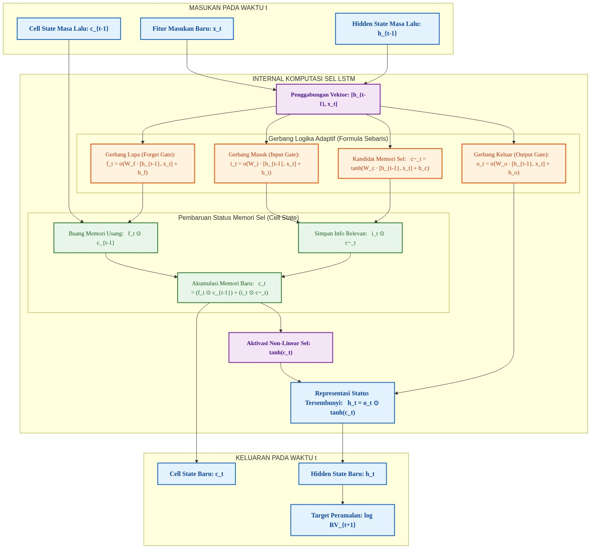
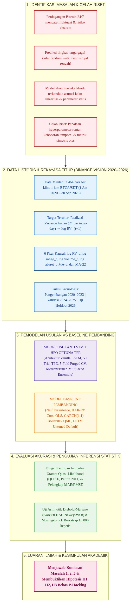

# BAB II KAJIAN PUSTAKA

## A. Landasan Teori

### 1. Karakteristik Pasar Kripto dan Data Deret Waktu Bitcoin

Pasar aset kripto, khususnya Bitcoin (BTC), beroperasi secara terdesentralisasi tanpa otoritas terpusat serta aktif secara kontinu selama 24 jam sehari dan 7 hari seminggu tanpa hari libur bursa. Dalam sudut pandang sains komputasi dan analisis deret waktu (*time series*), pergerakan transaksi perdagangan Bitcoin menghasilkan aliran data kronologis berfrekuensi tinggi yang sangat masif dan dinamis. Dinamika harga Bitcoin sangat dipengaruhi oleh likuiditas global, sentimen pasar berskala mikro maupun makro, serta perilaku spekulatif para pelaku transaksi, sebagaimana dijelaskan dalam kajian analitis oleh Katsiampa (2017). Karakteristik lingkungan perdagangan yang tidak pernah berhenti ini menyebabkan struktur risiko pada aset kripto memiliki tingkat kompleksitas dan ketidakpastian yang jauh lebih tinggi dibandingkan dengan pasar modal konvensional yang memiliki jam perdagangan reguler.

Sejumlah penelitian di bidang ilmu informatika berupaya meramalkan pergerakan pasar Bitcoin dengan memprediksi nilai nominal harga penutupan (*closing price*), seperti riset yang dipublikasikan oleh Khumaidi dkk. (2024), Aswadi dan Ependi (2025), serta Fawzi dkk. (2025). Akan tetapi, deret data harga nominal pada pasar yang efisien memiliki dinamika yang mendekati lintasan acak (*random walk*), sehingga prediksi titik harga satu langkah ke depan menghasilkan rasio sinyal terhadap derau (*signal-to-noise ratio*) yang sangat rendah. Ketidakmampuan model cerdas dalam mengungguli model pembanding naif pada tingkat harga mendorong transformasi paradigma ilmiah menuju pemodelan variabilitas atau fluktuasi harga. Kajian komputasi keuangan modern oleh Lim dan Zohren (2021) menegaskan bahwa peramalan besaran variabilitas pasar menawarkan peluang keberhasilan yang jauh lebih tinggi karena volatilitas memiliki struktur dependensi temporal yang kuat dan dapat dipetakan secara matematis.

Data historis yang digunakan pada studi yang dilakukan merupakan catatan transaksi resmi *open*, *high*, *low*, *close*, dan *volume* (OHLCV) pada pasangan perdagangan Bitcoin terhadap Tether (BTC/USDT) dengan interval waktu satu jam (*1-hour kline*). Seluruh data transaksi intra-day tersebut diunduh dari basis data arsip publik resmi bursa Binance Vision (2024) untuk rentang waktu temporal mulai dari 1 Januari 2020 hingga 30 September 2026. Data mentah berfrekuensi tinggi ini memberikan granularitas informasi pergerakan harga yang sangat mendalam pada tingkat intra-day, sehingga memungkinkan kalkulasi variabilitas harian yang jauh lebih kaya informasi dan bebas dari bias penutupan semu bila dibandingkan dengan hanya mengandalkan satu titik harga penutupan harian saja.

### 2. Teori Volatilitas Finansial dan Sifat Khasnya

Dalam disiplin ekonometrika keuangan dan analisis risiko komputasional, volatilitas didefinisikan sebagai ukuran dispersi atau simpangan baku bersyarat dari imbal hasil (*return*) suatu aset dalam horizon waktu tertentu. Secara fundamental, volatilitas merupakan manifestasi dari derajat ketidakpastian pasar yang mencerminkan intensitas kedatangan aliran informasi baru ke dalam ekosistem perdagangan. Berbeda dengan harga nominal aset yang memiliki tren arah (*trend direction*), volatilitas finansial memiliki sejumlah sifat khas (*stylized facts*) universal yang teramati secara empiris di berbagai bursa global, sebagaimana dirangkum dalam studi teoretis oleh Andersen dan Bollerslev (1998) serta Bollerslev (1986). Keberadaan sifat-sifat empiris inilah yang menjadikan volatilitas dapat dimodelkan dan diproyeksikan secara komputasional.

Sifat empiris pertama yang paling dominan adalah fenomena pengelompokan volatilitas (*volatility clustering*), di mana perubahan harga berfluktuasi besar cenderung diikuti oleh fluktuasi besar kembali, dan fluktuasi kecil cenderung diiringi oleh fluktuasi kecil pada periode berikutnya. Sifat kedua adalah pembalikan ke nilai rata-rata (*mean reversion*), yang bermakna bahwa meskipun volatilitas dapat melonjak drastis akibat kejutan pasar ekstrem, nilainya secara perlahan akan selalu kembali menuju tingkat ekuilibrium rata-rata jangka panjangnya. Sifat ketiga adalah memori panjang (*long memory*), di mana dampak suatu guncangan pasar memiliki dependensi temporal yang bertahan melintasi horizon harian, mingguan, hingga bulanan. Pada data Bitcoin, Katsiampa (2017) serta Ardia dkk. (2019) membuktikan bahwa sifat *volatility clustering* dan pergeseran rezim struktural muncul secara nyata, sehingga memerlukan model adaptif non-linear untuk memetakannya.

### 3. Proksi Realized Variance dan Transformasi Logaritmik

Secara teoretis, volatilitas laten (*latent volatility*) tidak dapat diamati secara langsung di pasar keuangan riil, sehingga besaran nilainya harus diestimasi menggunakan variabel proksi kuantitatif yang representatif. Pendekatan ekonometrika modern memecahkan keterbatasan ini melalui kerangka teori variasi kuadratik (*quadratic variation*), yang membuktikan bahwa integrasi varians sesaat dapat didekati secara konsisten melalui penjumlahan kuadrat imbal hasil intra-day berfrekuensi tinggi (Andersen dkk., 2003; Barndorff-Nielsen & Shephard, 2002). Variabel proksi ini dikenal sebagai *Realized Variance* (RV). Misalkan $C_{t,h}$ dan $O_{t,h}$ berturut-turut menyatakan harga penutupan (*close*) dan pembukaan (*open*) pada bar kline ke-$h$ pada hari ke-$t$. Dengan mengagregasikan 24 bar kline 1 jam per hari perdagangan siklus UTC penuh ($h = 1, 2, \dots, 24$), nilai $RV_t$ harian dihitung melalui formula:

$$RV_t = \sum_{h=1}^{24} \left[ \ln\left(\frac{C_{t,h}}{O_{t,h}}\right) \right]^2 \tag{2.1}$$

Nilai $RV_t$ mentah pada aset kripto memiliki rentang sebaran yang sangat lebar, mencakup nilai desimal yang sangat kecil pada periode pasar tenang hingga angka yang melonjak tinggi saat terjadi peristiwa likuidasi massal. Rentang distribusi asimetris dengan ekor tebal (*fat tail*) ini berpotensi mengganggu stabilitas optimasi gradien pada jaringan saraf tiruan. Untuk mengatasi tantangan numerik tersebut, nilai $RV_t$ ditransformasikan ke dalam skala logaritmik natural ($\log RV_t$) dengan menyisipkan konstanta pelindung kecil $10^{-12}$ guna mencegah timbulnya galat matematis logaritma nol saat pasar mengalami pembekuan transaksi:

$$\log RV_t = \ln\left(RV_t + 10^{-12}\right) \tag{2.2}$$

Transformasi logaritmik ini secara efektif menstabilkan varians data, menjadikan distribusi probabilitas target mendekati lonceng Gaussian simetris, serta meredam pengaruh buruk pencilan ekstrem (*outliers*) tanpa menghilangkan integritas pola temporal historisnya. Dalam eksperimen ini, variabel $\log RV_t$ menjadi target utama prediksi satu langkah ke depan ($\log RV_{t+1}$) sekaligus menjadi fitur masukan autoregresif utama bagi model pembelajaran mendalam.

---

### 4. Model Ekonometrika Runtun Waktu Klasik (Baseline)

#### a. Generalized Autoregressive Conditional Heteroskedasticity / GARCH(1,1)

Model *Generalized Autoregressive Conditional Heteroskedasticity* (GARCH) yang dirumuskan oleh Bollerslev (1986) merupakan pengembangan teoretis dari model ARCH buatan Engle (1982). Model GARCH(1,1) memodelkan varians kondisional masa kini ($\sigma_t^2$) sebagai fungsi linear dari rata-rata varians jangka panjang ($\omega$), kuadrat residual kesalahan imbal hasil satu periode sebelumnya ($\varepsilon_{t-1}^2$), dan varians kondisional satu periode sebelumnya ($\sigma_{t-1}^2$). Struktur persamaan matematika GARCH(1,1) didefinisikan sebagai:

$$r_t = \mu + \varepsilon_t, \quad \varepsilon_t = \sigma_t z_t, \quad z_t \sim \mathcal{N}(0, 1) \tag{2.3}$$

$$\sigma_t^2 = \omega + \alpha \varepsilon_{t-1}^2 + \beta \sigma_{t-1}^2 \tag{2.4}$$

dengan batasan parameter non-negatif $\omega > 0$, $\alpha \ge 0$, $\beta \ge 0$, serta syarat stasioneritas kovarians $\alpha + \beta < 1$ agar varians proses tidak mengalami ledakan eksplosif. Parameter $\alpha$ mengukur derajat sensitivitas volatilitas terhadap kejutan pasar baru (*market shock*), sedangkan parameter $\beta$ mencerminkan persistensi memori volatilitas masa lalu. Estimasi parameter model GARCH(1,1) diselesaikan melalui metode *Quasi-Maximum Likelihood Estimation* (QML) yang terbukti konsisten dan asimtotik normal. Model ini menjadi tolok ukur klasik fundamental pada peramalan deret waktu finansial.

#### b. Heterogeneous Autoregressive of Realized Volatility / HAR-RV

Meskipun model GARCH sangat populer, model tersebut hanya memanfaatkan data imbal hasil harian dan mengabaikan kekayaan informasi transaksi intra-day. Untuk mengatasi hal tersebut, Corsi (2009) merancang model *Heterogeneous Autoregressive of Realized Volatility* (HAR-RV) yang dibangun di atas hipotesis pasar heterogen (*Heterogeneous Market Hypothesis*). Hipotesis ini menyatakan bahwa pasar dihuni oleh berbagai tipe pelaku ekonomi dengan horizon waktu keputusan yang berbeda, mulai dari pedagang harian (*day trader*), investor mingguan, hingga pengelola dana institusional berjangka panjang. Model HAR-RV membedah volatilitas harian ke dalam tiga komponen rata-rata bergerak kaskade temporal: harian ($RV_t^{(d)}$), mingguan ($RV_t^{(w)}$), dan bulanan ($RV_t^{(m)}$).

Pada studi yang dilakukan, model HAR-RV diestimasi menggunakan regresi linear kuadrat terkecil (*Ordinary Least Squares* / OLS) pada skala logaritmik natural guna menjaga konsistensi dimensi perbandingan terhadap model pembelajaran mendalam. Persamaan matematis spesifikasi log-linear HAR-RV dinyatakan sebagai berikut:

$$\log RV_{t+1} = \beta_0 + \beta_d \log RV_t + \beta_w \overline{\log RV}_{t-6:t} + \beta_m \overline{\log RV}_{t-21:t} + \varepsilon_{t+1} \tag{2.5}$$

Komponen mingguan ($\overline{\log RV}_{t-6:t}$) dibentuk dari rata-rata bergerak 7 hari perdagangan kalender kripto, sedangkan komponen bulanan ($\overline{\log RV}_{t-21:t}$) mencakup rata-rata 22 hari perdagangan. Model HAR-RV memiliki keunggulan berupa transparansi matematis yang tinggi dan mampu menangkap sifat memori panjang secara sederhana. Namun demikian, model HAR-RV dibatasi oleh asumsi kaku berupa linearitas koefisien statis, sehingga rentan mengalami penurunan akurasi saat pasar mengalami lonjakan asimetris non-linear mendadak (Conrad dkk., 2018).

---

### 5. Arsitektur Deep Learning Long Short-Term Memory (LSTM)

#### a. Keterbatasan RNN Konvensional dan Masalah Vanishing Gradient

Jaringan saraf tiruan berulang konvensional (*Standard Recurrent Neural Network* / RNN) dirancang untuk memproses data sekuensial dengan cara meneruskan status tersembunyi (*hidden state*) dari satu langkah waktu ke langkah waktu berikutnya. Akan tetapi, pada deret waktu yang memiliki dependensi temporal panjang, proses pelatihan RNN standar melalui algoritma *Backpropagation Through Time* (BPTT) menghadapi kendala matematis serius berupa fenomena hilangnya gradien (*vanishing gradient*) atau ledakan gradien (*exploding gradient*). Ketika gradien galat dipropagasikan mundur melintasi puluhan langkah waktu, perkalian matriks bobot yang berulang-ulang menyebabkan nilai gradien mengecil mendekati nol secara eksponensial. Akibatnya, bobot jaringan pada lapisan awal tidak mengalami pembaruan berarti, sehingga RNN standar gagal menangkap informasi dependensi historis jangka panjang (Hochreiter & Schmidhuber, 1997).

#### b. Anatomi Mekanisme Gerbang Sel LSTM

Untuk menanggulangi kelemahan fundamental RNN tersebut, Hochreiter dan Schmidhuber (1997) memperkenalkan arsitektur *Long Short-Term Memory* (LSTM) yang kemudian disempurnakan oleh Greff dkk. (2017). Kunci keberhasilan LSTM terletak pada pemisahan antara status memori jangka panjang yang disebut status sel (*cell state*, $c_t$) dan status keluaran jangka pendek (*hidden state*, $h_t$). Aliran transfer informasi diatur secara adaptif melalui tiga pintu gerbang logika komputasi yang memanfaatkan fungsi aktivasi non-linear sigmoid ($\sigma$) dan tangen hiperbolik ($\tanh$).

Tahapan komputasi internal sel LSTM pada setiap langkah waktu $t$ berlangsung melalui empat formulasi matematis utama:

1. **Gerbang Lupa (*Forget Gate*, $f_t$):** Mengatur proporsi informasi masa lalu pada status sel $c_{t-1}$ yang harus dibuang atau dipertahankan berdasarkan masukan saat ini $x_t$ dan representasi sebelumnya $h_{t-1}$:
   $$f_t = \sigma\left(W_f \cdot [h_{t-1}, x_t] + b_f\right) \tag{2.6}$$

2. **Gerbang Masuk (*Input Gate*, $i_t$) dan Kandidat Sel ($\tilde{c}_t$):** Menentukan informasi baru mana yang layak disimpan ke dalam memori sel:
   $$i_t = \sigma\left(W_i \cdot [h_{t-1}, x_t] + b_i\right) \tag{2.7}$$
   $$\tilde{c}_t = \tanh\left(W_c \cdot [h_{t-1}, x_t] + b_c\right) \tag{2.8}$$

3. **Pembaruan Status Sel (*Cell State Update*, $c_t$):** Menggabungkan memori lama yang dipertahankan dengan kandidat informasi baru melalui operasi perkalian elemen-demi-elemen ($\odot$):
   $$c_t = f_t \odot c_{t-1} + i_t \odot \tilde{c}_t \tag{2.9}$$

4. **Gerbang Keluar (*Output Gate*, $o_t$) dan Status Tersembunyi ($h_t$):** Menentukan bagian status sel yang diteruskan sebagai luaran representasi tersembunyi:
   $$o_t = \sigma\left(W_o \cdot [h_{t-1}, x_t] + b_o\right) \tag{2.10}$$
   $$h_t = o_t \odot \tanh(c_t) \tag{2.11}$$

Kombinasi gerbang logika ini memungkinkan sel LSTM mempertahankan memori informasi volatilitas penting selama puluhan langkah waktu tanpa terdegradasi oleh masalah hilangnya gradien.

#### c. Algoritma Optimasi Adam dan Regularisasi Dropout

Keberhasilan konvergensi jaringan saraf tiruan LSTM sangat ditopang oleh algoritma optimasi pembaruan bobot dan teknik regularisasi pencegah lewat-jenuh (*overfitting*). Pada studi yang dilakukan, optimasi bobot dilatih menggunakan algoritma *Adaptive Moment Estimation* (Adam) yang dikembangkan oleh Kingma dan Ba (2014). Optimizer Adam mengombinasikan keunggulan momentum gradien orde pertama dan penskalaan laju pembelajaran adaptif berbasis kuadrat gradien orde kedua, sehingga sangat tangguh dalam menangani data runtun waktu yang memiliki derau stokastik tinggi.

Selain optimizer Adam, diterapkan teknik regularisasi *Dropout* yang diperkenalkan oleh Srivastava dkk. (2014). Selama tahapan proses pelatihan (*forward-backward pass*), unit-unit neuron pada lapisan LSTM dinonaktifkan secara acak dengan probabilitas tertentu ($p_{drop}$). Mekanisme *Dropout* memaksa jaringan untuk mempelajari representasi fitur yang redundan dan saling independen, sehingga mencegah terjadinya ko-adaptasi bobot yang berlebihan pada data historis dan meningkatkan kemampuan generalisasi model terhadap data baru di masa depan.

---

### 6. Optimasi Hyperparameter Berbasis Bayesian dan Kerangka Optuna

#### a. Paradigma Hyperparameter Optimization

Performa model *deep learning* LSTM sangat dipengaruhi oleh konfigurasi parameter eksternal atau *hyperparameter*, seperti panjang jendela sekuens waktu historis (*lookback window*, $L$), jumlah unit neuron tersembunyi, koefisien regularisasi *dropout*, laju pembelajaran (*learning rate*), hingga ukuran *batch*. Pendekatan konvensional seperti pencarian kisi (*Grid Search*) mengeksplorasi seluruh kombinasi secara diskret sehingga sangat tidak efisien dan boros daya komputasi ketika ruang parameter berdimensi tinggi. Sementara itu, pencarian acak (*Random Search*) mengeksplorasi ruang parameter tanpa pola dan tidak memanfaatkan informasi hasil evaluasi trial sebelumnya, sehingga tidak menjamin tercapainya titik konvergensi optimal.

#### b. Algoritma Tree-structured Parzen Estimator (TPE)

Untuk mengatasi kelemahan metode pencarian tradisional, Bergstra dkk. (2011) merumuskan pendekatan optimasi berbasis Bayesian sekuensial yang disebut *Tree-structured Parzen Estimator* (TPE). Alih-alih memodelkan fungsi objektif $P(y|x)$ secara langsung menggunakan proses Gaussian, algoritma TPE memodelkan distribusi probabilitas konfigurasi masukan $x$ bersyarat terhadap performa objektif $y$, yaitu $P(x|y)$. TPE membagi riwayat observasi uji coba sebelumnya ke dalam dua kelompok distribusi menggunakan batas kuantil pemisah $\gamma$:

$$P(x|y) = \begin{cases} \ell(x), & \text{jika } y < y^* \\ g(x), & \text{jika } y \ge y^* \end{cases} \tag{2.12}$$

Kelompok $\ell(x)$ mewakili kepadatan probabilitas konfigurasi *hyperparameter* yang menghasilkan metrik galat rendah (kelompok berkinerja unggul), sedangkan $g(x)$ mewakili kelompok berkinerja buruk. Algoritma TPE memaksimalkan fungsi akuisisi *Expected Improvement* ($EI$) yang secara matematis sebanding dengan rasio probabilitas:

$$EI_{y^*}(x) \propto \left( \gamma + \frac{g(x)}{\ell(x)}(1 - \gamma) \right)^{-1} \tag{2.13}$$

Maka dari itu, untuk memaksimumkan peningkatan performa, TPE secara cerdas memilih titik kandidat *hyperparameter* baru $x$ yang meminimalkan rasio $g(x)/\ell(x)$, yakni titik yang memiliki probabilitas tertinggi berada di kelompok berkinerja baik dan probabilitas terendah berada di kelompok buruk.

#### c. Kerangka Kerja Optuna dan Mekanisme MedianPruner

Implementasi algoritma TPE pada studi yang dilakukan dieksekusi melalui kerangka kerja perangkat lunak *open-source* Optuna yang dikembangkan oleh Akiba dkk. (2019). Optuna menawarkan arsitektur komputasi mutakhir berbasis prinsip *define-by-run* yang sangat dinamis dan modular. Keunggulan utama kerangka Optuna terletak pada integrasi algoritma sampling TPESampler dengan mekanisme pemangkasan dini otomatis (*automated early pruning*) melalui algoritma *MedianPruner*.

Mekanisme *MedianPruner* memantau kurva nilai galat validasi dari setiap trial pelatihan yang sedang berjalan pada setiap langkah *epoch*. Jika performa galat suatu trial berada di bawah nilai median riwayat trial terdahulu pada langkah waktu yang setara, proses pelatihan trial tersebut akan dihentikan secara prematur (*pruned*). Pemangkasan dini ini melenyapkan pemborosan alokasi sumber daya prosesor pada konfigurasi parameter yang tidak menjanjikan, sehingga efisiensi waktu komputasi eksperimen meningkat secara dramatis tanpa mengorbankan kualitas pencarian solusi optimal.

---

### 7. Evaluasi Peramalan dan Inferensi Statistik

#### a. Protokol Validasi Bebas Kebocoran: Purged Cross-Validation

Penerapan teknik validasi silang standar (*k-fold cross-validation*) yang membagi data secara acak terbukti sangat fatal jika diterapkan pada data deret waktu finansial. Pengacakan posisi temporal merusak kausalitas alami data dan menimbulkan bias pandang-depan (*lookahead bias*), di mana informasi masa depan bocor ke dalam data pelatihan masa lalu. Pakar rekayasa finansial kuantitatif López de Prado (2018) menegaskan bahwa pengujian model runtun waktu wajib menerapkan skema *Purged Cross-Validation*.

Dalam skema *Purged Cross-Validation*, partisi data diatur secara kronologis dengan menyisipkan jeda pemisah (*purge gap*) di antara sekat akhir data pelatihan (*training fold*) dan sekat awal data validasi (*validation fold*). Besaran jeda pemisah disesuaikan persis dengan panjang jendela sekuens historis ($L$). Penyisipan celah ini menjamin bahwa tidak ada satu pun vektor fitur masukan pada data validasi yang dibentuk menggunakan informasi harga yang bertumpang-tindih dengan target pelatihan, sehingga model dievaluasi secara murni bebas dari kebocoran data (*zero data leakage*).

#### b. Fungsi Kerugian Asimetris Quasi-Likelihood (QLIKE)

Evaluasi akurasi model peramalan varians tidak dapat disamakan dengan peramalan nilai nominal harga. Metrik evaluasi simetris konvensional seperti *Mean Squared Error* (MSE) atau *Mean Absolute Error* (MAE) terbukti memiliki cacat teoretis ketika berhadapan dengan target volatilitas yang diestimasi melalui variabel proksi. Patton (2011) membuktikan secara matematis bahwa metrik simetris rentan terdistorsi oleh derau pengukuran proksi dan dapat menghasilkan peringkat model yang salah (*loss function inconsistency*).

Patton (2011) membuktikan bahwa fungsi kerugian yang robust dan konsisten terhadap derau proksi varians adalah fungsi *Quasi-Likelihood* (QLIKE). Metrik QLIKE bersifat asimetris dan memberikan penalti galat yang proporsional terhadap rasio relatif antara nilai aktual dan nilai proyeksi. Pada skala logaritmik natural dengan $e_t = \log RV_t - \widehat{\log RV}_t$, formulasi QLIKE dinyatakan sebagai:

$$QLIKE = \frac{1}{T} \sum_{t=1}^T \left[ \exp(e_t) - e_t - 1 \right] \tag{2.14}$$

Persamaan (2.14) bernilai identik dengan formulasi standar pada skala varians mentah:

$$QLIKE = \frac{1}{T} \sum_{t=1}^T \left[ \frac{RV_t}{\widehat{RV}_t} - \ln\left(\frac{RV_t}{\widehat{RV}_t}\right) - 1 \right] \tag{2.15}$$

Nilai QLIKE selalu bernilai non-negatif ($QLIKE \ge 0$), bernilai nol hanya jika prediksi sempurna ($\widehat{RV}_t = RV_t$), dan memberikan penalti yang sangat tegas terhadap kesalahan prediksi *under-estimation* yang membahayakan sistem mitigasi risiko finansial.

#### c. Uji Signifikansi Asimtotik Diebold-Mariano (Koreksi HAC)

Perbedaan nilai rata-rata metrik evaluasi antar-model peramalan tidak serta-merta membuktikan keunggulan ilmiah suatu algoritma. Untuk memastikan apakah selisih akurasi peramalan tersebut signifikan secara statistik atau sekadar faktor kebetulan acak, diterapkan uji hipotesis komparasi asimtotik yang dikembangkan oleh Diebold dan Mariano (1995). Misalkan $d_t = L(y_t, \hat{y}_{1,t}) - L(y_t, \hat{y}_{2,t})$ mendefinisikan selisih kerugian (*loss differential*) antara model usulan dan model pembanding pada waktu $t$. Statistik uji Diebold-Mariano dirumuskan sebagai:

$$DM = \frac{\bar{d}}{\sqrt{\widehat{\text{Var}}(\bar{d})}} \tag{2.16}$$

dengan $\bar{d}$ menyatakan nilai rata-rata selisih kerugian dan $\widehat{\text{Var}}(\bar{d})$ adalah varians asimtotik dari rata-rata selisih tersebut. Mengingat galat peramalan deret waktu finansial sering kali memiliki korelasi serial dan varians yang berubah antarwaktu, estimasi varians dihitung menggunakan koreksi *Heteroskedasticity and Autocorrelation Consistent* (HAC) yang dirumuskan oleh Newey dan West (1987) dengan panjang lag ketergantungan 5 hari. Pengujian dilakukan secara satu sisi (*one-sided test*) dengan nilai $p < 0{,}05$ sebagai batas penolakan hipotesis nol atas kesetaraan performa.

#### d. Estimasi Non-Parametrik Moving-Block Bootstrap

Mengingat uji Diebold-Mariano bertumpu pada asumsi distribusi normal asimtotik pada sampel tak berhingga, inferensi tersebut perlu diperkuat oleh pendekatan non-parametrik yang tangguh terhadap ukuran sampel terbatas. Penelitian ini mengintegrasikan prosedur *Moving-Block Bootstrap* yang diformulasikan oleh Künsch (1989). Prosedur ini melakukan teknik penarikan sampel berulang dengan pengembalian (*resampling with replacement*) terhadap blok-blok data berurutan sepanjang 20 hari.

Pemilihan skema blok temporal bertujuan menjaga struktur dependensi dan autokorelasi lokal deret waktu agar tidak rusak selama proses resampel. Dengan mengeksekusi 10.000 repetisi resampel menggunakan pengacakan terkontrol (*seed 42*), dihitung estimasi empiris sebaran selisih kerugian ($\Delta QLIKE$) beserta batas interval kepercayaan persentil 95% (*95% Confidence Interval*). Superioritas model peramalan dinyatakan valid secara meyakinkan apabila seluruh rentang interval kepercayaan 95% berada di bawah nilai nol.

#### e. Pengendalian Variabilitas Multi-seed

Penelitian eksperimental berskala global oleh Bouthillier dkk. (2021) mengungkapkan fenomena kritis dalam *benchmark* kecerdasan buatan, di mana variasi stokastik yang bersumber dari inisialisasi bobot acak awal (*random seed*) sering kali menghasilkan fluktuasi galat yang melebihi selisih performa antar-arsitektur model itu sendiri. Fenomena ini memicu timbulnya bias seleksi acak (*selection noise*), di mana seorang peneliti berpotensi secara keliru mengklaim keunggulan model yang sebenarnya hanya didorong oleh keberuntungan inisialisasi bobot tunggal.

Guna mengeliminasi bias optimisme semu tersebut, penelitian ini menerapkan protokol evaluasi *multi-seed*. Model akhir LSTM dilatih secara independen menggunakan lima konfigurasi bobot acak yang berbeda (*seed 42, 43, 44, 45, dan 46*). Proyeksi akhir yang diuji pada data evaluasi bukan diambil dari satu model terbaik, melainkan hasil rata-rata agregat (*ensemble average*) dari kelima model tersebut. Protokol ketat ini menjamin integritas kesimpulan ilmiah yang bebas dari rekayasa pengujian (*p-hacking*).

---

## B. Penelitian Terdahulu

Perkembangan literatur ilmiah mengenai peramalan pergerakan pasar dan volatilitas Bitcoin terbagi ke dalam tiga arus utama:

1. **Arus Ekonometrika Klasik:**  
   Katsiampa (2017) meneliti dinamika volatilitas Bitcoin menggunakan varian model GARCH dan membuktikan keunggulan model autoregresif asimetris. Ardia dkk. (2019) memperluas analisis tersebut menggunakan model *Markov-Switching GARCH* (MSGARCH) dan menemukan bukti empiris bahwa volatilitas Bitcoin kerap mengalami pergeseran rezim (*regime changes*). Conrad dkk. (2018) mengaplikasikan model GARCH-MIDAS untuk membedah interaksi komponen volatilitas jangka pendek dan faktor makroekonomi. Meskipun kaya secara teoretis, kelompok riset ekonometrika ini umumnya mengabaikan pemodelan *deep learning* dan tidak melakukan pengujian pada periode *out-of-sample holdout* yang terisolasi ketat.

2. **Arus Prediksi Harga Berbasis Deep Learning dan HPO:**  
   Khumaidi dkk. (2024), Aswadi dan Ependi (2025), serta Fawzi dkk. (2025) menerapkan model LSTM untuk meramalkan harga nominal Bitcoin, namun penelitian mereka terbatas pada penalaan manual satu partisi data tanpa menyertakan pembanding *baseline* naif. Kervanci dan Akay (2023) meneliti pengaruh delapan *hyperparameter* LSTM pada prediksi harga kripto, namun belum memisahkan fase penalaan dan fase uji secara kronologis. Aldo dkk. (2026) membandingkan enam metode HPO pada aset kripto, sementara Widad dkk. (2026) menguji metode *grid search* pada arsitektur LSTM dan GRU. Mayoritas riset pada arus kedua ini masih berorientasi pada harga nominal yang rentan kegagalan *random walk* serta belum mengadopsi protokol evaluasi asimetris QLIKE.

3. **Arus Peramalan Volatilitas Berbasis Pembelajaran Mesin:**  
   Kim dan Won (2018) merintis penggabungan model hibrida LSTM dan GARCH pada volatilitas indeks saham dan mencatat peningkatan performa yang signifikan. Christensen dkk. (2023) melakukan studi berskala masif mengenai peramalan *realized volatility* berbasis *machine learning* pada bursa saham global dan membuktikan kapasitas model non-linear dalam melampaui batas kemampuan model ekonometrika linear HAR-RV. Ula dkk. (2024) membandingkan performa LSTM terhadap *Random Forest* pada data Bitcoin. Riset-riset tersebut membuktikan potensi besar integrasi AI pada target volatilitas, namun belum menginvestigasi peramalan *realized volatility* Bitcoin dengan optimasi Optuna-TPE dan protokol validasi *Purged CV*.

Sintesis pemetaan studi-studi terdahulu yang mendasari posisi penelitian ini dirangkum secara komprehensif pada Tabel 2.1.

**Tabel 2.1 Matriks Sintesis Penelitian Terdahulu**

| No | Peneliti & Tahun | Target Riset | Metode / Model | Protokol Validasi | Model Baseline | Keterbatasan & Kesenjangan (*Research Gap*) |
|:--:|:---|:---|:---|:---|:---|:---|
| 1 | Katsiampa (2017) | Volatilitas Bitcoin | GARCH, AR-CGARCH | Sampel in-sample tunggal | Varian GARCH | Tidak menguji model *deep learning*; tanpa data uji *out-of-sample*. |
| 2 | Ardia dkk. (2019) | Volatilitas Bitcoin | MSGARCH | Estimasi *regime switching* | GARCH standar | Fokus pada pemodelan ekonometrika murni; tanpa optimasi AI. |
| 3 | Conrad dkk. (2018) | Volatilitas Kripto | GARCH-MIDAS | Pemisahan horizon waktu | GARCH dasar | Mengabaikan kapasitas non-linear LSTM; tanpa evaluasi fungsi QLIKE. |
| 4 | Kim & Won (2018) | Volatilitas Saham | Hibrida LSTM-GARCH | Pembagian partisi tunggal | GARCH, LSTM | Objek bukan aset kripto; tidak menerapkan penalaan HPO sistematis. |
| 5 | Christensen dkk. (2023) | *Realized Volatility* | Berbagai model ML | Multi-periode bursa saham | HAR-RV linear | Objek bursa saham konvensional; belum menelaah transfer HPO Optuna. |
| 6 | Khumaidi dkk. (2024) | Harga Bitcoin | Vanilla LSTM | Split train-test tunggal | LSTM default | Menargetkan harga nominal; tanpa pengujian terhadap *baseline persistence*. |
| 7 | Kervanci & Akay (2023) | Harga Bitcoin | LSTM + 8 Hparam | Penalaan kisi konvensional | LSTM standar | Target tingkat harga; evaluasi rentan kebocoran data temporal. |
| 8 | Aldo dkk. (2026) | Harga Kripto TRX | LSTM + 6 Metode HPO | Komparasi HPO | LSTM untuned | Target harga nominal; pengujian terbatas pada pengacakan benih tunggal. |
| 9 | Widad dkk. (2026) | Harga Bitcoin | LSTM, GRU, Grid Search | Split data standar | GRU, LSTM | Mengandalkan *grid search* yang boros komputasi; metrik evaluasi simetris. |
| 10 | Ula dkk. (2024) | Harga Bitcoin | LSTM vs Random Forest | Split data 80:20 | Random Forest | Target harga; tanpa mekanisme penalaan *hyperparameter* otomatis. |
| 11 | Patton (2011) | Teori Kerugian Volatilitas | Teorema QLIKE | Kajian matematis asimtotik | MSE, MAE | Studi murni fondasi teori evaluasi; bukan eksperimen empiris Bitcoin. |
| 12 | López de Prado (2018) | Validasi Finansial | *Purged Cross-Validation* | Metodologi deret waktu | Standar *k-fold* | Panduan metodologis rekayasa kuantitatif; bukan studi kasus spesifik. |
| 13 | Bouthillier dkk. (2021) | Evaluasi AI | *Multi-seed Variability* | Analisis *benchmark* acak | Benih tunggal | Kajian metodologis replikasi AI; bukan pemodelan volatilitas kripto. |

---

## C. Sintesis Penelitian dan Posisi Riset

Berdasarkan tinjauan matriks pustaka pada Tabel 2.1, teridentifikasi adanya empat celah penelitian (*research gap*) nyata yang mendasari urgensi penelitian ini:

1. **Pergeseran Target Menuju Realized Volatility:**  
   Mayoritas riset informatika terkini di tingkat nasional maupun internasional masih terjebak pada peramalan harga nominal penutupan Bitcoin yang terbukti memiliki sifat *random walk*. Penelitian ini memposisikan diri secara tegas dengan mengalihkan fokus riset menuju *Realized Volatility* harian berbasis agregasi 24 bar kline 1 jam yang memiliki struktur keteraturan dependensi temporal terukur.

2. **Pemberantasan Kebocoran Data Temporal (*Zero Data Leakage*):**  
   Banyak penelitian sebelumnya menerapkan penalaan *hyperparameter* pada keseluruhan himpunan data atau menggunakan validasi silang acak yang merusak kausalitas temporal. Penelitian ini menegakkan protokol *Purged Cross-Validation* dengan jeda pemisah (*purge gap*) sebesar panjang *lookback* serta mengunci partisi data kronologis yang memisahkan fase pengembangan (2020–2023), validasi (2024–2025), dan uji *holdout* (2026).

3. **Penalaan Cerdas Bayesian TPE Berbasis Optuna:**  
   Berbeda dari studi terdahulu yang masih mengandalkan pencarian kisi (*grid search*) atau coba-coba manual yang boros daya, penelitian ini menerapkan penalaan terarah berbasis algoritma *Tree-structured Parzen Estimator* (TPE) yang diintegrasikan dengan mekanisme pemangkasan dini *MedianPruner* pada kerangka kerja Optuna.

4. **Integritas Evaluasi dan Pengujian Bebas Rekayasa Ilmiah (*Anti P-Hacking*):**  
   Penelitian ini menolak klaim keunggulan semu yang hanya berpatokan pada selisih angka rata-rata metrik simetris MSE/MAE. Evaluasi dipusatkan pada fungsi kerugian asimetris QLIKE yang terbukti tahan derau proksi, diperkuat oleh protokol multi-seed ensemble, uji asimtotik Diebold-Mariano berkoreksi HAC Newey-West, serta estimasi empiris *Moving-Block Bootstrap* 10.000 repetisi.

---

## D. Kerangka Pemikiran

Kerangka pemikiran pada studi yang dilakukan menghubungkan dinamika permasalahan pasar, tata kelola data, rekayasa model komputasi, hingga pengujian hipotesis akhir dalam satu kesatuan sistematis yang logis dan dapat direproduksi secara utuh (*fully reproducible*).

Alur kerangka pemikiran konseptual tersebut diuraikan ke dalam enam tahapan sistematis sebagai berikut:

1. **Tahap Identifikasi Masalah:** Berangkat dari tingginya risiko fluktuasi pasar Bitcoin 24/7, kegagalan prediksi harga nominal, keterbatasan asumsi linear model klasik, serta kerentanan kebocoran data pada eksperimen penalaan *hyperparameter*.
2. **Tahap Manajemen Data dan Fitur:** Mengunduh 2.464 hari data kline 1 jam BTC/USDT dari Binance Vision (2020–2026), menghitung target $RV_t$ dan $\log RV_{t+1}$, serta membentuk 6 fitur teknikal kausal tanpa bias pandang-depan.
3. **Tahap Pemodelan dan Optimasi:** Merancang model LSTM dan mengeksekusi penalaan 50 trial Optuna berbasis Bayesian TPE dengan skema 5-fold *Purged Cross-Validation* pada data pengembangan 2020–2023.
4. **Tahap Komparasi Baseline:** Mengonfigurasi model pembanding mencakup naif *Persistence*, ekonometrika linear HAR-RV, model runtun waktu GARCH(1,1), serta model pembanding LSTM *untuned*.
5. **Tahap Pelatihan Final dan Evaluasi Uji:** Melatih model akhir menggunakan 5 acakan bobot (*multi-seed*), mengevaluasi metrik asimetris QLIKE pada data uji eksternal 2026, serta menguji signifikansi statistik melalui uji Diebold-Mariano dan *Moving-Block Bootstrap*.
6. **Tahap Penarikan Kesimpulan:** Memverifikasi ketercapaian hipotesis secara objektif dan mendokumentasikan temuan ilmiah secara transparan.

---

## E. Hipotesis Penelitian

Berdasarkan landasan teoretis dan tinjauan penelitian terdahulu yang telah dijabarkan, dirumuskan tiga hipotesis penelitian yang terukur dan berorientasi rencana:

* **Hipotesis 1 (H1):**  
  Model *Long Short-Term Memory* (LSTM) yang dioptimasi menggunakan algoritma Optuna menghasilkan nilai fungsi kerugian asimetris *Quasi-Likelihood* (QLIKE) yang lebih rendah secara signifikan dibandingkan model naif *persistence* pada data uji eksternal tahun 2026.

* **Hipotesis 2 (H2):**  
  Model LSTM teroptimasi Optuna menghasilkan nilai fungsi kerugian QLIKE yang mampu menyaingi atau lebih unggul secara komparatif dibandingkan model ekonometrika klasik *Heterogeneous Autoregressive of Realized Volatility* (HAR-RV) dan GARCH(1,1) dalam memproyeksikan volatilitas pasar Bitcoin.

* **Hipotesis 3 (H3):**  
  Performa peramalan model LSTM teroptimasi Optuna pada data uji eksternal tahun 2026 menunjukkan stabilitas generalisasi yang konsisten terhadap performa pada periode validasi 2024–2025 tanpa mengalami fenomena degradasi galat yang ekstrem (*overfitting failure*).

---

## F. Kesimpulan Kajian Pustaka

Kajian komprehensif pada Bab II ini menegaskan bahwa transformasi orientasi riset dari peramalan tingkat harga menuju pemodelan *Realized Volatility* harian memiliki landasan teoretis yang sangat kukuh. Keberadaan fenomena *volatility clustering*, *mean reversion*, dan dependensi memori panjang membuktikan bahwa volatilitas Bitcoin memiliki keteraturan temporal yang dapat dipetakan secara akurat oleh arsitektur *deep learning* sekuensial LSTM.

Penerapan algoritma optimasi Bayesian TPE melalui kerangka kerja Optuna memberikan landasan komputasional yang efisien dan sistematis dalam menemukan kombinasi *hyperparameter* terbaik tanpa pemborosan alokasi prosesor. Di samping hal tersebut, penegakan protokol *Purged Cross-Validation*, penggunaan fungsi kerugian asimetris QLIKE, inferensi statistik Diebold-Mariano berkoreksi HAC, serta estimasi interval kepercayaan *Moving-Block Bootstrap* membentuk benteng metodologi yang ketat guna menjamin integritas temuan ilmiah bebas dari bias kebocoran data maupun manipulasi hasil pengujian. Seluruh landasan teoretis ini menjadi acuan operasional dalam penyusunan metodologi penelitian pada Bab III.
