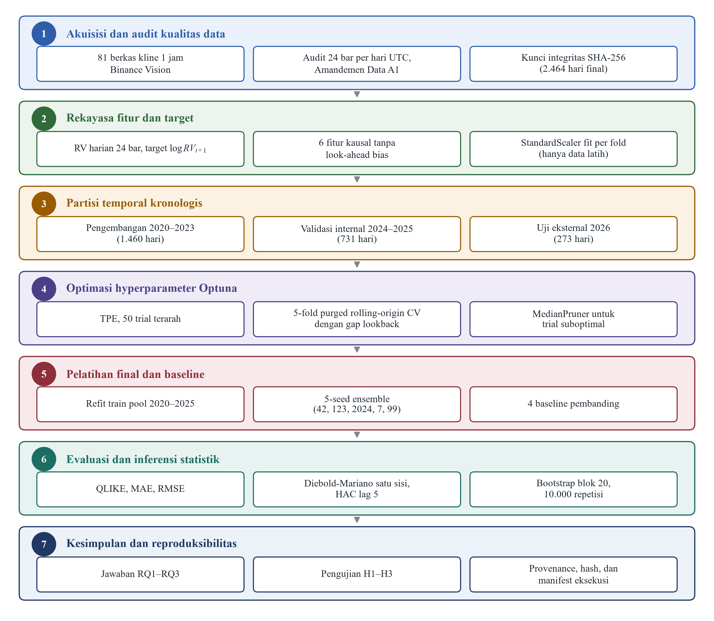

# BAB III METODE PENELITIAN

## A. Jenis dan Desain Penelitian

### 1. Pendekatan dan Desain Eksperimental Komputasional

Penelitian ini dirancang menggunakan pendekatan kuantitatif dengan desain eksperimental komputasional yang berfokus pada pemodelan runtun waktu finansial secara objektif dan sistematis. Pendekatan kuantitatif dipilih karena fenomena dinamika volatilitas pasar aset digital direpresentasikan melalui metrik numerik terukur yang memerlukan pembuktian empiris berbasis data historis transaksi (Lim & Zohren, 2021). Desain eksperimental komputasional memanfaatkan perangkat lunak untuk menjalankan seluruh tahapan penelitian, meliputi pra-pemrosesan data, rekayasa fitur kausal, pencarian ruang hyperparameter, pelatihan model multi-seed, hingga inferensi statistik komparatif menurut prosedur yang terdokumentasi secara transparan. Otomasi alur kerja ini mendukung konsistensi dan integritas eksperimen, sehingga proses peramalan dapat dievaluasi secara adil pada periode evaluasi yang sama untuk seluruh model pembanding yang diuji.

Guna menjamin integritas ilmiah dan mencegah terjadinya bias seleksi data (*data snooping*) maupun manipulasi hasil (*p-hacking*), seluruh protokol komputasional dirancang dan dikunci secara ketat sebelum proses pelatihan model dieksekusi (Bouthillier et al., 2021). Protokol ini menetapkan batasan ruang pencarian hyperparameter, skema validasi temporal bebas bocor, fungsi kerugian asimetris, dan kriteria inferensi statistik secara apriori. Pendekatan pra-penguncian protokol ini memastikan bahwa seluruh keputusan metodologis diambil secara independen dan tidak dipengaruhi oleh hasil evaluasi akhir. Tahap berikutnya, seluruh eksekusi eksperimen akan dicatat secara terprogram melalui manifes komputasi dan verifikasi kode hash kriptografis guna menjamin keterlacakan (*traceability*) dan keterulangan (*reproducibility*) hasil penelitian secara menyeluruh.

### 2. Objek Penelitian dan Ruang Lingkup

Objek yang diteliti pada studi yang dilakukan adalah *realized volatility* harian dari pasangan perdagangan Bitcoin terhadap Tether (BTC/USDT) pada bursa aset digital global. Bitcoin dipilih sebagai objek penelitian karena memegang peranan sebagai aset kripto dengan tingkat likuiditas dan kapitalisasi pasar terbesar di dunia, serta memiliki struktur volatilitas yang sangat dinamis dan menjadi barometer pergerakan pasar aset digital secara keseluruhan (Katsiampa, 2017). Pengukuran volatilitas berbasis data intra-day berfrekuensi tinggi menyediakan resolusi informasi yang jauh lebih kaya mengenai variasi dispersi harga dalam satu hari perdagangan dibandingkan hanya mengandalkan satu kuadrat imbal hasil harian konvensional (Andersen et al., 2003; Barndorff-Nielsen & Shephard, 2002). Dengan demikian, target yang diramalkan mampu merepresentasikan intensitas fluktuasi pasar secara autentik dan terbebas dari derau mikrostruktur sesaat.

Ruang lingkup penelitian ini dibatasi secara tegas pada peramalan nilai *log realized variance* satu langkah ke depan ($t+1$) pada skala temporal harian. Horizon satu hari dipilih sebagai fokus pemodelan karena relevan bagi kebutuhan manajemen risiko harian, alokasi posisi perdagangan, dan penetapan batas toleransi *Value-at-Risk* (VaR). Evaluasi model diarahkan murni pada akurasi statistik komputasional menggunakan metrik asimetris *Quasi-Likelihood* (QLIKE) dan inferensi statistik formal, serta tidak mencakup simulasi eksekusi sistem perdagangan otomatis (*trading strategy*), perhitungan biaya komisi bursa, pembentukan portofolio multi-aset, maupun analisis sentimen eksternal.

## B. Data Penelitian dan Pra-Pemrosesan

### 1. Sumber dan Pengumpulan Data

Data mentah yang digunakan pada studi yang dilakukan bersumber dari arsip repositori publik resmi Binance Vision (Binance, 2024). Data yang diunduh mencakup data pasar spot historis untuk pasangan perdagangan BTC/USDT pada resolusi bar kline 1 jam (*1-hour interval*) yang terbentang sepanjang periode 1 Januari 2020 hingga 30 September 2026. Pemilihan rentang waktu observasi selama lebih dari enam tahun ini dirancang untuk mencakup beragam rezim pasar yang heterogen, meliputi fase kenaikan ekstrem (*bull market*), penurunan tajam (*bear market*), hingga periode konsolidasi mendatar (*sideways*), sehingga model komputasi yang dibangun dapat diuji ketahanannya pada berbagai dinamika pasar yang berbeda.

Pengumpulan data dilakukan secara otomatis melalui skrip terprogram yang mengunduh 81 berkas arsip bulanan bursa Binance Vision. Setiap berkas arsip yang diunduh langsung dicatat integritasnya menggunakan algoritma *hash* kriptografis SHA-256 guna memastikan keaslian data mentah dan mencegah adanya kerusakan berkas selama proses transfer data berlangsung. Data mentah kline 1 jam tersebut memuat atribut lengkap, meliputi stempel waktu pembukaan (*open time*), harga pembukaan (*open*), harga tertinggi (*high*), harga terendah (*low*), harga penutupan (*close*), dan volume transaksi (*volume*) yang menjadi masukan fundamental bagi tahap pra-pemrosesan data berikutnya.

### 2. Audit Kualitas dan Integritas Data

Tahap awal pra-pemrosesan data difokuskan pada pelaksanaan audit kualitas dan verifikasi integritas struktur bar harga intra-hari secara menyeluruh pada seluruh runtun waktu observasi. Karena pasar aset digital beroperasi tanpa henti selama 24 jam sehari dan tujuh hari seminggu, maka setiap unit hari kalender secara ideal wajib memiliki tepat 24 bar kline berdurasi 1 jam (Binance, 2024). Keberadaan bar harga yang hilang atau terdistorsi akibat kendala teknis jaringan bursa berpotensi memicu bias kalkulasi pada nilai *realized variance* harian, sehingga verifikasi struktur kalender menjadi prasyarat mutlak sebelum fitur dan target peramalan dihitung.

Berdasarkan pemeriksaan struktur data historis, teridentifikasi 15 hari kalender pada rentang awal observasi yang memiliki jumlah bar tidak lengkap, yaitu antara 19 hingga 23 bar. Guna menangani anomali tersebut tanpa merusak kontinuitas deret waktu secara berlebihan, ditetapkan aturan Amandemen Data A1 secara apriori. Aturan ini menetapkan bahwa hari kalender dengan jumlah bar kurang dari 20 bar akan dieliminasi dari dataset penelitian, sedangkan hari dengan ketersediaan 20 hingga 23 bar tetap dipertahankan dengan menghitung *realized variance* dari bar yang tersedia serta menyematkan label penanda integritas data. Berdasarkan kriteria operasional tersebut, hanya satu hari kalender yang dieliminasi, yaitu tanggal 19 Februari 2020 yang hanya memuat 19 bar. Eliminasi satu hari ini menghasilkan total 2.464 observasi harian valid dari keseluruhan 2.465 hari kalender yang diteliti.

### 3. Normalisasi Timestamp dan Agregasi Bar Harian UTC

Stempel waktu transaksi pada berkas historis bursa Binance memiliki variasi format penomoran, mulai dari presisi milidetik hingga mikrodetik yang mengikuti perkembangan pembaruan infrastruktur mesin pencocokan transaksi bursa (Binance, 2024). Seluruh stempel waktu pembukaan bar dinormalisasi ke format waktu universal UTC (*Coordinated Universal Time*). Penetapan zona waktu UTC secara ketat menjamin konsistensi batas pergantian hari kalender yang dimulai tepat pada pukul 00:00:00 UTC hingga berakhir pada pukul 23:59:59 UTC pada setiap tanggal transaksi.

Setelah normalisasi stempel waktu selesai, bar kline 1 jam diagregasikan menurut tanggal UTC menjadi ringkasan harian yang memuat harga pembukaan harian, harga tertinggi intra-hari ($H_t$), harga terendah intra-hari ($L_t$), harga penutupan harian ($C_t$), total volume perdagangan harian ($V_t$), serta nilai *realized variance* ($RV_t$). Seluruh sampel sekuensial yang melintasi jeda kalender tanggal 19 Februari 2020 ditandai dan dikeluarkan dari pembentukan jendela sekuens guna mencegah distorsi imbal hasil yang melintasi celah waktu yang tidak berkesinambungan.

## C. Pengembangan Fitur dan Target Peramalan

### 1. Kalkulasi Realized Variance dan Transformasi Logaritmik

Variabel target yang diramalkan pada studi yang dilakukan dirumuskan melalui perhitungan *realized variance* harian yang mengagregasikan kuadrat imbal hasil logaritmik intra-hari berfrekuensi tinggi (Andersen & Bollerslev, 1998; Barndorff-Nielsen & Shephard, 2002). Untuk setiap hari kalender UTC $t$, nilai *realized variance* harian ($RV_t$) dihitung sebagai jumlahan kuadrat return logaritmik *open-to-close* dari setiap bar 1 jam yang tersedia pada hari tersebut, sebagaimana diformulasikan pada Persamaan (3.1):

$$RV_t = \sum_{h \in \mathcal{H}_t} \left[ \ln\left( \frac{C_{t,h}}{O_{t,h}} \right) \right]^2 \tag{3.1}$$

Pada Persamaan (3.1), $C_{t,h}$ dan $O_{t,h}$ merepresentasikan harga penutupan dan harga pembukaan pada jam perdagangan ke-$h$ dalam hari kalender $t$, sementara $\mathcal{H}_t$ adalah himpunan indeks bar yang tersedia pada hari tersebut. Formulasi *open-to-close* intra-bar ini secara efektif menangkap lintasan dispersi harga yang terjadi di dalam setiap jam perdagangan tanpa terdistorsi oleh lonjakan diskontinuitas antar-bar.

Distribusi empiris dari nilai $RV_t$ pada data keuangan memiliki derajat kemencengan yang tinggi. Guna memfasilitasi kestabilan konvergensi gradien matematika pada jaringan saraf tiruan, nilai $RV_t$ ditransformasikan ke dalam skala logaritma natural ($\log RV_t$) dengan penambahan konstanta regularisasi numerik $10^{-12}$, sebagaimana dinyatakan pada Persamaan (3.2):

$$\log RV_t = \ln\left( RV_t + 10^{-12} \right) \tag{3.2}$$

Target yang akan diprediksi oleh seluruh model komputasi adalah nilai log *realized variance* satu hari ke depan, yaitu $\log RV_{t+1}$. Prediksi ini kemudian dikembalikan ke skala varians positif melalui transformasi eksponensial $\widehat{RV}_{t+1} = \exp(\widehat{\log RV}_{t+1})$ sebelum dievaluasi menggunakan metrik fungsi kerugian asimetris.

### 2. Pembentukan Enam Fitur Masukan Teknikal Kausal

Model komputasi yang dirancang memanfaatkan enam fitur masukan teknikal yang dikonstruksi secara kausal dari informasi yang telah terbentuk sempurna hingga hari ke-$t$ tanpa melibatkan informasi masa depan sama sekali (Aalborg et al., 2019; Christensen et al., 2023). Fitur pertama adalah log realized variance hari ini ($\log RV_t$) yang berfungsi menangkap derajat persistensi volatilitas terkini. Fitur kedua adalah log rentang harga intra-hari ($\log range_t$) yang mengukur selisih logaritmik antara harga tertinggi dan terendah intra-hari sebagaimana diformulasikan pada Persamaan (3.3):

$$\log range_t = \ln\left( \frac{H_t}{L_t} \right) = \ln\left( \frac{\max_{h} H_{t,h}}{\min_{h} L_{t,h}} \right) \tag{3.3}$$

Fitur ketiga merepresentasikan volume perdagangan logaritmik kumulatif harian, yang dirumuskan sebagai $\log volume_t = \ln(\sum_{h \in \mathcal{H}_t} V_{t,h} + 10^{-12})$. Fitur keempat adalah logaritmik imbal hasil absolut penutupan harian ($\log absret_t$) pada Persamaan (3.4), yang menangkap magnitudo guncangan pergerakan harga tanpa memperhitungkan arah kenaikan atau penurunan:

$$\log absret_t = \ln\left( \lvert \ln(C_t / C_{t-1}) \rvert + 10^{-12} \right) \tag{3.4}$$

Fitur kelima dan keenam dirumuskan sebagai rata-rata bergerak log *realized variance* untuk horizon jangka menengah (5 hari) dan jangka panjang (22 hari), sebagaimana disajikan pada Persamaan (3.5) dan Persamaan (3.6):

$$rv\_mean\_5_t = \frac{1}{5} \sum_{i=0}^{4} \log RV_{t-i} \tag{3.5}$$

$$rv\_mean\_22_t = \frac{1}{22} \sum_{i=0}^{21} \log RV_{t-i} \tag{3.6}$$

Ringkasan formulasi matematis, tipe variabel, dan peran teoretis dari keenam fitur masukan disajikan secara komprehensif pada Tabel 3.1.

**Tabel 3.1 Definisi Fitur Masukan Teknikal Kausal**

| No | Nama Fitur | Formulasi Matematis | Peran dan Justifikasi Teoretis |
|:--:|---|---|---|
| 1 | $\log RV_t$ | $\ln(RV_t + 10^{-12})$ | Menangkap persistensi autoregresif volatilitas harian terkini |
| 2 | $\log range_t$ | $\ln(\max_h H_{t,h} / \min_h L_{t,h})$ | Mengukur rentang dispersi harga ekstrem intra-hari |
| 3 | $\log volume_t$ | $\ln(\sum_{h \in \mathcal{H}_t} V_{t,h} + 10^{-12})$ | Mengukur intensitas likuiditas dan aktivitas transaksi pasar |
| 4 | $\log absret_t$ | $\ln(\lvert \ln(C_t / C_{t-1}) \rvert + 10^{-12})$ | Menangkap besaran guncangan imbal hasil absolut harian |
| 5 | $rv\_mean\_5_t$ | $(1/5)\sum_{i=0}^{4} \log RV_{t-i}$ | Merepresentasikan komponen volatilitas mingguan (5 hari kerja) |
| 6 | $rv\_mean\_22_t$ | $(1/22)\sum_{i=0}^{21} \log RV_{t-i}$ | Merepresentasikan komponen volatilitas bulanan (22 hari kerja) |

### 3. Skalasi Fitur Tanpa Kebocoran (StandardScaler Fold-Specific)

Pelatihan jaringan saraf tiruan berbasis perambatan mundur (*backpropagation*) sangat sensitif terhadap disparitas rentang nilai antar-variabel masukan (Hochreiter & Schmidhuber, 1997; Kingma & Ba, 2014). Apabila variabel dengan magnitudo besar—seperti volume perdagangan yang bernilai jutaan—dicampurkan dengan variabel berangka desimal kecil tanpa standarisasi, pembaruan bobot model akan didominasi secara keliru oleh gradien fitur bervolume besar. Atas dasar tersebut, seluruh fitur masukan dan target ditransformasikan menggunakan algoritma *StandardScaler* guna menyelaraskan rata-rata menjadi nol dan varians menjadi satu demi kestabilan perambatan gradien matematika.

Guna mencegah kebocoran informasi masa depan (*information leakage*) secara mutlak, parameter penstandar—yaitu nilai rata-rata ($\mu$) dan simpangan baku ($\sigma$)—hanya diestimasi (*fit*) dari subset data pelatihan pada masing-masing lipatan validasi silang (López de Prado, 2018). Statistik penskalaan yang diperoleh dari data latih kemudian diaplikasikan (*transform*) ke subset validasi dan data uji tanpa pembaruan ulang parameter. Penskalaan terpisah juga diterapkan pada variabel target. Sebelum metrik evaluasi dihitung, hasil prediksi model dikembalikan ke skala logaritmik aslinya melalui operasi transformasi balik (*inverse transform*) guna menjamin objektivitas evaluasi galat.

## D. Pembagian Data Temporal Kronologis (Temporal Window)

### 1. Pembagian Dataset: Pengembangan, Validasi, dan Uji Eksternal

Penelitian runtun waktu finansial melarang keras penerapan pembagian data secara acak (*random split*) atau pengacakan silang (*shuffling*), karena data keuangan memuat korelasi serial dan kausalitas waktu yang kuat (López de Prado, 2018). Pengacakan data akan menempatkan informasi masa depan ke dalam subset pelatihan masa lalu, sehingga menciptakan ilusi akurasi optimis yang semu (*look-ahead bias*). Oleh karena itu, penelitian ini mengimplementasikan partisi data temporal kronologis yang membagi keseluruhan 2.464 hari observasi menjadi tiga jendela waktu yang saling terpisah secara sekuensial, sebagaimana dirangkum pada Tabel 3.2.

**Tabel 3.2 Pembagian Jendela Temporal Dataset Penelitian**

| Jendela Temporal | Rentang Tanggal Kalender | Jumlah Hari | Peran Fungsional dalam Metodologi |
|---|---|---:|---|
| Pengembangan (*Development*) | 1 Jan 2020 – 31 Des 2023 | 1.460 | Pelatihan lipatan internal dan penalaan ruang hyperparameter Optuna |
| Validasi Internal (*Validation*) | 1 Jan 2024 – 31 Des 2025 | 731 | Pos pemeriksaan stabilitas (*checkpoint*) pipeline dan pembanding baseline |
| Kumpulan Latih Final (*Train Pool*) | 1 Jan 2020 – 31 Des 2025 | 2.191 | Pelatihan ulang arsitektur final terpilih dengan skema *early stopping* |
| Uji Eksternal (*Out-of-Sample*) | 1 Jan 2026 – 30 Sep 2026 | 273 | Evaluasi performa generalisasi model yang terisolasi secara ketat |

Jendela pengembangan (2020–2023, 1.460 hari) dialokasikan khusus untuk proses penalaan hyperparameter Optuna menggunakan skema 5-fold *Purged Cross-Validation*. Jendela validasi internal (2024–2025, 731 hari) digunakan sebagai pos pemeriksaan stabilitas model. Selanjutnya, kedua jendela tersebut digabungkan menjadi *Train Pool* (2020–2025, 2.191 hari) untuk melatih ulang arsitektur model terbaik yang dihasilkan Optuna, di mana 10% sampel terakhir secara kronologis dialokasikan sebagai subset pemantau penghentian dini (*early stopping*). Terakhir, jendela 1 Januari hingga 30 September 2026 (273 hari) dialokasikan sebagai data uji eksternal murni (*holdout out-of-sample*) yang tidak disentuh sama sekali selama proses pelatihan maupun penalaan hyperparameter berlangsung.

### 2. Pembentukan Sampel Sekuensial Sliding Window

Struktur masukan bagi model LSTM dibentuk menggunakan teknik jendela bergeser (*sliding window*) temporal yang merangkum informasi masa lalu sepanjang parameter *lookback* ($L$) secara berurutan (Lim & Zohren, 2021). Untuk setiap tanggal target prediksi $T$, masukan model berupa matriks berdimensi $L \times 6$, yang memuat $L$ baris observasi fitur historis dari hari-hari sebelum $T$ dan enam kolom fitur teknikal per hari. Jendela masukan bergeser maju satu hari kalender untuk membentuk sampel pelatihan berikutnya.

Pembentukan sampel memerlukan periode pemanasan (*warm-up*) minimal 22 hari untuk mengakomodasi kalkulasi fitur rata-rata bergerak $rv\_mean\_22_t$. Setiap kandidat sampel hanya diterima ke dalam dataset apabila seluruh tanggal di dalam jendela $L$ tersusun kontinu tanpa jeda kalender dan seluruh nilai fitur serta target tersedia lengkap tanpa nilai hilang (*NaN*). Seluruh jendela sampel yang melintasi jeda tanggal 19 Februari 2020 dieliminasi secara otomatis guna menjamin kontinuitas urutan temporal yang valid.

## E. Pemodelan Usulan (LSTM) dan Optimasi Hyperparameter Optuna

### 1. Arsitektur Jaringan Vanilla LSTM Multivariat-Sekuensial

Arsitektur model usulan dibangun menggunakan jaringan saraf tiruan *vanilla Long Short-Term Memory* (LSTM) multivariat-sekuensial (Greff et al., 2017; Hochreiter & Schmidhuber, 1997). Tensor masukan berdimensi `[batch_size, lookback, 6]` dialirkan ke dalam satu atau dua lapisan tersembunyi LSTM yang dilengkapi lapisan regularisasi *Dropout*. Lapisan keluaran akhir berupa satu neuron linear padat (*dense layer*) yang memproyeksikan representasi status tersembunyi akhir ($h_T$) menjadi nilai skalar prediksi $\log RV_{t+1}$.

Interaksi antar-gerbang logika internal LSTM—meliputi gerbang lupa ($f_t$), gerbang masuk ($i_t$), dan gerbang keluar ($o_t$)—berfungsi menyaring arus informasi volatilitas secara adaptif (Hochreiter & Schmidhuber, 1997; Kim & Won, 2018). Gerbang lupa mengeliminasi derau fluktuasi usang, gerbang masuk memperbarui memori sel dengan sinyal guncangan volatilitas baru, dan gerbang keluar mengontrol proyeksi representasi risiko. Arsitektur sekuensial ini memberikan kapasitas pemodelan non-linear yang sangat fleksibel dalam mengenali dinamika ketergantungan temporal jangka panjang pasar Bitcoin.

### 2. Ruang Pencarian Hyperparameter

Kinerja model LSTM sangat sensitif terhadap penetapan hyperparameter arsitektural dan pelatihan. Oleh karena itu, dirancang ruang pencarian (*search space*) yang mencakup enam hyperparameter krusial berdasarkan landasan teoretis komputasi deret waktu (Greff et al., 2017; Kervancı & Akay, 2023). Batasan domain pencarian ditetapkan secara cermat guna mencegah risiko *overfitting* serta menjaga efisiensi proses eksplorasi parameter, sebagaimana dirangkum pada Tabel 3.3.

**Tabel 3.3 Ruang Pencarian Hyperparameter Model LSTM**

| Nama Hyperparameter | Tipe Variabel | Batasan Domain Pencarian | Rasional dan Peran Fungsional |
|---|---|---|---|
| *lookback* ($L$) | Integer | 10 – 30 hari (langkah: 1) | Menentukan panjang horizon memori historis sekuensial masukan |
| *units* ($U$) | Integer | 16 – 128 sel (langkah: 1) | Mengatur kapasitas dimensi representasi non-linear ruang tersembunyi |
| *layers* | Kategorikal | 1 atau 2 lapisan | Menentukan kedalaman hierarki abstraksi representasi fitur temporal |
| *dropout* ($p$) | Float | 0,05 – 0,40 (langkah: 0,05) | Mengontrol intensitas regularisasi penonaktifan bobot pencegah *overfitting* |
| *learning_rate* | Float (Log) | $3 \times 10^{-4}$ – $2 \times 10^{-3}$ | Mengatur besaran langkah pembaruan bobot pada pengoptimal gradien Adam |
| *batch_size* | Kategorikal | 16, 32, 64 sampel | Mengatur ukuran blok data pada estimasi gradien per iterasi pelatihan |

### 3. Skema 5-Fold Purged Rolling-Origin Cross-Validation

Proses pencarian hyperparameter dijalankan pada data pengembangan (2020–2023) menggunakan skema 5-fold *rolling-origin TimeSeriesSplit*. Pada setiap lipatan validasi, data pelatihan selalu mendahului data validasi secara kronologis dengan ukuran jendela pelatihan yang semakin meluas pada setiap lipatan berikutnya. Rancangan *rolling-origin* ini mereplikasi kondisi peramalan dunia nyata di mana masa lalu digunakan untuk meramalkan masa depan secara bertahap.

Guna mengeliminasi potensi kebocoran informasi temporal antar-lipatan akibat tumpang tindih jendela masukan sekuensial, disisipkan jeda pemisah (*purge gap*) sebesar $gap = lookback + 1$ observasi di antara batas akhir data pelatihan dan batas awal data validasi (López de Prado, 2018). Sampel observasi yang berada di dalam zona jeda pemisah dikeluarkan dari evaluasi lipatan tersebut. Kinerja setiap kandidat konfigurasi parameter pada setiap *trial* dinilai berdasarkan rata-rata fungsi kerugian QLIKE dari kelima lipatan validasi silang (Patton, 2011), di mana konfigurasi dengan rata-rata kerugian terendah dipilih sebagai konfigurasi optimal.

### 4. Algoritma Tree-structured Parzen Estimator (TPE) dan MedianPruner

Penalaan hyperparameter dieksekusi menggunakan algoritma Bayesian *Tree-structured Parzen Estimator* (TPE) sebanyak 50 *trial* terarah di bawah kerangka kerja Optuna (Akiba et al., 2019; Bergstra et al., 2011). Algoritma TPE memodelkan distribusi probabilitas konfigurasi parameter bersyarat terhadap performa fungsi objektif, membagi observasi menjadi kelompok berkinerja unggul $\ell(x)$ dan kelompok berkinerja buruk $g(x)$, serta mengarahkan pencarian kandidat baru ke area yang memaksimalkan kriteria *Expected Improvement* (EI).

Guna mengoptimalkan alokasi daya komputasi, algoritma TPE dipadukan dengan mekanisme pemangkasan dini *MedianPruner* (Akiba et al., 2019; Optuna Development Team, 2024). Pengaturan pemangkasan dikonfigurasikan dengan 10 uji coba awal tanpa pemangkasan (*n_startup_trials* = 10) dan dua langkah evaluasi pemanasan (*n_warmup_steps* = 2). Pada setiap lipatan validasi silang yang selesai dievaluasi, *MedianPruner* membandingkan nilai kerugian sementara *trial* berjalan dengan nilai median dari seluruh *trial* sebelumnya pada lipatan yang sama. *Trial* yang memperlihatkan performa di bawah median akan dihentikan secara otomatis, sehingga waktu komputasi dialihkan untuk mengevaluasi kombinasi hyperparameter lain yang lebih potensial.

## F. Pelatihan Model Final dan Protokol Multi-Seed

### 1. Pelatihan Ulang pada Train Pool (2020–2025)

Setelah konfigurasi hyperparameter terbaik diidentifikasi melalui proses optimasi Optuna TPE pada data pengembangan, arsitektur model final dilatih ulang menggunakan seluruh data yang terhimpun dalam *Train Pool* periode 2020 hingga 2025 (Wahyuddin et al., 2025). Penggabungan jendela pengembangan dan validasi internal ini menyediakan 2.191 hari observasi historis, memberikan paparan rezim pasar yang lebih kaya bagi model sebelum menghadapi evaluasi *out-of-sample*.

Pelatihan ulang model final menggunakan optimizer Adam dengan *learning rate* optimal hasil penalaan (Kingma & Ba, 2014) dan fungsi kerugian pelatihan MSE pada skala target yang distandarisasi. Pelatihan dibatasi maksimal 100 epoch dengan mekanisme *EarlyStopping* berpatokan pada *patience* 10 epoch untuk memulihkan bobot sinaptik terbaik (*restore best weights*). Sebanyak 10% sampel terakhir secara kronologis dari *Train Pool* dialokasikan sebagai data pemantau validasi internal *early stopping*, sehingga bobot model tidak mengalami lewat-jenuh pada data latih.

### 2. Protokol Multi-Seed Ensemble

Inisialisasi bobot sinaptik secara acak dan urutan pengacakan batch pelatihan kerap menimbulkan variabilitas performa pada jaringan saraf tiruan (Bouthillier et al., 2021). Menilai kualitas model hanya dari satu kali inisialisasi acak (*single seed*) sangat berisiko memicu bias keberuntungan (*cherry-picking*). Oleh karena itu, penelitian ini menerapkan protokol *multi-seed ensemble* dengan melatih lima model LSTM secara independen menggunakan lima nilai benih acak yang ditetapkan secara apriori, yaitu *seed* 42, 123, 2024, 7, dan 99.

Proyeksi akhir model LSTM untuk setiap langkah peramalan $t+1$ dihasilkan melalui agregasi rata-rata aritmatika (*ensemble average*) dari kelima prediksi model multi-seed tersebut, sebagaimana dirumuskan pada Persamaan (3.7) (Bouthillier et al., 2021; Fawzi et al., 2025):

$$\widehat{\log RV}_{t+1} = \frac{1}{5} \sum_{s \in \{42, 123, 2024, 7, 99\}} \widehat{\log RV}_{t+1}^{(s)} \tag{3.7}$$

Agregasi multi-seed ini mereduksi varians estimasi individual dan meningkatkan stabilitas prediksi model secara signifikan saat menghadapi dinamika data uji yang belum pernah dipelajari sebelumnya.

## G. Implementasi Model Baseline Pembanding

### 1. Baseline Naif: Random Walk Persistence

Sebagai patokan kelayakan ilmiah paling mendasar (*sanity benchmark*), diimplementasikan model naif *Random Walk Persistence* (Andersen et al., 2003; Patton, 2011). Model *persistence* memproyeksikan bahwa nilai log *realized variance* hari esok sama persis dengan nilai hari ini tanpa melalui estimasi parameter statistik apa pun, sebagaimana dirumuskan pada Persamaan (3.8):

$$\widehat{\log RV}_{t+1} = \log RV_t \tag{3.8}$$

Karena deret volatilitas memiliki ketergantungan temporal autoregresif yang sangat kuat, model *machine learning* yang tidak mampu mengungguli akurasi model *persistence* pada data uji secara statistik dianggap tidak memiliki nilai praktis dalam peramalan deret waktu finansial (Corsi, 2009). Pada studi yang dilakukan, model *persistence* bertindak sebagai salah satu baseline primer penentu keberhasilan penelitian.

### 2. Baseline Ekonometrika High-Frequency: HAR-RV

Model pembanding kedua adalah *Heterogeneous Autoregressive of Realized Volatility* (HAR-RV) yang dirumuskan oleh Corsi (2009). Model HAR-RV memodelkan dinamika log *realized variance* melalui kombinasi linier dari komponen harian, komponen mingguan (rata-rata tujuh observasi terakhir), dan komponen bulanan (rata-rata 22 observasi terakhir), sebagaimana dirumuskan pada Persamaan (3.9):

$$\log RV_{t+1} = \beta_0 + \beta_d \log RV_t + \beta_w \left( \frac{1}{7}\sum_{i=0}^{6} \log RV_{t-i} \right) + \beta_m \left( \frac{1}{22}\sum_{i=0}^{21} \log RV_{t-i} \right) + \varepsilon_{t+1} \tag{3.9}$$

Parameter regresi linier Persamaan (3.9) diestimasi menggunakan metode *Ordinary Least Squares* (OLS) pada kumpulan data *Train Pool* (2020–2025). Model HAR-RV memegang peranan sebagai baseline primer kedua untuk membuktikan apakah model non-linear LSTM teroptimasi mampu melampaui standar baku model ekonometrika volatilitas berfrekuensi tinggi.

### 3. Baseline Volatilitas Klasik: GARCH(1,1) Expanding Window

Sebagai representasi model varians bersyarat ekonometrika klasik, diimplementasikan model GARCH(1,1) yang diestimasi dari imbal hasil penutupan harian Bitcoin ($r_t = \ln(C_t/C_{t-1}) \times 100$) (Bollerslev, 1986). Persamaan varians bersyarat GARCH(1,1) dirumuskan sebagai berikut:

$$\sigma_{t+1}^2 = \omega + \alpha \varepsilon_t^2 + \beta \sigma_t^2 \tag{3.10}$$

Parameter model diestimasi menggunakan metode *Quasi-Maximum Likelihood* (QML) dengan skema jendela meluas (*expanding window*) yang diestimasi ulang secara berkala pada setiap awal bulan kalender sepanjang periode evaluasi 2026. Proyeksi varians bersyarat satu langkah ke depan kemudian ditransformasikan ke dalam skala log-varians agar setara dengan target evaluasi. Model GARCH(1,1) diposisikan sebagai baseline sekunder.

### 4. Baseline Deep Learning Heuristik: LSTM Untuned

Baseline sekunder keempat adalah model LSTM dengan konfigurasi heuristik tetap (*untuned*) tanpa melalui proses optimasi Bayesian Optuna. Model ini dikonfigurasikan dengan parameter standar industri: *lookback* 21 hari, 64 unit LSTM satu lapisan, *dropout* 0,20, *learning rate* Adam $10^{-3}$, dan *batch size* 32 sampel. Model ini dilatih pada *Train Pool* menggunakan protokol multi-seed dan *early stopping* yang identik dengan model usulan. Perbandingan terhadap LSTM *untuned* bertujuan mengisolasi dan membuktikan secara empiris kontribusi penalaan hyperparameter terpandu Optuna terhadap peningkatan akurasi peramalan.

Ringkasan formulasi, kategori paradigma, dan konfigurasi dari keempat model baseline disajikan pada Tabel 3.4.

**Tabel 3.4 Konfigurasi Spesifikasi Model Baseline Pembanding**

| Nama Model Baseline | Kategori Paradigma | Formulasi dan Konfigurasi Spesifikasi | Prosedur Estimasi Parameter |
|---|---|---|---|
| *Random Walk Persistence* | Model Naif Statis | $\widehat{\log RV}_{t+1} = \log RV_t$ | Tanpa estimasi parameter statistik |
| HAR-RV (Corsi, 2009) | Ekonometrika RV | Regresi linier 3 skala waktu: harian, mingguan (7 hari), bulanan (22 hari) | Estimasi OLS pada data *Train Pool* (2020–2025) |
| GARCH(1,1) *Expanding* | Ekonometrika Return | Model varians bersyarat $\sigma_{t+1}^2 = \omega + \alpha \varepsilon_t^2 + \beta \sigma_t^2$ | Estimasi QML; *refit* berkala bulanan *expanding window* |
| LSTM *Untuned* Heuristik | *Deep Learning Default* | *Lookback*: 21, *Units*: 64, *Dropout*: 0,20, *Lr*: $10^{-3}$, *Batch*: 32 | Pelatihan Adam pada *Train Pool*; 5-seed ensemble |

## H. Protokol Evaluasi dan Inferensi Statistik

### 1. Metrik Evaluasi: QLIKE, MAE, dan RMSE

Evaluasi performa peramalan model berfokus pada fungsi kerugian asimetris *Quasi-Likelihood* (QLIKE) sebagai metrik primer, yang terbukti secara matematis konsisten dan tangguh terhadap proksi varians yang mengandung derau (Patton, 2011). Nilai QLIKE dihitung dari selisih logaritmik aktual dan prediksi ($e_t = \log RV_t - \widehat{\log RV}_t$) sebagaimana dirumuskan pada Persamaan (3.11):

$$QLIKE = \frac{1}{T} \sum_{t=1}^T \left[ \exp(e_t) - e_t - 1 \right] \tag{3.11}$$

Sebagai pelengkap analisis kuantitatif, dihitung pula metrik sekunder berupa *Mean Absolute Error* (MAE) dan *Root Mean Squared Error* (RMSE) langsung pada skala log *realized variance*, sebagaimana dirumuskan pada Persamaan (3.12) dan Persamaan (3.13) (Lim & Zohren, 2021):

$$MAE = \frac{1}{T} \sum_{t=1}^{T} \left| \log RV_t - \widehat{\log RV}_t \right| \tag{3.12}$$

$$RMSE = \sqrt{ \frac{1}{T} \sum_{t=1}^{T} \left( \log RV_t - \widehat{\log RV}_t \right)^2 } \tag{3.13}$$

### 2. Uji Asimtotik Diebold-Mariano dengan Koreksi Newey-West

Uji signifikansi komparatif antara model LSTM-Optuna dan model baseline dilakukan menggunakan uji Diebold-Mariano (Diebold & Mariano, 1995). Misalkan $d_t = QLIKE_{\text{usulan}, t} - QLIKE_{\text{baseline}, t}$ menyatakan deret selisih kerugian harian pada waktu $t$. Hipotesis statistik yang diuji dirumuskan sebagai:

$$H_0: E[d_t] \ge 0 \quad (\text{Model usulan tidak lebih baik dari baseline})$$
$$H_1: E[d_t] < 0 \quad (\text{Model usulan secara signifikan lebih akurat dari baseline})$$

Statistik uji Diebold-Mariano ($DM$) dihitung berdasarkan rasio rata-rata selisih kerugian ($\bar{d}$) terhadap estimasi simpangan baku asimtotiknya:

$$DM = \frac{\bar{d}}{\sqrt{\widehat{\text{Var}}(\bar{d})}} \tag{3.14}$$

Varians $\widehat{\text{Var}}(\bar{d})$ diestimasi menggunakan estimator *Heteroskedasticity and Autocorrelation Consistent* (HAC) Newey-West dengan panjang kelambatan (*lag*) 5 hari guna mengatasi autokorelasi serial dan heteroskedastisitas (Newey & West, 1987). Tingkat signifikansi statistik ditetapkan pada $\alpha = 0{,}05$ secara satu sisi.

### 3. Estimasi Empiris Moving-Block Bootstrap

Sebagai penopang non-parametrik yang tangguh terhadap keterbatasan ukuran sampel data uji, diterapkan metode *Moving-Block Bootstrap* (Künsch, 1989). Metode ini mempertahankan dependensi runtun waktu dengan cara meresampel blok-blok observasi berurutan sepanjang $b = 20$ hari secara berulang sebanyak 10.000 repetisi dengan penetapan benih acak *seed* 42 (Künsch, 1989; Patton, 2011).

Dari 10.000 sampel bootstrap yang terbentuk, dihitung distribusi empiris selisih rata-rata kerugian ($\Delta QLIKE$) guna menyusun interval kepercayaan persentil 95%. Keunggulan model LSTM-Optuna terbukti secara kokoh apabila batas atas dari interval kepercayaan 95% tersebut berada sepenuhnya di bawah angka nol.

### 4. Kriteria Keberhasilan Eksperimen

Kriteria keberhasilan eksperimen ditetapkan secara formal dan apriori mengacu pada protokol evaluasi:

1. **Status Positif (*Positive*):** Diberikan apabila model LSTM-Optuna menghasilkan nilai rata-rata QLIKE yang lebih rendah dibandingkan kedua baseline primer (*Persistence* dan HAR-RV), uji Diebold-Mariano satu sisi menghasilkan $p < 0{,}05$ untuk kedua perbandingan, dan batas atas interval bootstrap 95% berada di bawah nol untuk kedua perbandingan pada data uji 2026.
2. **Status Campuran (*Mixed*):** Diberikan apabila model LSTM-Optuna menghasilkan nilai QLIKE yang lebih rendah dari kedua baseline primer secara numerik (*point estimate*), namun salah satu atau lebih uji signifikansi inferensial belum mencapai ambang signifikansi $p < 0{,}05$ atau batas interval bootstrap melintasi nol.
3. **Status Negatif (*Negative*):** Diberikan apabila model LSTM-Optuna gagal menghasilkan nilai QLIKE yang lebih rendah dibandingkan salah satu atau kedua model baseline primer.

Rangkuman protokol evaluasi dan kriteria inferensi statistik disajikan pada Tabel 3.5.

**Tabel 3.5 Protokol Evaluasi dan Kriteria Inferensi Statistik**

| Komponen Evaluasi | Parameter dan Pengaturan Metodologis |
|---|---|
| Metrik Kerugian Utama | QLIKE dihitung dari log RV aktual dan prediksi: $\exp(e_t)-e_t-1$ |
| Metrik Kerugian Sekunder | Mean Absolute Error (MAE) dan Root Mean Squared Error (RMSE) pada $\log RV$ |
| Uji Signifikansi Primer | Diebold-Mariano satu sisi dengan koreksi HAC Newey-West lag 5 ($\alpha = 0{,}05$) |
| Uji Interval Non-Parametrik | Moving-Block Bootstrap (panjang blok: 20 hari, 10.000 resampel, seed: 42) |
| Pasangan Uji Primer | LSTM-Optuna vs *Random Walk Persistence*; LSTM-Optuna vs HAR-RV |
| Pasangan Uji Sekunder | LSTM-Optuna vs GARCH(1,1); LSTM-Optuna vs LSTM *Untuned* |
| Kriteria Keberhasilan | Klasifikasi status formal: *Positive*, *Mixed*, atau *Negative* secara apriori |

## I. Validitas dan Pengendalian Kebocoran Data

### 1. Pengendalian Temporal Ordering dan Look-Ahead Bias

Ancaman paling fatal terhadap validitas internal penelitian runtun waktu finansial adalah kebocoran informasi masa depan (*look-ahead bias*) (López de Prado, 2018). Pada studi yang dilakukan, urutan kronologis dijaga secara ketat pada setiap modul pemrosesan komputasi. Tidak ada satu pun proses pengacakan sampel yang diizinkan dalam pembentukan fitur masukan maupun peramalan target. Setiap vektor fitur pada hari ke-$t$ murni diekstraksi dari harga penutupan, harga ekstrem, volume, dan *realized variance* yang telah terbentuk sempurna hingga jam 23:59:59 UTC pada hari ke-$t$ tanpa pernah melampaui batas hari pengamatan yang sedang dievaluasi.

### 2. Pengendalian Information Leakage pada Standarisasi Fitur

Kebocoran data kerap menyusup melalui tahapan normalisasi atau penstandaran fitur masukan secara global terhadap seluruh dataset sebelum partisi temporal dilakukan (López de Prado, 2018). Apabila nilai rata-rata dan simpangan baku dihitung menggunakan keseluruhan rentang waktu observasi, maka karakteristik statistik dari data validasi dan data uji akan mencemari proses pembobotan pada data latih. Guna mengeliminasi risiko tersebut, parameter *StandardScaler* hanya diestimasi (*fit*) dari data pelatihan pada masing-masing lipatan validasi silang, kemudian diaplikasikan (*transform*) ke subset evaluasi tanpa pembaruan statistik.

### 3. Pengendalian Purging Gap pada Cross-Validation

Sampel sekuensial yang berdekatan berpotensi memuat sebagian observasi historis yang saling tumpang tindih. Pada skema validasi silang *rolling-origin*, diterapkan jeda pemisah (*purge gap*) sebesar $gap = lookback + 1$ hari di antara data pelatihan dan data validasi (López de Prado, 2018). Sampel yang berada di dalam zona jeda pemisah ini dieliminasi dari evaluasi lipatan tersebut guna menjamin ketiadaan irisan informasi sekuensial antar-partisi.

### 4. Isolasi Data Uji Eksternal

Data uji eksternal tahun 2026 (273 hari) diisolasi secara ketat sejak awal penelitian. Data ini tidak disentuh sama sekali selama proses penalaan hyperparameter Optuna, pelatihan model fold, pemilihan arsitektur, maupun penetapan ambang batas *early stopping*. Isolasi ketat ini menjamin bahwa evaluasi akhir mencerminkan kemampuan generalisasi model yang autentik pada data yang belum pernah dipelajari sebelumnya.

## J. Robustness, Reproduksibilitas, dan Alur Penelitian

### 1. Manajemen Provenance, Cryptographic Hashing, dan Manifest Komputasi

Ketertelusuran data dan protokol penelitian didukung oleh pencatatan *provenance* dan penguncian kode hash kriptografis SHA-256. Sebelum eksperimen skala penuh dijalankan, berkas dataset harian hasil agregasi dikunci dengan nilai hash SHA-256 `ec2e3fb42f9233b4e37f2f6a9a79cc0cd6a34e78c275c27b7e98e546e651e08b` guna mencegah modifikasi data yang tidak terdokumentasi. Setiap eksekusi eksperimen akan secara otomatis mencatat manifes komputasi yang merekam commit Git, hash data, versi pustaka Python, konfigurasi parameter, dan seed acak guna menjamin keterlacakan (*traceability*) dan keterulangan (*reproducibility*) komputasional secara utuh.

### 2. Arsitektur Kode dan Unit Testing Mandiri

Perangkat lunak penelitian dibangun dengan prinsip arsitektur modular yang memisahkan tanggung jawab fungsional secara tegas (*separation of concerns*) guna memudahkan audit komputasi (Lim & Zohren, 2021). Repositori kode dibagi menjadi sembilan modul sumber mandiri di direktori `study2_volatility/` yang mengelola konfigurasi sistem (`s2_config.py`), pemrosesan data (`s2_data.py`), kalkulasi metrik statistik (`s2_stats.py`), arsitektur model LSTM (`s2_models.py`), optimasi HPO Optuna (`s2_optuna_search.py`), pelatihan final (`s2_final_run.py`), analisis hasil (`s2_analyze.py`), pembuatan visualisasi ilmiah (`s2_figures.py`), serta pencatatan provenance dan jejak audit (`s2_runlog.py`).

Guna menjamin keandalan perangkat lunak, dibangun rangkaian pengujian unit (*unit testing*) mandiri berbasis pustaka `pytest` yang mencakup 34 skenario pengujian komprehensif. Pengujian ini memverifikasi integritas fungsi kalender temporal, isolasi penskalaan *StandardScaler*, penanganan jeda *purge gap*, kalkulasi fungsi kerugian QLIKE, hingga konsistensi uji inferensi statistik sebelum pelatihan skala penuh dieksekusi.

### 3. Tahapan Eksperimen dan Alur Komputasi

Keseluruhan alur tahapan eksperimen komputasional dirangkum secara visual pada Gambar 3.1. Alur penelitian terbagi menjadi tujuh fase utama yang saling terhubung secara berkesinambungan: (1) akuisisi dan audit kualitas data historis 2020–2026, (2) rekayasa fitur kausal dan formulasi target peramalan, (3) partisi dataset temporal kronologis, (4) optimasi hyperparameter LSTM berbasis Optuna TPE dan MedianPruner, (5) pelatihan model final multi-seed dan implementasi empat baseline pembanding, (6) evaluasi out-of-sample dan inferensi statistik Diebold-Mariano serta bootstrap, dan (7) penarikan kesimpulan ilmiah bebas bias seleksi (López de Prado, 2018).

## K. Jadwal Penelitian

Matriks jadwal pelaksanaan penelitian direncanakan berlangsung selama empat bulan (16 minggu), sebagaimana dirangkum pada Tabel 3.6. Jadwal ini mencakup delapan tahapan kegiatan sistematis, mulai dari studi literatur, akuisisi data, eksperimen pemodelan, hingga penyusunan laporan naskah skripsi.

**Tabel 3.6 Matriks Jadwal Pelaksanaan Penelitian**

| No | Tahapan Kegiatan Penelitian | Bulan 1 | Bulan 2 | Bulan 3 | Bulan 4 |
|:--:|---|:---:|:---:|:---:|:---:|
| 1 | Studi literatur & perumusan celah riset (*research gap*) | ✓ | | | |
| 2 | Akuisisi data Binance Vision & verifikasi hash SHA-256 | ✓ | | | |
| 3 | Rekayasa fitur kausal & kalkulasi Realized Variance | ✓ | ✓ | | |
| 4 | Partisi data temporal & implementasi 4 model baseline | | ✓ | | |
| 5 | Eksperimen HPO Bayesian Optuna TPE & Purged CV | | ✓ | ✓ | |
| 6 | Pelatihan final 5-seed ensemble & uji eksternal 2026 | | | ✓ | |
| 7 | Inferensi statistik Diebold-Mariano & Bootstrap | | | ✓ | ✓ |
| 8 | Penyusunan laporan skripsi & ujian seminar proposal/skripsi | | | ✓ | ✓ |
