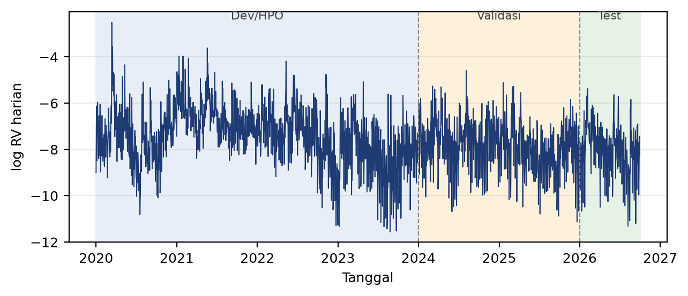
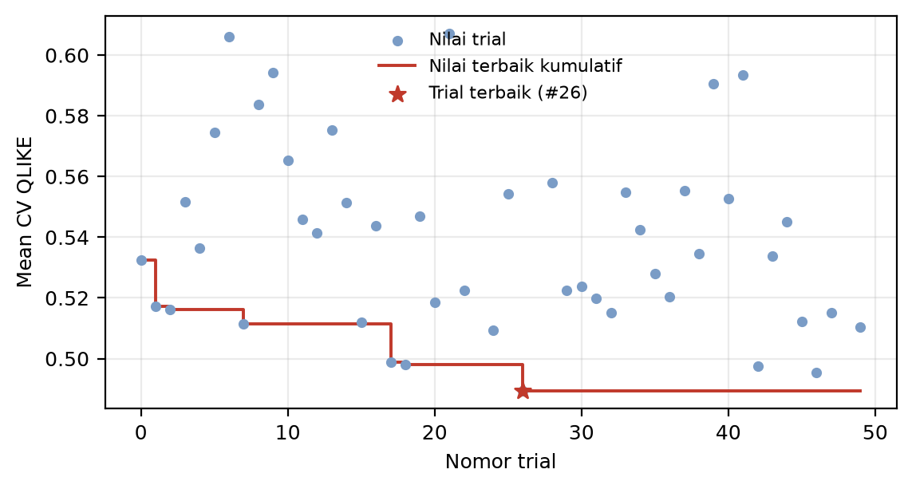
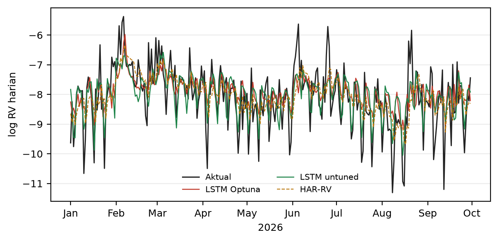
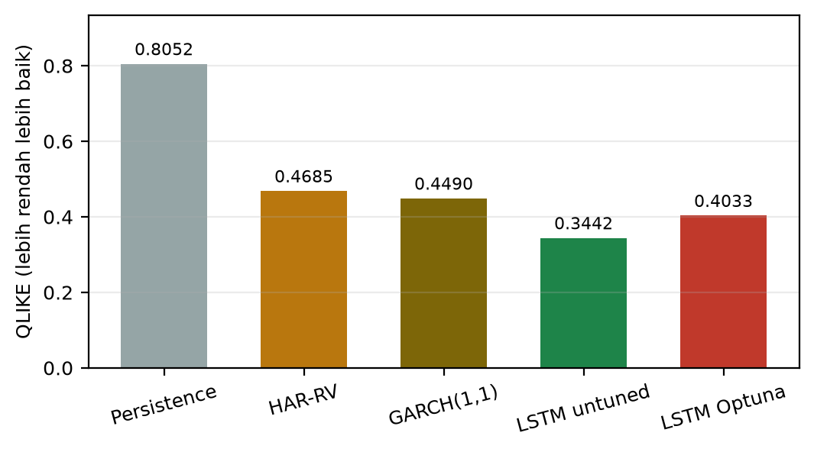
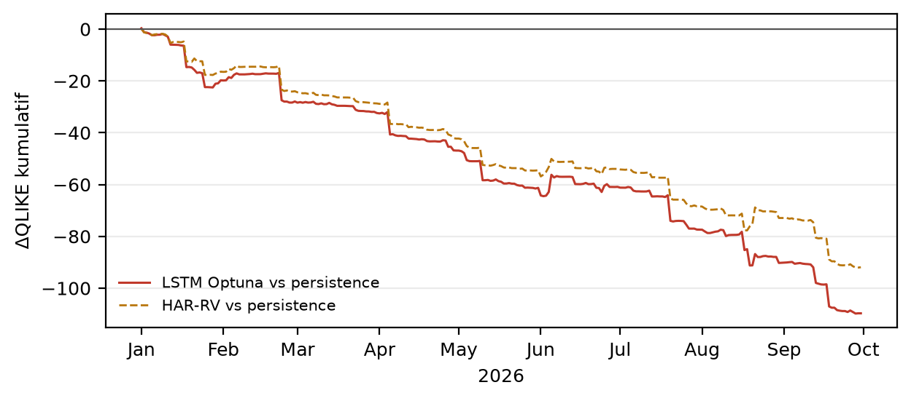

# BAB IV HASIL DAN PEMBAHASAN

## 4.1 Statistik Deskriptif

Dataset final terdiri atas 2.464 hari perdagangan, mencakup 2020-01-01 sampai 2026-09-30. Setiap hari memiliki 24 bar 1 jam, kecuali sejumlah hari pada periode 2020–2023 yang memiliki 20–23 bar dan tetap dipertahankan sesuai amandemen A1. Satu hari, yaitu 2020-02-19, dikeluarkan karena hanya memiliki 19 bar. Tidak ada hari cacat pada periode validasi 2024–2025 maupun periode uji 2026. Statistik deskriptif target disajikan pada Tabel 4.1.

**Tabel 4.1 Statistik Deskriptif \(\log RV\)**

| Periode | n | Rata-rata | SD | Minimum | Maksimum | Median RV |
|---|---:|---:|---:|---:|---:|---:|
| Seluruh data (2020–2026) | 2.464 | −7,6232 | 1,1843 | −11,5567 | −2,5086 | 0,000513 |
| Pengembangan (2020–2023) | 1.460 | −7,4289 | 1,2352 | −11,5567 | −2,5086 | – |
| Validasi (2024–2025) | 731 | −7,8404 | 1,0353 | −11,1275 | −4,5897 | – |
| Uji (2026) | 273 | −8,0808 | 1,0492 | −11,3086 | −5,3758 | – |

Sumber: hasil pengolahan penulis (2026).

Rata-rata \(\log RV\) menurun dari −7,4289 pada periode pengembangan menjadi −7,8404 pada periode validasi dan −8,0808 pada periode uji. Penurunan ini menunjukkan bahwa tingkat volatilitas Bitcoin pada 2024–2026 relatif lebih rendah dibandingkan 2020–2023. Periode 2020–2023 mencakup sejumlah peristiwa ekstrem, termasuk pandemi COVID-19, reli besar 2021, dan penurunan tajam 2022. Sebaliknya, 2026 memiliki tingkat volatilitas yang lebih moderat, meskipun tetap terdapat lonjakan sesekali. Perbedaan level ini penting untuk interpretasi hasil: model yang dilatih pada periode bergejolak kemudian diuji pada periode yang lebih tenang, sehingga kemampuan adaptasi terhadap perubahan level menjadi bagian dari ujian.

Simpangan baku \(\log RV\) juga menurun dari 1,2352 pada periode pengembangan menjadi 1,0353 pada validasi dan 1,0492 pada uji. Penurunan ini konsisten dengan level volatilitas yang lebih rendah dan stabilitas pasar yang relatif lebih baik. Namun, simpangan baku yang masih sekitar 1,0 pada skala log menunjukkan bahwa variasi harian tetap besar. Distribusi \(\log RV\) memiliki skewness −0,125 dan kurtosis 0,576, sehingga relatif simetris dan tidak terlalu berekor tebal dibandingkan RV mentah. Transformasi log berhasil membuat distribusi lebih stabil, meskipun masih terdapat outlier pada sisi volatilitas tinggi.

Autokorelasi lag pertama \(\log RV\) pada seluruh data adalah 0,5775. Pada periode pengembangan, autokorelasi mencapai 0,6264; pada validasi 0,4082; dan pada uji 0,4471. Nilai-nilai ini menunjukkan bahwa volatilitas memiliki memori yang jelas, tetapi memori tersebut tidak konstan antarperiode. Penurunan autokorelasi pada 2024–2026 dapat mencerminkan perubahan dinamika pasar atau level volatilitas yang lebih rendah. Bagi model, autokorelasi yang positif berarti informasi masa lalu memiliki nilai prediktif, tetapi hubungan tersebut tidak cukup kuat untuk membuat peramalan menjadi trivial. Inilah yang membedakan target volatilitas dari target harga: masih ada sinyal, tetapi sinyalnya tidak sempurna.

Gambar 4.1 menampilkan deret waktu \(\log RV\) beserta batas periode pengembangan, validasi, dan uji. Terlihat bahwa volatilitas Bitcoin tidak stasioner dalam level: terdapat periode tenang dan periode gejolak yang panjang. Terdapat lonjakan besar pada 2020, 2021, dan 2022, kemudian level yang lebih stabil pada 2023–2026. Meskipun demikian, lonjakan pada 2024 dan 2026 tetap terjadi, sehingga model tidak dapat mengandalkan level rata-rata saja. Pola visual ini mendukung penggunaan model yang dapat menangkap dependensi temporal dan perubahan level, sekaligus menjelaskan mengapa baseline persistence memiliki keterbatasan.

Sumber: hasil pengolahan penulis (2026).

## 4.2 Hasil Optimasi Hyperparameter

Optuna menjalankan 50 trial pada periode pengembangan 2020–2023. Dari jumlah tersebut, 47 trial berstatus COMPLETE dan 3 trial berstatus PRUNED. Trial yang dipangkas tidak menghasilkan nilai objective lengkap karena dihentikan lebih awal oleh MedianPruner. Dari 47 trial yang selesai, nilai mean CV QLIKE berkisar antara 0,48937 dan 0,60711, dengan median 0,53447. Trial terbaik adalah trial nomor 26, dengan mean CV QLIKE 0,48937. Hyperparameter terbaik disajikan pada Tabel 4.2.

**Tabel 4.2 Hyperparameter Terbaik Hasil Optuna**

| Hyperparameter | Nilai |
|---|---|
| Nomor trial | 26 |
| lookback | 16 |
| units | 22 |
| layers | 1 |
| dropout | 0,10 |
| learning_rate | \(5{,}117 \times 10^{-4}\) |
| batch_size | 16 |
| Mean CV QLIKE | 0,48937 |

Sumber: run `20261028_094124_optuna_hpo_5be039`, file `best_params.json`.

Trial terbaik menghasilkan QLIKE yang berbeda antarfold: 0,5153 pada fold 0; 0,2882 pada fold 1; 0,3574 pada fold 2; 0,5950 pada fold 3; dan 0,6909 pada fold 4. Perbedaan antarfold cukup besar, terutama antara fold 1 dan fold 4. Fold 4 memiliki QLIKE tertinggi, yang menunjukkan bahwa periode validasi pada fold tersebut lebih sulit diprediksi. Rata-rata kelima fold menjadi dasar pemilihan, sehingga model yang dipilih tidak harus menjadi yang terbaik pada setiap fold. Variabilitas antarfold ini merupakan salah satu sumber ketidakpastian dalam pemilihan hyperparameter dan menjadi alasan mengapa evaluasi pada test eksternal diperlukan.

Gambar 4.2 menampilkan riwayat nilai trial dan nilai terbaik kumulatif. Nilai terbaik turun cukup cepat pada awal pencarian, dari sekitar 0,533 pada trial 0 menjadi 0,517 pada trial 2, lalu 0,511 pada trial 7. Perbaikan besar terjadi pada trial 17–18, ketika nilai turun ke sekitar 0,498. Nilai terbaik berikutnya dicapai pada trial 26 dengan 0,48937. Setelah trial 26, tidak ada trial yang berhasil memperbaiki nilai tersebut hingga trial 49. Pola ini menunjukkan bahwa TPE menemukan konfigurasi yang menjanjikan pada sepertiga awal pencarian, tetapi kemudian menghabiskan sebagian besar trial untuk eksplorasi yang tidak menghasilkan perbaikan. Dengan hanya 50 trial, ruang pencarian belum tentu dieksplorasi secara menyeluruh; namun jumlah trial telah ditetapkan sebelum eksperimen dan tidak ditambah setelah melihat hasil.

Sumber: run `20261028_094124_optuna_hpo_5be039`, file `trials.csv`.

Hyperparameter terbaik menunjukkan model yang relatif kecil: lookback 16, units 22, satu lapisan, dropout 0,1, dan batch size 16. Model kecil cenderung lebih stabil pada data harian yang terbatas, tetapi juga memiliki kapasitas terbatas untuk menangkap pola kompleks. Learning rate sekitar \(5 \times 10^{-4}\) termasuk moderat untuk Adam, sedangkan batch size 16 memberikan pembaruan yang lebih sering per epoch. Kombinasi ini konsisten dengan strategi regularisasi implicit melalui model kecil dan batch kecil. Namun, perlu ditegaskan bahwa nilai CV QLIKE 0,48937 bukan estimasi kinerja out-of-sample; nilai tersebut hanya berlaku pada fold pengembangan.

Perbandingan dengan LSTM untuned tidak dapat dilakukan secara langsung pada tahap ini karena LSTM untuned tidak dioptimasi dan tidak memiliki mean CV QLIKE yang sebanding. Perbandingan baru dilakukan pada periode validasi dan uji, ketika kedua model dilatih dengan protokol yang sama. Meskipun demikian, hasil HPO sudah memberi indikasi awal: model terbaik yang dipilih Optuna lebih kecil daripada konfigurasi untuned (lookback 21, units 64). Perbedaan kapasitas ini akan menjadi salah satu faktor yang dibahas pada analisis tambahan.

## 4.3 Hasil Validasi 2024–2025

Pada periode validasi, model LSTM dilatih hanya pada periode pengembangan 2020–2023, kemudian memprediksi 2024–2025. Baseline HAR-RV, GARCH(1,1), dan persistence juga dijalankan pada periode yang sama. Hasil validasi disajikan pada Tabel 4.3. Periode ini berfungsi sebagai checkpoint, bukan sebagai dasar pemilihan model; tidak ada hyperparameter, epoch, atau seed yang diubah berdasarkan hasil validasi.

**Tabel 4.3 Metrik Validasi 2024–2025**

| Model | QLIKE | MAE \(\log RV\) | RMSE \(\log RV\) |
|---|---:|---:|---:|
| HAR-RV | 0,42676 | 0,71494 | 0,91463 |
| LSTM untuned | 0,43238 | 0,72278 | 0,92472 |
| GARCH(1,1) | 0,45779 | 0,93518 | 1,19949 |
| LSTM Optuna | 0,49372 | 0,75375 | 0,96071 |
| Persistence | 0,76115 | 0,90005 | 1,12565 |

Sumber: run `20261028_101839_final_ab5d93`, file `metrics_baselines_val.json` dan `metrics_lstm_*_val.json`.

Pada periode validasi, HAR-RV memiliki QLIKE terendah (0,42676), diikuti LSTM untuned (0,43238), GARCH(1,1) (0,45779), LSTM Optuna (0,49372), dan persistence (0,76115). LSTM Optuna mengungguli persistence secara signifikan: selisih QLIKE −0,26743, statistik DM −5,286, dan \(p = 6{,}26 \times 10^{-8}\). Namun, LSTM Optuna kalah dari HAR-RV dengan selisih +0,06696 (\(p \approx 1,0\) untuk arah model lebih baik), dan kalah dari LSTM untuned dengan selisih +0,06134. Terhadap GARCH(1,1), LSTM Optuna juga kalah dengan selisih +0,03593, meskipun perbedaannya tidak signifikan secara statistik (\(p = 0,8665\) untuk arah model lebih baik).

Hasil validasi sudah memberi sinyal penting: optimasi hyperparameter belum menghasilkan model yang lebih baik daripada LSTM default, dan belum mampu menyaingi HAR-RV. Sebaliknya, LSTM Optuna masih jauh lebih baik daripada persistence. Pola ini menunjukkan bahwa nilai tambah LSTM terutama berasal dari kemampuannya memanfaatkan memori volatilitas, bukan dari optimasi hyperparameter itu sendiri. Dengan kata lain, pada periode validasi, model sudah "belajar" sesuatu yang berguna, tetapi proses pemilihan hyperparameter belum menemukan konfigurasi yang lebih baik daripada konfigurasi default yang wajar.

Perbandingan MAE dan RMSE memberikan gambaran yang sedikit berbeda. LSTM Optuna memiliki MAE 0,75375 dan RMSE 0,96071, lebih rendah daripada persistence (0,90005 dan 1,12565) tetapi lebih tinggi daripada HAR-RV (0,71494 dan 0,91463) dan LSTM untuned (0,72278 dan 0,92472). GARCH memiliki MAE dan RMSE tertinggi, meskipun QLIKE-nya lebih rendah daripada LSTM Optuna. Perbedaan urutan antara QLIKE dan MAE/RMSE menunjukkan bahwa metrik tidak selalu memberikan peringkat yang sama. QLIKE memberi penalti lebih besar pada kesalahan relatif terhadap level variance, sedangkan MAE/RMSE memberi bobot yang lebih besar pada kesalahan absolut. Karena penelitian ini menetapkan QLIKE sebagai metrik utama, peringkat berdasarkan QLIKE yang digunakan untuk menjawab hipotesis.

## 4.4 Hasil Uji Eksternal 2026

Periode uji eksternal mencakup 273 hari, dari 2026-01-01 sampai 2026-09-30. Model LSTM dilatih ulang pada train pool 2020–2025, sehingga menggunakan dua tahun data tambahan dibandingkan pelatihan validasi. Baseline HAR-RV dan GARCH juga di-fit pada train pool, dengan GARCH di-refit secara expanding setiap awal bulan. Hasil uji eksternal disajikan pada Tabel 4.4.

**Tabel 4.4 Metrik Uji Eksternal 2026**

| Model | QLIKE | MAE \(\log RV\) | RMSE \(\log RV\) |
|---|---:|---:|---:|
| LSTM untuned | 0,34422 | 0,58659 | 0,76144 |
| LSTM Optuna | 0,40333 | 0,66620 | 0,88531 |
| GARCH(1,1) | 0,44898 | 0,93533 | 1,18944 |
| HAR-RV | 0,46846 | 0,68046 | 0,90767 |
| Persistence | 0,80521 | 0,85026 | 1,09996 |

Sumber: run `20261028_101839_final_ab5d93`, file `metrics_baselines_test.json` dan `metrics_lstm_*_test.json`.

Pada periode uji, seluruh model LSTM mengungguli persistence secara jelas. LSTM untuned memiliki QLIKE terendah (0,34422), diikuti LSTM Optuna (0,40333), GARCH(1,1) (0,44898), HAR-RV (0,46846), dan persistence (0,80521). LSTM Optuna mengungguli kedua baseline ekonometrik secara point estimate: selisih QLIKE terhadap GARCH adalah −0,04564, dan terhadap HAR-RV adalah −0,06513. Namun, LSTM untuned masih lebih baik daripada LSTM Optuna dengan selisih 0,05911. Urutan ini berbeda dari periode validasi, ketika HAR-RV berada di posisi teratas. Perubahan urutan menunjukkan bahwa peringkat model tidak stabil antarperiode, dan bahwa test eksternal memberikan informasi yang tidak dapat disimpulkan dari validasi saja.

Gambar 4.3 menampilkan prediksi LSTM Optuna, LSTM untuned, HAR-RV, dan nilai aktual pada periode uji. Secara visual, kedua model LSTM mengikuti pola umum \(\log RV\) dengan cukup baik, termasuk penurunan dan kenaikan bertahap. Namun, keduanya cenderung meremehkan lonjakan ekstrem, terutama pada awal Februari, awal dan akhir Juni, serta 21 Agustus 2026. LSTM untuned memiliki variasi prediksi yang lebih besar dan korelasi yang lebih tinggi dengan nilai aktual, sedangkan LSTM Optuna lebih halus. Perbedaan ini konsisten dengan kapasitas model: LSTM Optuna memiliki 22 unit dan lookback 16, sedangkan LSTM untuned memiliki 64 unit dan lookback 21. Model yang lebih besar memiliki kapasitas lebih besar untuk mengikuti lonjakan, tetapi juga berisiko overfitting; pada periode uji 2026, kapasitas tambahan tampaknya lebih menguntungkan.

Sumber: run `20261028_101839_final_ab5d93`, file `predictions_lstm_*_test.csv`.

Gambar 4.4 membandingkan QLIKE kelima model pada periode uji. Perbedaan antara LSTM dan persistence sangat besar: QLIKE persistence lebih dari dua kali lipat QLIKE LSTM untuned. Perbedaan antara LSTM Optuna dan GARCH/HAR lebih kecil, tetapi masih terlihat jelas secara visual. Sebaliknya, perbedaan antara LSTM Optuna dan LSTM untuned juga terlihat, dengan LSTM untuned lebih rendah. Gambar ini menegaskan bahwa klaim "LSTM lebih baik" perlu dipisahkan: LSTM memang jauh lebih baik daripada baseline naif, tetapi optimasi hyperparameter tidak otomatis membuat LSTM lebih baik daripada konfigurasi default.

Sumber: hasil pengolahan penulis (2026).

Perubahan kinerja dari validasi ke uji perlu dibahas. QLIKE LSTM Optuna turun dari 0,49372 pada validasi menjadi 0,40333 pada uji, sedangkan QLIKE LSTM untuned turun dari 0,43238 menjadi 0,34422. Sebaliknya, QLIKE HAR-RV naik dari 0,42676 menjadi 0,46846, dan QLIKE persistence naik dari 0,76115 menjadi 0,80521. GARCH relatif stabil, dari 0,45779 menjadi 0,44898. Penurunan QLIKE LSTM dapat disebabkan oleh dua faktor yang tidak sepenuhnya terpisah: periode uji 2026 memiliki level volatilitas yang lebih rendah dan lebih stabil, dan model LSTM pada uji dilatih dengan dua tahun data tambahan (2024–2025) dibandingkan model validasi yang hanya dilatih pada 2020–2023. Faktor pertama membuat persistence lebih sering salah karena level volatilitas bergeser; faktor kedua memberi LSTM lebih banyak contoh untuk mempelajari dinamika level tersebut.

Tabel 4.5 merangkum perbandingan QLIKE antara validasi dan uji. Selisih negatif berarti QLIKE test lebih rendah daripada QLIKE validasi, yang menunjukkan kinerja lebih baik pada periode uji.

**Tabel 4.5 Perbandingan QLIKE Validasi dan Uji**

| Model | QLIKE validasi | QLIKE uji | Selisih (uji − validasi) |
|---|---:|---:|---:|
| LSTM Optuna | 0,49372 | 0,40333 | −0,09038 |
| LSTM untuned | 0,43238 | 0,34422 | −0,08816 |
| Persistence | 0,76115 | 0,80521 | +0,04406 |
| HAR-RV | 0,42676 | 0,46846 | +0,04171 |
| GARCH(1,1) | 0,45779 | 0,44898 | −0,00881 |

Sumber: hasil pengolahan penulis (2026).

Pola pada Tabel 4.5 menunjukkan bahwa kinerja relatif LSTM tidak memburuk pada periode eksternal; justru sebaliknya, QLIKE kedua model LSTM menurun. Namun, penurunan ini tidak boleh ditafsirkan sebagai bukti bahwa model "semakin baik seiring waktu". Periode uji memiliki karakteristik yang berbeda, dan model uji menggunakan data pelatihan yang lebih panjang. Yang dapat disimpulkan adalah bahwa tidak terjadi degradasi ekstrem pada periode eksternal, dan bahwa LSTM tetap kompetitif terhadap baseline. Kesimpulan yang lebih kuat tentang konsistensi memerlukan beberapa periode uji eksternal yang independen, yang tidak tersedia dalam penelitian ini.

## 4.5 Uji Signifikansi

Uji Diebold-Mariano dan moving-block bootstrap digunakan untuk menilai apakah perbedaan QLIKE antara LSTM Optuna dan baseline signifikan secara statistik. Hasilnya disajikan pada Tabel 4.6. Selisih \(\Delta QLIKE\) dihitung sebagai QLIKE model dikurangi QLIKE baseline; nilai negatif berarti model lebih baik. Uji DM bersifat satu sisi dengan hipotesis alternatif bahwa model memiliki loss lebih rendah. Interval kepercayaan 95% dihitung dengan moving-block bootstrap, block length 20, 10.000 resampel, dan seed 42.

**Tabel 4.6 Uji Diebold-Mariano dan Block Bootstrap pada Periode Uji 2026**

| Perbandingan | \(\Delta QLIKE\) | Statistik DM | \(p\) satu sisi | CI 95% \(\Delta QLIKE\) | Kesimpulan |
|---|---:|---:|---:|---|---|
| LSTM Optuna vs persistence | −0,40188 | −4,410 | \(5{,}18 \times 10^{-6}\) | [−0,55787; −0,22960] | Signifikan |
| LSTM Optuna vs HAR-RV | −0,06513 | −1,612 | 0,05344 | [−0,14468; −0,00840] | *Near-miss* |
| LSTM Optuna vs GARCH(1,1) | −0,04564 | −0,907 | 0,18217 | [−0,11977; 0,04563] | Tidak signifikan |
| LSTM Optuna vs LSTM untuned | +0,05911 | +1,917 | 0,97236* | [−0,01878; 0,12355] | Tidak signifikan** |

Sumber: run `20261028_101839_final_ab5d93`, file `results_analysis.json`.

Keterangan: \(p\) satu sisi untuk arah yang telah ditetapkan (LSTM Optuna lebih baik). **Perbandingan ini bersifat eksploratif, bukan perbandingan primary**; \(p\) dua sisi \(\approx 0,055\).

Terhadap persistence, LSTM Optuna menang secara jelas. Selisih QLIKE −0,40188, statistik DM −4,410, dan \(p = 5{,}18 \times 10^{-6}\). Interval kepercayaan 95% sepenuhnya berada di bawah nol, dari −0,55787 sampai −0,22960. Ini berarti seluruh nilai \(\Delta QLIKE\) yang plausible menunjukkan bahwa LSTM Optuna lebih baik daripada persistence. Hasil ini konsisten dengan teori volatility clustering: informasi masa lalu memiliki nilai prediktif, dan model yang menggunakan sekuens serta fitur tambahan mampu memanfaatkannya lebih baik daripada model yang hanya menggunakan satu nilai terakhir.

Terhadap HAR-RV, LSTM Optuna memiliki QLIKE lebih rendah secara point estimate, dengan selisih −0,06513. Namun, statistik DM hanya −1,612 dan \(p = 0,05344\), sedikit di atas ambang 0,05. Interval kepercayaan bootstrap sepenuhnya berada di bawah nol, dari −0,14468 sampai −0,00840. Terdapat ketegangan antara dua prosedur inferensi: uji DM tidak cukup kuat untuk menolak hipotesis nol pada tingkat 5%, sedangkan block bootstrap menunjukkan bahwa selisih negatif cukup konsisten. Perbedaan ini dapat terjadi karena DM menggunakan pendekatan normal asimtotik dengan HAC lag 5, sedangkan bootstrap mempertahankan struktur dependensi lokal dan distribusi empiris. Pada sampel 273 hari, kedua prosedur tidak harus memberikan kesimpulan yang identik.

Protokol penelitian menetapkan bahwa keberhasilan memerlukan kedua syarat: \(p < 0,05\) dan batas atas interval kepercayaan di bawah nol. Karena syarat pertama tidak terpenuhi, perbandingan terhadap HAR-RV tidak dapat diklaim signifikan pada tingkat 5%. Hasil ini dilaporkan sebagai *near-miss*, bukan sebagai kemenangan. Memilih bootstrap saja karena hasilnya lebih favorable, atau menaikkan \(\alpha\) menjadi 0,10 setelah melihat hasil, akan melanggar protokol dan merupakan bentuk p-hacking. Oleh karena itu, kesimpulan yang diambil adalah bahwa LSTM Optuna **menyaingi** HAR-RV secara point estimate, tetapi belum terbukti lebih baik secara statistik pada tingkat signifikansi yang ditetapkan.

Terhadap GARCH(1,1), LSTM Optuna juga memiliki QLIKE lebih rendah secara point estimate, dengan selisih −0,04564. Namun, statistik DM −0,907 dan \(p = 0,18217\) menunjukkan bahwa perbedaan tersebut tidak signifikan. Interval kepercayaan bootstrap mencakup nol, dari −0,11977 sampai 0,04563. Dengan demikian, belum ada bukti statistik yang cukup bahwa LSTM Optuna lebih baik daripada GARCH(1,1). Secara deskriptif, LSTM Optuna unggul, tetapi keunggulan itu tidak cukup konsisten untuk disimpulkan pada populasi yang lebih luas.

Perbandingan LSTM Optuna dengan LSTM untuned bersifat eksploratif. Selisih \(+0,05911\) berarti LSTM Optuna memiliki QLIKE lebih tinggi (lebih buruk) daripada LSTM untuned. Statistik DM +1,917 dengan \(p\) satu sisi 0,97236 untuk arah "Optuna lebih baik" menunjukkan tidak ada bukti bahwa Optuna lebih baik. Jika diuji dua sisi, \(p \approx 0,055\), sehingga perbedaan tersebut juga belum signifikan pada tingkat 5%. Interval kepercayaan bootstrap mencakup nol, dari −0,01878 sampai 0,12355. Kesimpulannya, tidak ada bukti statistik yang cukup untuk mengatakan bahwa LSTM untuned lebih baik daripada LSTM Optuna, tetapi juga tidak ada bukti bahwa Optuna memberi perbaikan. Arah point estimate konsisten dengan periode validasi, di mana LSTM untuned juga lebih baik.

Gambar 4.5 menampilkan \(\Delta QLIKE\) kumulatif LSTM Optuna dan HAR-RV terhadap persistence. Kedua garis turun sepanjang periode uji, yang berarti kedua model secara konsisten lebih baik daripada persistence dari waktu ke waktu. Garis LSTM Optuna turun lebih tajam, terutama pada Januari, April–Mei, Juli, dan September, yang menunjukkan bahwa keunggulan LSTM tidak bergantung pada satu atau dua observasi ekstrem. Namun, garis HAR-RV juga turun, sehingga jarak antara LSTM Optuna dan HAR-RV tidak melebar secara dramatis. Ini konsisten dengan selisih QLIKE yang relatif kecil dan uji DM yang berada di ambang signifikansi.

Sumber: hasil pengolahan penulis (2026).

## 4.6 Analisis Tambahan: Kontribusi Optimasi Hyperparameter

Analisis ini bersifat tambahan dan tidak termasuk dalam kriteria keberhasilan primary. Tujuannya adalah memahami apakah optimasi hyperparameter Optuna memberi nilai tambah dibandingkan LSTM dengan konfigurasi default. Perbandingan dilakukan pada periode validasi dan uji, dengan protokol pelatihan yang sama: lima seed, rata-rata prediksi, dan early stopping internal. Hasilnya disajikan pada Tabel 4.7.

**Tabel 4.7 LSTM Optuna vs LSTM Untuned**

| Periode | Model | QLIKE | MAE \(\log RV\) | RMSE \(\log RV\) |
|---|---|---:|---:|---:|
| Validasi 2024–2025 | LSTM untuned | 0,43238 | 0,72278 | 0,92472 |
| Validasi 2024–2025 | LSTM Optuna | 0,49372 | 0,75375 | 0,96071 |
| Uji 2026 | LSTM untuned | 0,34422 | 0,58659 | 0,76144 |
| Uji 2026 | LSTM Optuna | 0,40333 | 0,66620 | 0,88531 |

Sumber: run `20261028_101839_final_ab5d93`, file `metrics_lstm_*_val.json` dan `metrics_lstm_*_test.json`.

Pada periode validasi, LSTM untuned lebih baik daripada LSTM Optuna dengan selisih QLIKE −0,06134. Pada periode uji, LSTM untuned juga lebih baik dengan selisih −0,05911. Arah perbedaan konsisten di kedua periode, meskipun besarnya sedikit berbeda. Jika diuji dengan DM pada periode validasi, perbedaan tersebut signifikan ke arah LSTM untuned; pada periode uji, perbedaan dua sisi \(p \approx 0,055\), sehingga belum signifikan pada tingkat 5%. Dengan demikian, bukti yang ada cukup konsisten untuk menunjukkan bahwa optimasi Optuna **tidak memberikan keunggulan out-of-sample** pada konfigurasi ini, tetapi belum cukup kuat untuk menyatakan superioritas LSTM untuned secara definitif.

Mengapa optimasi tidak memberikan keunggulan? Terdapat beberapa penjelasan yang saling melengkapi. Pertama, **selection noise**. Optuna memilih hyperparameter berdasarkan mean CV QLIKE pada lima fold. Dengan 47 trial yang selesai dan data pengembangan yang terbatas, nilai terbaik pada validasi silang dapat berasal dari kombinasi yang kebetulan cocok dengan fold-fold tersebut, bukan dari sinyal yang benar-benar dapat digeneralisasi. Fenomena winner's curse membuat nilai terbaik pada validasi cenderung terlalu optimistis. Kedua, **perbedaan kapasitas model**. Hyperparameter terbaik Optuna menghasilkan model yang lebih kecil (22 unit, lookback 16) daripada LSTM untuned (64 unit, lookback 21). Model kecil lebih stabil, tetapi kurang mampu mengikuti lonjakan volatilitas. Pada 2026, lonjakan ekstrem masih terjadi, sehingga model yang lebih responsif memiliki keunggulan. Ketiga, **pergeseran rezim**. Hyperparameter dipilih pada 2020–2023, periode dengan volatilitas tinggi dan dinamika yang berbeda dari 2026. Konfigurasi yang optimal pada periode bergejolak belum tentu optimal pada periode yang lebih tenang. Keempat, **trade-off bias-variance**. Optuna cenderung memilih model dengan regularisasi lebih kuat karena objective validasi silang menghukum overfitting; pada data uji yang berbeda, regularisasi tersebut dapat menjadi terlalu konservatif.

Temuan ini bukan berarti Optuna tidak berguna. Optuna tetap berhasil menemukan model yang jauh lebih baik daripada persistence dan kompetitif terhadap baseline ekonometrik. Namun, temuan ini menunjukkan bahwa optimasi hyperparameter bukan jaminan peningkatan out-of-sample, terutama ketika data terbatas, target berubah rezim, dan ruang pencarian tidak mencakup semua kemungkinan. Hasil ini sejalan dengan Bouthillier et al. (2021), yang menekankan pentingnya variabilitas dan evaluasi berulang dalam benchmark machine learning, serta dengan pengalaman studi pilot pada harga Bitcoin, di mana optimasi juga tidak menghasilkan generalisasi yang lebih baik.

Perbandingan dengan studi pilot relevan untuk diskusi. Pada studi pilot, model LSTM dengan Optuna memiliki MAE 1.687,49 USD, sedangkan persistence 1.579,80 USD; selisih +107,69 USD (CI 95%: +50,82 sampai +170,90) menunjukkan bahwa model lebih buruk daripada baseline naif. Pada Study 2, target dipindahkan ke volatilitas, dan LSTM berhasil mengungguli persistence secara signifikan. Perbedaan ini menunjukkan bahwa pemilihan target memainkan peran besar: harga harian mendekati random walk, sedangkan volatilitas memiliki memori. Namun, dalam kedua studi, optimasi hyperparameter tidak otomatis mengalahkan baseline yang kuat. Pola yang konsisten ini memperkuat pesan metodologis bahwa evaluasi yang ketat dan baseline yang tepat lebih penting daripada optimasi agresif.

## 4.7 Ringkasan Jawaban Rumusan Masalah

Berdasarkan hasil di atas, jawaban atas setiap rumusan masalah dapat dirangkum sebagai berikut.

**RQ1: Bagaimana merancang pipeline optimasi hyperparameter LSTM berbasis Optuna yang bebas kebocoran data untuk prediksi realized volatility Bitcoin?**

Pipeline berhasil dirancang dan diimplementasikan. Pipeline mencakup pengunduhan data kline 1 jam, agregasi harian, perhitungan realized variance dan enam fitur, pembagian data temporal, purged rolling-origin cross-validation, optimasi Optuna, pelatihan multi-seed, baseline persistence/HAR-RV/GARCH/LSTM untuned, evaluasi QLIKE, uji DM, dan block bootstrap. Protokol dan data di-hash sebelum eksperimen; hash protokol `72c75880…` dan hash data `ec2e3fb4…` tercatat pada manifest. Sebelum model final dijalankan, pipeline memverifikasi kedua hash tersebut. Terdapat 34 unit test yang mencakup integritas data, metrik, dan statistik, dan seluruhnya lulus. Dengan demikian, RQ1 terjawab positif: pipeline dapat dibangun, dijalankan, dan direproduksi.

**RQ2: Sejauh mana model LSTM yang dioptimasi Optuna mampu mengungguli baseline persistence dalam memprediksi realized volatility Bitcoin pada periode uji eksternal 2026?**

Keunggulannya jelas dan signifikan. Pada periode uji 2026, LSTM Optuna memiliki QLIKE 0,40333, sedangkan persistence 0,80521. Selisih −0,40188, statistik DM −4,410, \(p = 5{,}18 \times 10^{-6}\), dan interval kepercayaan 95% [−0,55787; −0,22960] sepenuhnya di bawah nol. Dengan demikian, LSTM Optuna mengungguli persistence secara signifikan, baik secara point estimate maupun secara statistik. RQ2 terjawab positif.

**RQ3: Apakah model LSTM yang dioptimasi Optuna mampu menyaingi baseline ekonometrik HAR-RV dan GARCH(1,1) pada periode uji eksternal?**

Secara point estimate, ya. LSTM Optuna memiliki QLIKE 0,40333, lebih rendah daripada GARCH(1,1) 0,44898 dan HAR-RV 0,46846. Namun, secara statistik jawabannya belum sepenuhnya positif. Terhadap HAR-RV, selisih −0,06513 dengan \(p = 0,05344\) berada sedikit di atas ambang 0,05, meskipun interval kepercayaan bootstrap sepenuhnya di bawah nol. Terhadap GARCH(1,1), selisih −0,04564 dengan \(p = 0,18217\) dan interval kepercayaan yang mencakup nol. Dengan demikian, LSTM Optuna **menyaingi** kedua baseline ekonometrik, tetapi belum terbukti lebih baik secara statistik pada tingkat 5%. RQ3 terjawab positif secara deskriptif, tetapi belum positif secara inferensial.

**RQ4: Bagaimana konsistensi kinerja model LSTM yang dioptimasi Optuna antara periode validasi 2024–2025 dan periode uji eksternal 2026 yang tidak digunakan dalam pelatihan maupun optimasi?**

Konsistensi kinerja model terjaga dalam batas yang dapat diuji. QLIKE LSTM Optuna turun dari 0,49372 pada validasi menjadi 0,40333 pada uji, dan QLIKE LSTM untuned turun dari 0,43238 menjadi 0,34422. Tidak terjadi degradasi ekstrem; model tetap kompetitif dan bahkan meningkatkan kinerja relatifnya. Namun, periode uji memiliki level volatilitas yang lebih rendah dan model uji dilatih dengan data yang lebih panjang, sehingga penurunan QLIKE tidak dapat sepenuhnya diatribusikan pada konsistensi model. Yang dapat disimpulkan adalah bahwa model tidak gagal pada periode eksternal dan tetap mengungguli persistence. RQ4 terjawab positif dengan catatan metodologis tersebut.

Secara keseluruhan, hasil penelitian ini dikategorikan **mixed**, bukan **positive** penuh. Model berhasil mengungguli persistence secara signifikan dan menyaingi HAR-RV serta GARCH(1,1) secara point estimate, tetapi tidak memenuhi seluruh kriteria keberhasilan yang ditetapkan sebelum eksperimen karena uji DM terhadap HAR-RV tidak mencapai \(p < 0,05\). Selain itu, LSTM tanpa optimasi justru memiliki QLIKE lebih rendah daripada LSTM Optuna pada periode uji, sehingga klaim bahwa optimasi hyperparameter meningkatkan kinerja out-of-sample tidak didukung. Kategori mixed ini dilaporkan apa adanya, sesuai dengan protokol yang telah dikunci.

