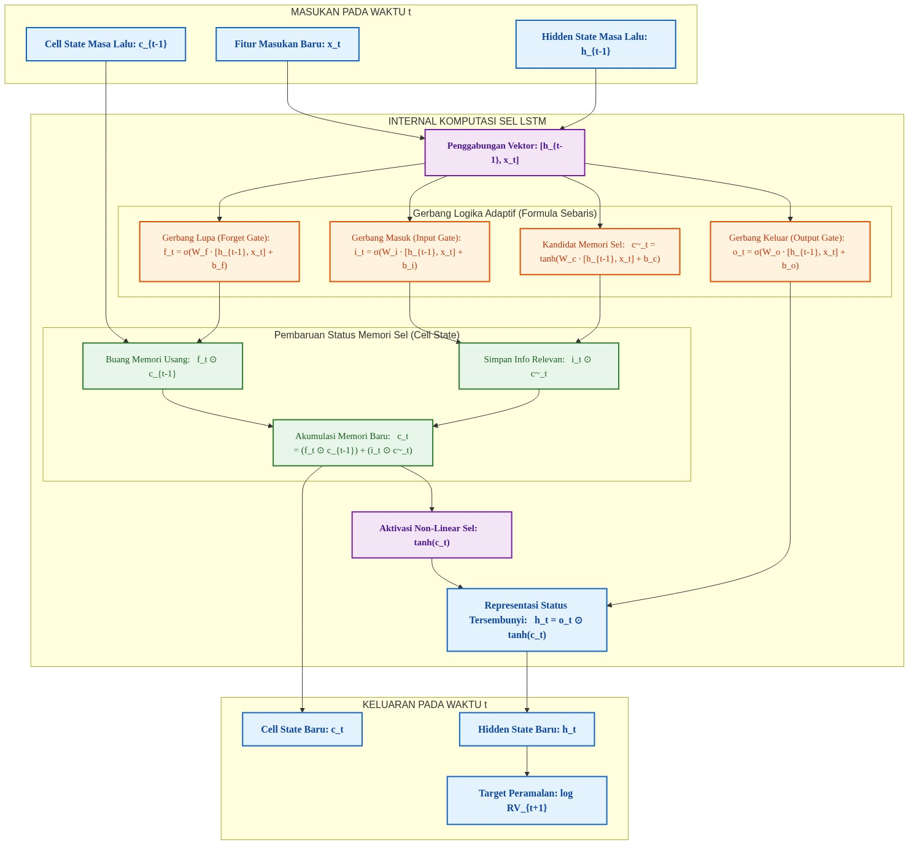
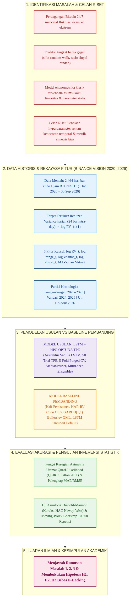
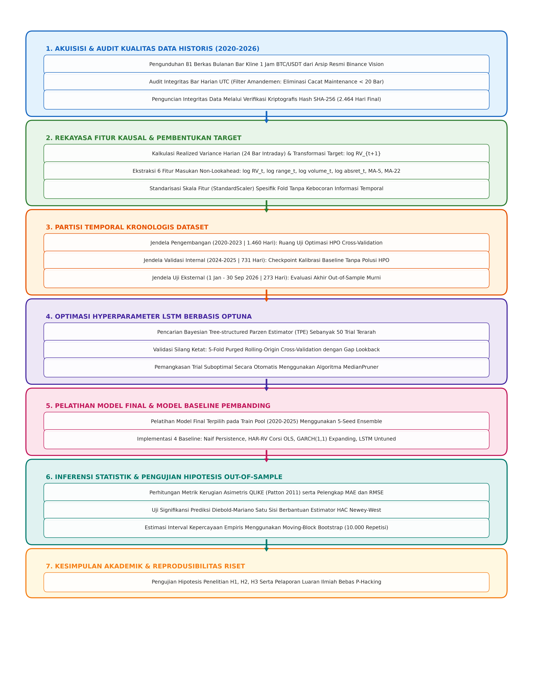

# BAB I PENDAHULUAN

## A. Latar Belakang

Pasar aset kripto, khususnya Bitcoin (BTC), merupakan salah satu instrumen keuangan digital yang memiliki tingkat kapitalisasi pasar terbesar di dunia sekaligus mencatat derajat fluktuasi harga yang sangat ekstrem. Dalam disiplin ilmu Teknik Informatika, data rekaman transaksi perdagangan Bitcoin tersimpan secara kronologis dan berkesinambungan sebagai data deret waktu (*time series*). Karakteristik bursa kripto yang beroperasi penuh selama 24 jam sehari tanpa jeda libur serta tanpa keberadaan otoritas pengatur terpusat menyebabkan dinamika risiko aset ini jauh lebih kompleks dibandingkan instrumen keuangan konvensional. Mengantisipasi risiko pasar yang sedemikian dinamis memerlukan metode komputasi cerdas yang mampu mengenali pola pergerakan masa lalu guna memitigasi potensi kerugian finansial di masa depan, sebagaimana ditekankan dalam survei komputasi finansial oleh Lim dan Zohren (2021). Atas dasar tersebut, perancangan model prediksi berbasis kecerdasan buatan menjadi instrumen penting dalam menganalisis data deret waktu bursa digital.

Sejumlah penelitian terdahulu berupaya meramalkan pergerakan pasar Bitcoin menggunakan algoritma pembelajaran mendalam (*deep learning*), seperti riset yang dilakukan oleh Khumaidi dkk. (2024), Aswadi dan Ependi (2025), serta Fawzi dkk. (2025). Akan tetapi, mayoritas penelitian komputasi tersebut secara langsung menargetkan nominal harga penutupan (*closing price*). Memprediksi tingkat harga nominal terbukti memiliki tingkat kesulitan yang sangat tinggi karena harga aset di pasar yang efisien bergerak mendekati lintasan acak (*random walk*). Pada studi pendahuluan, model prediksi harga berbasis *deep learning* terbukti secara statistik gagal mengungguli model naif *persistence* akibat rasio sinyal terhadap derau (*signal-to-noise ratio*) yang sangat rendah. Sebaliknya, besaran fluktuasi pasar atau volatilitas terbukti memiliki pola keteraturan berupa pengelompokan volatilitas (*volatility clustering*), di mana periode varians tinggi cenderung saling berkelompok, sebagaimana dibuktikan oleh Andersen dan Bollerslev (1998) serta Bollerslev (1986).

Keberadaan pola keteraturan temporal pada volatilitas membuka peluang ilmiah bagi penerapan model peramalan komputasional yang terukur. Berbeda dengan deret tingkat harga yang tidak memiliki ketergantungan waktu yang panjang, volatilitas aset kripto memiliki struktur dependensi temporal yang kuat (Katsiampa, 2017). Secara empiris, volatilitas tidak dapat diamati secara langsung di pasar keuangan, sehingga memerlukan proksi perhitungan kuantitatif yang akurat. Pendekatan ekonometrika modern mengestimasi besaran volatilitas melalui *realized variance* (RV), yaitu penjumlahan kuadrat pengembalian harga intra-day berfrekuensi tinggi dalam satu hari perdagangan penuh (Andersen dkk., 2003; Barndorff-Nielsen & Shephard, 2002). Proksi *realized variance* berbasis data intra-day terbukti secara teoritis jauh lebih kaya informasi dan bebas dari derau mikrostruktur pasar dibandingkan varians harian konvensional, sehingga menjadi target peramalan yang sangat objektif dan relevan dalam riset komputasi finansial modern.

Secara tradisional, peramalan volatilitas dilakukan menggunakan model ekonometrika runtun waktu klasik, seperti *Generalized Autoregressive Conditional Heteroskedasticity* atau GARCH(1,1) oleh Bollerslev (1986) dan model *Heterogeneous Autoregressive of Realized Volatility* atau HAR-RV oleh Corsi (2009). Model HAR-RV membedah volatilitas ke dalam tiga komponen horizon waktu yang berbeda, yakni komponen harian, mingguan, dan bulanan secara terstruktur dan transparan. Meskipun model HAR-RV memiliki landasan matematis yang kokoh dan mampu menangkap memori panjang secara sederhana, model ini dibatasi oleh asumsi kaku berupa hubungan linear proporsional antar-variabel masukan. Pada kenyataannya, pasar aset kripto sering kali mengalami lonjakan ekstrem mendadak dan pergeseran rezim struktural yang drastis, sehingga memunculkan perilaku asimetris non-linear dinamis yang tidak mampu diakomodasi oleh formulasi linear klasik tersebut (Ardia dkk., 2019; Conrad dkk., 2018).

Untuk mengatasi keterbatasan model linear, arsitektur jaringan saraf tiruan berulang *Long Short-Term Memory* (LSTM) yang diperkenalkan oleh Hochreiter dan Schmidhuber (1997) menjadi alternatif mutakhir yang sangat menjanjikan. LSTM dirancang khusus dengan mekanisme internal gerbang logika komputasi, meliputi gerbang masuk (*input gate*), gerbang lupa (*forget gate*), dan gerbang keluar (*output gate*). Gerbang-gerbang logika ini berfungsi menyaring arus informasi, memutuskan data historis mana yang wajib dipertahankan dan informasi usang mana yang harus dibuang, sekaligus mengeliminasi masalah hilangnya gradien (*vanishing gradient*) pada deret panjang. Studi empiris global oleh Christensen dkk. (2023) menunjukkan bahwa metode pembelajaran mesin memiliki kapasitas tinggi dalam menyaingi model ekonometrika klasik, sementara eksplorasi model sekuensial oleh Kim dan Won (2018) membuktikan keunggulan adaptif LSTM dalam memetakan interaksi non-linear pada volatilitas keuangan.

Kendati memiliki kapasitas pemetaan non-linear yang tinggi, performa model jaringan saraf tiruan LSTM sangat bergantung pada ketepatan kombinasi konfigurasi *hyperparameter* eksternal. Pengaturan arsitektur seperti panjang jendela sekuens waktu historis (*lookback window*), jumlah unit neuron tersembunyi, koefisien regularisasi *dropout* untuk mencegah *overfitting*, laju pembelajaran (*learning rate*), hingga ukuran *batch* sangat menentukan kemampuan generalisasi model (Greff dkk., 2017). Riset penalaan *hyperparameter* LSTM pada data aset kripto di jurnal nasional, seperti penelitian Aldo dkk. (2026), Widad dkk. (2026), serta Kervanci dan Akay (2023), umumnya masih mengandalkan metode coba-coba manual (*trial-and-error*), pencarian kisi (*grid search*), atau pencarian acak (*random search*). Pendekatan konvensional tersebut terbukti membutuhkan alokasi sumber daya komputasi yang sangat boros, tidak efisien waktu, serta tidak memberikan jaminan matematis bagi tercapainya konfigurasi parameter yang optimal.

Tantangan efisiensi pencarian *hyperparameter* tersebut dapat diselesaikan secara cerdas melalui algoritma optimasi berbasis Bayesian, khususnya *Tree-structured Parzen Estimator* (TPE) yang diformulasikan oleh Bergstra dkk. (2011). Berbeda dari metode pencarian acak yang mengeksplorasi ruang parameter tanpa panduan informasi masa lalu, algoritma TPE memodelkan distribusi probabilitas konfigurasi historis secara bersyarat guna mengarahkan pencarian menuju ruang parameter yang paling menjanjikan. Kerangka kerja perangkat lunak Optuna yang dikembangkan oleh Akiba dkk. (2019) mengintegrasikan algoritma TPE dengan mekanisme pemangkasan dini (*pruning*) otomatis melalui algoritma *MedianPruner*. Mekanisme cerdas ini secara otomatis menghentikan proses eksperimen pelatihan yang menunjukkan indikasi berkinerja buruk pada iterasi awal, sehingga mampu menghemat alokasi sumber daya prosesor secara masif serta mempercepat penemuan kombinasi *hyperparameter* model peramalan terbaik dengan tingkat efisiensi waktu komputasi yang sangat tinggi.

Terlepas dari keunggulan algoritma LSTM dan kerangka kerja Optuna, proses validasi model deret waktu finansial menghadapi ancaman serius berupa kebocoran data (*data leakage*) dan bias metrik evaluasi. Praktik umum yang membagi data secara acak menggunakan *k-fold cross-validation* konvensional atau melakukan normalisasi skala pada seluruh himpunan data terbukti merusak kausalitas temporal alami data runtun waktu. Pakar rekayasa finansial kuantitatif Lopez de Prado (2018) menegaskan bahwa evaluasi data deret waktu wajib menerapkan skema *Purged Cross-Validation* dengan menyisipkan jeda pemisah (*purge gap*) guna melenyapkan tumpang-tindih informasi antar-sekat data pelatihan dan validasi. Di samping hal tersebut, evaluasi akurasi varians sering kali keliru menggunakan metrik simetris konvensional. Patton (2011) membuktikan secara matematis bahwa galat peramalan varians wajib diukur menggunakan fungsi kerugian asimetris *Quasi-Likelihood* (QLIKE) yang terbukti tahan terhadap derau proksi.

Guna menjamin keabsahan klaim ilmiah dalam bidang kecerdasan buatan terapan, hasil perbandingan performa antar-model tidak cukup hanya dinilai berdasarkan selisih angka rata-rata metrik evaluasi semata. Penelitian Bouthillier dkk. (2021) menunjukkan bahwa variasi stokastik akibat inisialisasi bobot acak (*random seed*) dapat mengaburkan kesimpulan perbandingan performa model pembelajaran mendalam. Oleh sebab itu, pengujian model wajib menyertakan prosedur inferensi statistik yang komprehensif, multi-seed, dan bebas dari bias seleksi acak. Uji komparasi asimtotik Diebold dan Mariano (1995) dengan koreksi heteroskedastisitas dan autokorelasi (HAC) Newey dan West (1987), yang diperkuat oleh metode estimasi interval kepercayaan empiris *Moving-Block Bootstrap* oleh Kunsch (1989), menjadi instrumen pengujian yang sangat krusial untuk membuktikan secara empiris apakah superioritas model yang diajukan benar-benar signifikan secara statistik atau sekadar faktor keberuntungan acak semata.

Berdasarkan kesenjangan penelitian (*research gap*) tersebut, penelitian ini merancang *pipeline* komputasi peramalan *realized volatility* harian Bitcoin yang bebas dari kebocoran data temporal dan bias metrik evaluasi. Data mentah kline 1 jam bersumber resmi dari arsip publik Binance Vision (2024) periode 2020 hingga 2026 yang diagregasi menjadi *realized variance* harian berskala UTC. Penelitian ini mengintegrasikan optimasi *hyperparameter* LSTM berbasis kerangka kerja Optuna-TPE dengan skema 5-fold *Purged Cross-Validation* pada data historis, serta dievaluasi kinerjanya pada data uji eksternal *holdout* tahun 2026. Evaluasi performa model berpatokan pada fungsi kerugian asimetris QLIKE serta diuji signifikansinya terhadap *baseline persistence* dan model ekonometrika klasik HAR-RV. Penelitian ini diharapkan menghasilkan bukti empiris yang transparan, bebas dari manipulasi hasil (*p-hacking*), serta dapat direproduksi secara utuh (*fully reproducible*) oleh komunitas akademik.

## B. Rumusan Masalah

Berdasarkan latar belakang masalah yang telah diuraikan, rumusan masalah pada studi yang dilakukan dirumuskan sebagai berikut:

1. **Bagaimana** merancang arsitektur model *Long Short-Term Memory* (LSTM) teroptimasi Optuna dengan skema *Purged Cross-Validation* untuk mencegah kebocoran data (*data leakage*) pada peramalan *realized volatility* Bitcoin?
2. **Sejauh mana** peningkatan akurasi peramalan yang dihasilkan oleh model LSTM teroptimasi Optuna dibandingkan dengan *baseline persistence* berdasarkan fungsi kerugian asimetris *Quasi-Likelihood* (QLIKE) pada data uji eksternal 2026?
3. **Apakah** model LSTM teroptimasi Optuna mampu menyaingi performa model ekonometrika klasik *Heterogeneous Autoregressive of Realized Volatility* (HAR-RV) dan GARCH(1,1) dalam memproyeksikan volatilitas pasar kripto?

## C. Batasan Masalah

Guna menjaga fokus penelitian agar tetap terarah, terukur, dan mendalam, ditetapkan batasan-batasan masalah sebagai berikut:

1. Data yang digunakan merupakan data transaksi historis kline 1 jam pasangan perdagangan Bitcoin terhadap Tether (BTC/USDT) yang bersumber resmi dari arsip publik Binance Vision untuk rentang waktu 1 Januari 2020 hingga 30 September 2026 (total 2.464 hari).
2. Target peramalan dibatasi pada nilai *log realized variance* satu langkah ke depan ($\log RV_{t+1}$), yang dihitung melalui agregasi 24 bar kline 1 jam per hari perdagangan UTC.
3. Fitur masukan model dibatasi pada enam variabel teknikal terukur yang diturunkan dari informasi historis, meliputi $\log RV_t$, $\log range_t$, $\log volume_t$, $\log absret_t$, rata-rata bergerak 5 hari ($rv\_mean\_5_t$), dan rata-rata bergerak 22 hari ($rv\_mean\_22_t$).
4. Arsitektur jaringan saraf tiruan dibatasi pada model *vanilla* LSTM univariat-multivariat sekuensial, dengan ruang pencarian hyperparameter yang ditala melalui algoritma Optuna berbasis *Tree-structured Parzen Estimator* (TPE) sebanyak 50 trial.
5. Pembagian data temporal diatur secara kronologis: data pengembangan 2020–2023 (1.460 hari) untuk pelatihan dan penalaan CV, data validasi 2024–2025 (731 hari) untuk verifikasi internal, serta data uji eksternal 1 Januari – 30 September 2026 (273 hari) sebagai *out-of-sample holdout* murni.
6. Evaluasi performa model berfokus pada fungsi kerugian asimetris *Quasi-Likelihood* (QLIKE) sebagai metrik utama, didukung metrik MAE dan RMSE pada skala logaritmik, serta uji inferensi statistik Diebold-Mariano dan *Moving-Block Bootstrap* (10.000 repetisi, blok 20 hari).
7. Penelitian ini murni berfokus pada akurasi peramalan statistik komputasional deret waktu dan tidak mencakup simulasi eksekusi strategi perdagangan (*trading system*), analisis biaya transaksi (*slippage* dan komisi bursa), pembentukan portofolio multi-aset, maupun analisis sentimen media sosial dan faktor makroekonomi eksternal.

## D. Tujuan Penelitian

Sesuai dengan rumusan masalah yang ditetapkan, tujuan yang hendak dicapai pada studi yang dilakukan adalah sebagai berikut:

1. Merancang dan mengimplementasikan arsitektur model *Long Short-Term Memory* (LSTM) yang terintegrasi dengan algoritma penalaan Optuna (TPE) serta skema 5-fold *Purged Cross-Validation* guna menjamin proses peramalan bebas dari kebocoran data temporal.
2. Mengukur dan menganalisis efektivitas peningkatan akurasi model LSTM teroptimasi Optuna terhadap *baseline persistence* menggunakan metrik asimetris QLIKE dan uji signifikansi Diebold-Mariano pada data uji eksternal tahun 2026.
3. Menilai dan membuktikan daya saing komparatif model LSTM teroptimasi Optuna terhadap model ekonometrika klasik HAR-RV dan GARCH(1,1) dalam memodelkan dinamika *realized volatility* Bitcoin.

## E. Manfaat Penelitian

Penelitian ini diharapkan mampu memberikan kontribusi nyata yang terbagi ke dalam tiga aspek manfaat utama:

### 1. Manfaat Teoretis
  
   Penelitian ini memperkaya khazanah keilmuan Teknik Informatika dan sains data komputasional, khususnya dalam penerapan *deep learning* sekuensial pada data deret waktu berfluktuasi tinggi. Penelitian ini membuktikan secara empiris dinamika penerapan algoritma LSTM dan optimasi Bayesian TPE pada target *realized volatility*, sekaligus mengalihkan fokus riset kripto dari prediksi harga yang rentan kegagalan menuju pemodelan risiko yang memiliki dependensi temporal terstruktur.

### 2. Manfaat Praktis
  
   Bagi praktisi teknologi finansial, analis kuantitatif, dan pengelola risiko aset digital, pipeline komputasi yang dihasilkan pada studi yang dilakukan dapat dimanfaatkan sebagai modul inti sistem peringatan dini (*early warning system*) terhadap lonjakan risiko pasar. Proyeksi volatilitas yang akurat membantu pelaku industri dalam menentukan batas toleransi risiko (*Value-at-Risk*), alokasi lindung nilai (*hedging*), serta penetapan ukuran posisi perdagangan yang lebih terukur.

### 3. Manfaat Metodologis
  
   Penelitian ini menyajikan standar protokol eksperimen komputasi finansial yang ketat, transparan, dan dapat direproduksi secara utuh (*fully reproducible*). Integrasi antara *Purged Cross-Validation* untuk mencegah kebocoran data, fungsi kerugian asimetris QLIKE yang *robust* terhadap derau proksi, pengujian multi-seed, serta inferensi statistik Diebold-Mariano dan *Moving-Block Bootstrap* menjadi rujukan baku bagi penelitian sejenis agar tidak terjebak dalam bias optimisme semu.

## F. Sistematika Penulisan

Penyusunan naskah skripsi ini diorganisasikan ke dalam lima bab utama dengan sistematika pembahasan sebagai berikut:

* **BAB I PENDAHULUAN**  
  Menguraikan konteks latar belakang permasalahan dinamika pasar Bitcoin, transformasi orientasi riset dari prediksi harga ke *realized volatility*, urgensi optimasi *hyperparameter* LSTM bebas kebocoran, perumusan masalah, tujuan penelitian, manfaat teoretis dan praktis, batasan masalah, serta sistematika penulisan naskah.

* **BAB II LANDASAN TEORI**  
  Membahas kajian teoretis dan matematis mengenai konsep volatilitas dan *realized variance*, model ekonometrika runtun waktu klasik GARCH(1,1) dan HAR-RV, arsitektur jaringan saraf tiruan LSTM, algoritma penalaan Bayesian Optuna-TPE, fungsi kerugian asimetris QLIKE, protokol *Purged Cross-Validation*, uji statistik Diebold-Mariano dan bootstrap, tinjauan komprehensif penelitian terdahulu berskala nasional dan internasional, kerangka pemikiran konseptual, serta perumusan hipotesis penelitian.

* **BAB III METODE PENELITIAN**  
  Memaparkan metodologi rekayasa komputasi yang diterapkan, meliputi diagram alur tahapan penelitian, sumber dan prosedur pra-pemrosesan data Binance Vision, formulasi pembentukan fitur dan target, skema partisi data kronologis anti-kebocoran, konfigurasi arsitektur model dan ruang pencarian Optuna, prosedur pelatihan multi-seed, implementasi model pembanding, serta protokol evaluasi metrik dan inferensi statistik.

* **BAB IV HASIL DAN PEMBAHASAN**  
  Menyajikan temuan empiris hasil pengujian, mencakup statistik deskriptif karakteristik data, hasil penalaan hyperparameter terbaik Optuna, evaluasi kinerja peramalan pada data uji eksternal 2026, analisis komparatif performa terhadap model *baseline*, pengujian hipotesis statistik, visualisasi grafik sekuens prediksi dan galat, serta pembahasan mendalam (*discussion*) mengenai implikasi temuan ilmiah.

* **BAB V PENUTUP**  
  Memuat kesimpulan menyeluruh yang menjawab seluruh rumusan masalah penelitian, penjabaran kontribusi ilmiah yang berhasil dicapai, identifikasi keterbatasan penelitian, serta rekomendasi saran strategis untuk pengembangan penelitian lanjutan di masa mendatang.

---

# BAB II KAJIAN PUSTAKA

## A. Landasan Teori

### 1. Karakteristik Pasar Kripto dan Data Deret Waktu Bitcoin

Pasar aset kripto, khususnya Bitcoin (BTC), beroperasi secara terdesentralisasi tanpa otoritas terpusat serta aktif secara kontinu selama 24 jam sehari dan 7 hari seminggu tanpa hari libur bursa. Dalam sudut pandang sains komputasi dan analisis deret waktu (*time series*), pergerakan transaksi perdagangan Bitcoin menghasilkan aliran data kronologis berfrekuensi tinggi yang sangat masif dan dinamis. Dinamika harga Bitcoin sangat dipengaruhi oleh likuiditas global, sentimen pasar berskala mikro maupun makro, serta perilaku spekulatif para pelaku transaksi, sebagaimana dijelaskan dalam kajian analitis oleh Katsiampa (2017). Karakteristik lingkungan perdagangan yang tidak pernah berhenti ini menyebabkan struktur risiko pada aset kripto memiliki tingkat kompleksitas dan ketidakpastian yang jauh lebih tinggi dibandingkan dengan pasar modal konvensional yang memiliki jam perdagangan reguler.

Sejumlah penelitian di bidang ilmu informatika berupaya meramalkan pergerakan pasar Bitcoin dengan memprediksi nilai nominal harga penutupan (*closing price*), seperti riset yang dipublikasikan oleh Khumaidi dkk. (2024), Aswadi dan Ependi (2025), serta Fawzi dkk. (2025). Akan tetapi, deret data harga nominal pada pasar yang efisien memiliki dinamika yang mendekati lintasan acak (*random walk*), sehingga prediksi titik harga satu langkah ke depan menghasilkan rasio sinyal terhadap derau (*signal-to-noise ratio*) yang sangat rendah. Ketidakmampuan model cerdas dalam mengungguli model pembanding naif pada tingkat harga mendorong transformasi paradigma ilmiah menuju pemodelan variabilitas atau fluktuasi harga. Kajian komputasi keuangan modern oleh Lim dan Zohren (2021) menegaskan bahwa peramalan besaran variabilitas pasar menawarkan peluang keberhasilan yang jauh lebih tinggi karena volatilitas memiliki struktur dependensi temporal yang kuat dan dapat dipetakan secara matematis.

Data historis yang digunakan pada studi yang dilakukan merupakan catatan transaksi resmi *open*, *high*, *low*, *close*, dan *volume* (OHLCV) pada pasangan perdagangan Bitcoin terhadap Tether (BTC/USDT) dengan interval waktu satu jam (*1-hour kline*). Seluruh data transaksi intra-day tersebut diunduh dari basis data arsip publik resmi bursa Binance Vision (2024) untuk rentang waktu temporal mulai dari 1 Januari 2020 hingga 30 September 2026. Data mentah berfrekuensi tinggi ini memberikan granularitas informasi pergerakan harga yang sangat mendalam pada tingkat intra-day, sehingga memungkinkan kalkulasi variabilitas harian yang jauh lebih kaya informasi dan bebas dari bias penutupan semu bila dibandingkan dengan hanya mengandalkan satu titik harga penutupan harian saja.

### 2. Teori Volatilitas Finansial dan Sifat Khasnya

Dalam disiplin ekonometrika keuangan dan analisis risiko komputasional, volatilitas didefinisikan sebagai ukuran dispersi atau simpangan baku bersyarat dari imbal hasil (*return*) suatu aset dalam horizon waktu tertentu. Secara fundamental, volatilitas merupakan manifestasi dari derajat ketidakpastian pasar yang mencerminkan intensitas kedatangan aliran informasi baru ke dalam ekosistem perdagangan. Berbeda dengan harga nominal aset yang memiliki tren arah (*trend direction*), volatilitas finansial memiliki sejumlah sifat khas (*stylized facts*) universal yang teramati secara empiris di berbagai bursa global, sebagaimana dirangkum dalam studi teoretis oleh Andersen dan Bollerslev (1998) serta Bollerslev (1986). Keberadaan sifat-sifat empiris inilah yang menjadikan volatilitas dapat dimodelkan dan diproyeksikan secara komputasional.

Sifat empiris pertama yang paling dominan adalah fenomena pengelompokan volatilitas (*volatility clustering*), di mana perubahan harga berfluktuasi besar cenderung diikuti oleh fluktuasi besar kembali, dan fluktuasi kecil cenderung diiringi oleh fluktuasi kecil pada periode berikutnya. Sifat kedua adalah pembalikan ke nilai rata-rata (*mean reversion*), yang bermakna bahwa meskipun volatilitas dapat melonjak drastis akibat kejutan pasar ekstrem, nilainya secara perlahan akan selalu kembali menuju tingkat ekuilibrium rata-rata jangka panjangnya. Sifat ketiga adalah memori panjang (*long memory*), di mana dampak suatu guncangan pasar memiliki dependensi temporal yang bertahan melintasi horizon harian, mingguan, hingga bulanan. Pada data Bitcoin, Katsiampa (2017) serta Ardia dkk. (2019) membuktikan bahwa sifat *volatility clustering* dan pergeseran rezim struktural muncul secara nyata, sehingga memerlukan model adaptif non-linear untuk memetakannya.

### 3. Proksi Realized Variance dan Transformasi Logaritmik

Secara teoretis, volatilitas laten (*latent volatility*) tidak dapat diamati secara langsung di pasar keuangan riil, sehingga besaran nilainya harus diestimasi menggunakan variabel proksi kuantitatif yang representatif. Pendekatan ekonometrika modern memecahkan keterbatasan ini melalui kerangka teori variasi kuadratik (*quadratic variation*), yang membuktikan bahwa integrasi varians sesaat dapat didekati secara konsisten melalui penjumlahan kuadrat imbal hasil intra-day berfrekuensi tinggi (Andersen dkk., 2003; Barndorff-Nielsen & Shephard, 2002). Variabel proksi ini dikenal sebagai *Realized Variance* (RV). Misalkan $C_{t,h}$ dan $O_{t,h}$ berturut-turut menyatakan harga penutupan (*close*) dan pembukaan (*open*) pada bar kline ke-$h$ pada hari ke-$t$. Dengan mengagregasikan 24 bar kline 1 jam per hari perdagangan siklus UTC penuh ($h = 1, 2, \dots, 24$), nilai $RV_t$ harian dihitung melalui formula:

$$RV_t = \sum_{h=1}^{24} \left[ \ln\left(\frac{C_{t,h}}{O_{t,h}}\right) \right]^2 \tag{2.1}$$

Nilai $RV_t$ mentah pada aset kripto memiliki rentang sebaran yang sangat lebar, mencakup nilai desimal yang sangat kecil pada periode pasar tenang hingga angka yang melonjak tinggi saat terjadi peristiwa likuidasi massal. Rentang distribusi asimetris dengan ekor tebal (*fat tail*) ini berpotensi mengganggu stabilitas optimasi gradien pada jaringan saraf tiruan. Untuk mengatasi tantangan numerik tersebut, nilai $RV_t$ ditransformasikan ke dalam skala logaritmik natural ($\log RV_t$) dengan menyisipkan konstanta pelindung kecil $10^{-12}$ guna mencegah timbulnya galat matematis logaritma nol saat pasar mengalami pembekuan transaksi:

$$\log RV_t = \ln\left(RV_t + 10^{-12}\right) \tag{2.2}$$

Transformasi logaritmik ini secara efektif menstabilkan varians data, menjadikan distribusi probabilitas target mendekati lonceng Gaussian simetris, serta meredam pengaruh buruk pencilan ekstrem (*outliers*) tanpa menghilangkan integritas pola temporal historisnya. Dalam eksperimen ini, variabel $\log RV_t$ menjadi target utama prediksi satu langkah ke depan ($\log RV_{t+1}$) sekaligus menjadi fitur masukan autoregresif utama bagi model pembelajaran mendalam.

---

### 4. Model Ekonometrika Runtun Waktu Klasik (Baseline)

#### a. Generalized Autoregressive Conditional Heteroskedasticity / GARCH(1,1)

Model *Generalized Autoregressive Conditional Heteroskedasticity* (GARCH) yang dirumuskan oleh Bollerslev (1986) merupakan pengembangan teoretis dari model ARCH buatan Engle (1982). Model GARCH(1,1) memodelkan varians kondisional masa kini ($\sigma_t^2$) sebagai fungsi linear dari rata-rata varians jangka panjang ($\omega$), kuadrat residual kesalahan imbal hasil satu periode sebelumnya ($\varepsilon_{t-1}^2$), dan varians kondisional satu periode sebelumnya ($\sigma_{t-1}^2$). Struktur persamaan matematika GARCH(1,1) didefinisikan sebagai:

$$r_t = \mu + \varepsilon_t, \quad \varepsilon_t = \sigma_t z_t, \quad z_t \sim \mathcal{N}(0, 1) \tag{2.3}$$

$$\sigma_t^2 = \omega + \alpha \varepsilon_{t-1}^2 + \beta \sigma_{t-1}^2 \tag{2.4}$$

dengan batasan parameter non-negatif $\omega > 0$, $\alpha \ge 0$, $\beta \ge 0$, serta syarat stasioneritas kovarians $\alpha + \beta < 1$ agar varians proses tidak mengalami ledakan eksplosif. Parameter $\alpha$ mengukur derajat sensitivitas volatilitas terhadap kejutan pasar baru (*market shock*), sedangkan parameter $\beta$ mencerminkan persistensi memori volatilitas masa lalu. Estimasi parameter model GARCH(1,1) diselesaikan melalui metode *Quasi-Maximum Likelihood Estimation* (QML) yang terbukti konsisten dan asimtotik normal. Model ini menjadi tolok ukur klasik fundamental pada peramalan deret waktu finansial.

#### b. Heterogeneous Autoregressive of Realized Volatility / HAR-RV

Meskipun model GARCH sangat populer, model tersebut hanya memanfaatkan data imbal hasil harian dan mengabaikan kekayaan informasi transaksi intra-day. Untuk mengatasi hal tersebut, Corsi (2009) merancang model *Heterogeneous Autoregressive of Realized Volatility* (HAR-RV) yang dibangun di atas hipotesis pasar heterogen (*Heterogeneous Market Hypothesis*). Hipotesis ini menyatakan bahwa pasar dihuni oleh berbagai tipe pelaku ekonomi dengan horizon waktu keputusan yang berbeda, mulai dari pedagang harian (*day trader*), investor mingguan, hingga pengelola dana institusional berjangka panjang. Model HAR-RV membedah volatilitas harian ke dalam tiga komponen rata-rata bergerak kaskade temporal: harian ($RV_t^{(d)}$), mingguan ($RV_t^{(w)}$), dan bulanan ($RV_t^{(m)}$).

Pada studi yang dilakukan, model HAR-RV diestimasi menggunakan regresi linear kuadrat terkecil (*Ordinary Least Squares* / OLS) pada skala logaritmik natural guna menjaga konsistensi dimensi perbandingan terhadap model pembelajaran mendalam. Persamaan matematis spesifikasi log-linear HAR-RV dinyatakan sebagai berikut:

$$\log RV_{t+1} = \beta_0 + \beta_d \log RV_t + \beta_w \overline{\log RV}_{t-6:t} + \beta_m \overline{\log RV}_{t-21:t} + \varepsilon_{t+1} \tag{2.5}$$

Komponen mingguan ($\overline{\log RV}_{t-6:t}$) dibentuk dari rata-rata bergerak 7 hari perdagangan kalender kripto, sedangkan komponen bulanan ($\overline{\log RV}_{t-21:t}$) mencakup rata-rata 22 hari perdagangan. Model HAR-RV memiliki keunggulan berupa transparansi matematis yang tinggi dan mampu menangkap sifat memori panjang secara sederhana. Namun demikian, model HAR-RV dibatasi oleh asumsi kaku berupa linearitas koefisien statis, sehingga rentan mengalami penurunan akurasi saat pasar mengalami lonjakan asimetris non-linear mendadak (Conrad dkk., 2018).

---

### 5. Arsitektur Deep Learning Long Short-Term Memory (LSTM)

#### a. Keterbatasan RNN Konvensional dan Masalah Vanishing Gradient

Jaringan saraf tiruan berulang konvensional (*Standard Recurrent Neural Network* / RNN) dirancang untuk memproses data sekuensial dengan cara meneruskan status tersembunyi (*hidden state*) dari satu langkah waktu ke langkah waktu berikutnya. Akan tetapi, pada deret waktu yang memiliki dependensi temporal panjang, proses pelatihan RNN standar melalui algoritma *Backpropagation Through Time* (BPTT) menghadapi kendala matematis serius berupa fenomena hilangnya gradien (*vanishing gradient*) atau ledakan gradien (*exploding gradient*). Ketika gradien galat dipropagasikan mundur melintasi puluhan langkah waktu, perkalian matriks bobot yang berulang-ulang menyebabkan nilai gradien mengecil mendekati nol secara eksponensial. Akibatnya, bobot jaringan pada lapisan awal tidak mengalami pembaruan berarti, sehingga RNN standar gagal menangkap informasi dependensi historis jangka panjang (Hochreiter & Schmidhuber, 1997).

#### b. Anatomi Mekanisme Gerbang Sel LSTM

Untuk menanggulangi kelemahan fundamental RNN tersebut, Hochreiter dan Schmidhuber (1997) memperkenalkan arsitektur *Long Short-Term Memory* (LSTM) yang kemudian disempurnakan oleh Greff dkk. (2017). Kunci keberhasilan LSTM terletak pada pemisahan antara status memori jangka panjang yang disebut status sel (*cell state*, $c_t$) dan status keluaran jangka pendek (*hidden state*, $h_t$). Aliran transfer informasi diatur secara adaptif melalui tiga pintu gerbang logika komputasi yang memanfaatkan fungsi aktivasi non-linear sigmoid ($\sigma$) dan tangen hiperbolik ($\tanh$).

Tahapan komputasi internal sel LSTM pada setiap langkah waktu $t$ berlangsung melalui empat formulasi matematis utama:

1. **Gerbang Lupa (*Forget Gate*, $f_t$):** Mengatur proporsi informasi masa lalu pada status sel $c_{t-1}$ yang harus dibuang atau dipertahankan berdasarkan masukan saat ini $x_t$ dan representasi sebelumnya $h_{t-1}$:
   $$f_t = \sigma\left(W_f \cdot [h_{t-1}, x_t] + b_f\right) \tag{2.6}$$

2. **Gerbang Masuk (*Input Gate*, $i_t$) dan Kandidat Sel ($\tilde{c}_t$):** Menentukan informasi baru mana yang layak disimpan ke dalam memori sel:
   $$i_t = \sigma\left(W_i \cdot [h_{t-1}, x_t] + b_i\right) \tag{2.7}$$
   $$\tilde{c}_t = \tanh\left(W_c \cdot [h_{t-1}, x_t] + b_c\right) \tag{2.8}$$

3. **Pembaruan Status Sel (*Cell State Update*, $c_t$):** Menggabungkan memori lama yang dipertahankan dengan kandidat informasi baru melalui operasi perkalian elemen-demi-elemen ($\odot$):
   $$c_t = f_t \odot c_{t-1} + i_t \odot \tilde{c}_t \tag{2.9}$$

4. **Gerbang Keluar (*Output Gate*, $o_t$) dan Status Tersembunyi ($h_t$):** Menentukan bagian status sel yang diteruskan sebagai luaran representasi tersembunyi:
   $$o_t = \sigma\left(W_o \cdot [h_{t-1}, x_t] + b_o\right) \tag{2.10}$$
   $$h_t = o_t \odot \tanh(c_t) \tag{2.11}$$

Kombinasi gerbang logika ini memungkinkan sel LSTM mempertahankan memori informasi volatilitas penting selama puluhan langkah waktu tanpa terdegradasi oleh masalah hilangnya gradien.

#### c. Algoritma Optimasi Adam dan Regularisasi Dropout

Keberhasilan konvergensi jaringan saraf tiruan LSTM sangat ditopang oleh algoritma optimasi pembaruan bobot dan teknik regularisasi pencegah lewat-jenuh (*overfitting*). Pada studi yang dilakukan, optimasi bobot dilatih menggunakan algoritma *Adaptive Moment Estimation* (Adam) yang dikembangkan oleh Kingma dan Ba (2014). Optimizer Adam mengombinasikan keunggulan momentum gradien orde pertama dan penskalaan laju pembelajaran adaptif berbasis kuadrat gradien orde kedua, sehingga sangat tangguh dalam menangani data runtun waktu yang memiliki derau stokastik tinggi.

Selain optimizer Adam, diterapkan teknik regularisasi *Dropout* yang diperkenalkan oleh Srivastava dkk. (2014). Selama tahapan proses pelatihan (*forward-backward pass*), unit-unit neuron pada lapisan LSTM dinonaktifkan secara acak dengan probabilitas tertentu ($p_{drop}$). Mekanisme *Dropout* memaksa jaringan untuk mempelajari representasi fitur yang redundan dan saling independen, sehingga mencegah terjadinya ko-adaptasi bobot yang berlebihan pada data historis dan meningkatkan kemampuan generalisasi model terhadap data baru di masa depan.

---

### 6. Optimasi Hyperparameter Berbasis Bayesian dan Kerangka Optuna

#### a. Paradigma Hyperparameter Optimization

Performa model *deep learning* LSTM sangat dipengaruhi oleh konfigurasi parameter eksternal atau *hyperparameter*, seperti panjang jendela sekuens waktu historis (*lookback window*, $L$), jumlah unit neuron tersembunyi, koefisien regularisasi *dropout*, laju pembelajaran (*learning rate*), hingga ukuran *batch*. Pendekatan konvensional seperti pencarian kisi (*Grid Search*) mengeksplorasi seluruh kombinasi secara diskret sehingga sangat tidak efisien dan boros daya komputasi ketika ruang parameter berdimensi tinggi. Sementara itu, pencarian acak (*Random Search*) mengeksplorasi ruang parameter tanpa pola dan tidak memanfaatkan informasi hasil evaluasi trial sebelumnya, sehingga tidak menjamin tercapainya titik konvergensi optimal.

#### b. Algoritma Tree-structured Parzen Estimator (TPE)

Untuk mengatasi kelemahan metode pencarian tradisional, Bergstra dkk. (2011) merumuskan pendekatan optimasi berbasis Bayesian sekuensial yang disebut *Tree-structured Parzen Estimator* (TPE). Alih-alih memodelkan fungsi objektif $P(y|x)$ secara langsung menggunakan proses Gaussian, algoritma TPE memodelkan distribusi probabilitas konfigurasi masukan $x$ bersyarat terhadap performa objektif $y$, yaitu $P(x|y)$. TPE membagi riwayat observasi uji coba sebelumnya ke dalam dua kelompok distribusi menggunakan batas kuantil pemisah $\gamma$:

$$P(x|y) = \begin{cases} \ell(x), & \text{jika } y < y^* \\ g(x), & \text{jika } y \ge y^* \end{cases} \tag{2.12}$$

Kelompok $\ell(x)$ mewakili kepadatan probabilitas konfigurasi *hyperparameter* yang menghasilkan metrik galat rendah (kelompok berkinerja unggul), sedangkan $g(x)$ mewakili kelompok berkinerja buruk. Algoritma TPE memaksimalkan fungsi akuisisi *Expected Improvement* ($EI$) yang secara matematis sebanding dengan rasio probabilitas:

$$EI_{y^*}(x) \propto \left( \gamma + \frac{g(x)}{\ell(x)}(1 - \gamma) \right)^{-1} \tag{2.13}$$

Maka dari itu, untuk memaksimumkan peningkatan performa, TPE secara cerdas memilih titik kandidat *hyperparameter* baru $x$ yang meminimalkan rasio $g(x)/\ell(x)$, yakni titik yang memiliki probabilitas tertinggi berada di kelompok berkinerja baik dan probabilitas terendah berada di kelompok buruk.

#### c. Kerangka Kerja Optuna dan Mekanisme MedianPruner

Implementasi algoritma TPE pada studi yang dilakukan dieksekusi melalui kerangka kerja perangkat lunak *open-source* Optuna yang dikembangkan oleh Akiba dkk. (2019). Optuna menawarkan arsitektur komputasi mutakhir berbasis prinsip *define-by-run* yang sangat dinamis dan modular. Keunggulan utama kerangka Optuna terletak pada integrasi algoritma sampling TPESampler dengan mekanisme pemangkasan dini otomatis (*automated early pruning*) melalui algoritma *MedianPruner*.

Mekanisme *MedianPruner* memantau kurva nilai galat validasi dari setiap trial pelatihan yang sedang berjalan pada setiap langkah *epoch*. Jika performa galat suatu trial berada di bawah nilai median riwayat trial terdahulu pada langkah waktu yang setara, proses pelatihan trial tersebut akan dihentikan secara prematur (*pruned*). Pemangkasan dini ini melenyapkan pemborosan alokasi sumber daya prosesor pada konfigurasi parameter yang tidak menjanjikan, sehingga efisiensi waktu komputasi eksperimen meningkat secara dramatis tanpa mengorbankan kualitas pencarian solusi optimal.

---

### 7. Evaluasi Peramalan dan Inferensi Statistik

#### a. Protokol Validasi Bebas Kebocoran: Purged Cross-Validation

Penerapan teknik validasi silang standar (*k-fold cross-validation*) yang membagi data secara acak terbukti sangat fatal jika diterapkan pada data deret waktu finansial. Pengacakan posisi temporal merusak kausalitas alami data dan menimbulkan bias pandang-depan (*lookahead bias*), di mana informasi masa depan bocor ke dalam data pelatihan masa lalu. Pakar rekayasa finansial kuantitatif López de Prado (2018) menegaskan bahwa pengujian model runtun waktu wajib menerapkan skema *Purged Cross-Validation*.

Dalam skema *Purged Cross-Validation*, partisi data diatur secara kronologis dengan menyisipkan jeda pemisah (*purge gap*) di antara sekat akhir data pelatihan (*training fold*) dan sekat awal data validasi (*validation fold*). Besaran jeda pemisah disesuaikan persis dengan panjang jendela sekuens historis ($L$). Penyisipan celah ini menjamin bahwa tidak ada satu pun vektor fitur masukan pada data validasi yang dibentuk menggunakan informasi harga yang bertumpang-tindih dengan target pelatihan, sehingga model dievaluasi secara murni bebas dari kebocoran data (*zero data leakage*).

#### b. Fungsi Kerugian Asimetris Quasi-Likelihood (QLIKE)

Evaluasi akurasi model peramalan varians tidak dapat disamakan dengan peramalan nilai nominal harga. Metrik evaluasi simetris konvensional seperti *Mean Squared Error* (MSE) atau *Mean Absolute Error* (MAE) terbukti memiliki cacat teoretis ketika berhadapan dengan target volatilitas yang diestimasi melalui variabel proksi. Patton (2011) membuktikan secara matematis bahwa metrik simetris rentan terdistorsi oleh derau pengukuran proksi dan dapat menghasilkan peringkat model yang salah (*loss function inconsistency*).

Patton (2011) membuktikan bahwa fungsi kerugian yang robust dan konsisten terhadap derau proksi varians adalah fungsi *Quasi-Likelihood* (QLIKE). Metrik QLIKE bersifat asimetris dan memberikan penalti galat yang proporsional terhadap rasio relatif antara nilai aktual dan nilai proyeksi. Pada skala logaritmik natural dengan $e_t = \log RV_t - \widehat{\log RV}_t$, formulasi QLIKE dinyatakan sebagai:

$$QLIKE = \frac{1}{T} \sum_{t=1}^T \left[ \exp(e_t) - e_t - 1 \right] \tag{2.14}$$

Persamaan (2.14) bernilai identik dengan formulasi standar pada skala varians mentah:

$$QLIKE = \frac{1}{T} \sum_{t=1}^T \left[ \frac{RV_t}{\widehat{RV}_t} - \ln\left(\frac{RV_t}{\widehat{RV}_t}\right) - 1 \right] \tag{2.15}$$

Nilai QLIKE selalu bernilai non-negatif ($QLIKE \ge 0$), bernilai nol hanya jika prediksi sempurna ($\widehat{RV}_t = RV_t$), dan memberikan penalti yang sangat tegas terhadap kesalahan prediksi *under-estimation* yang membahayakan sistem mitigasi risiko finansial.

#### c. Uji Signifikansi Asimtotik Diebold-Mariano (Koreksi HAC)

Perbedaan nilai rata-rata metrik evaluasi antar-model peramalan tidak serta-merta membuktikan keunggulan ilmiah suatu algoritma. Untuk memastikan apakah selisih akurasi peramalan tersebut signifikan secara statistik atau sekadar faktor kebetulan acak, diterapkan uji hipotesis komparasi asimtotik yang dikembangkan oleh Diebold dan Mariano (1995). Misalkan $d_t = L(y_t, \hat{y}_{1,t}) - L(y_t, \hat{y}_{2,t})$ mendefinisikan selisih kerugian (*loss differential*) antara model usulan dan model pembanding pada waktu $t$. Statistik uji Diebold-Mariano dirumuskan sebagai:

$$DM = \frac{\bar{d}}{\sqrt{\widehat{\text{Var}}(\bar{d})}} \tag{2.16}$$

dengan $\bar{d}$ menyatakan nilai rata-rata selisih kerugian dan $\widehat{\text{Var}}(\bar{d})$ adalah varians asimtotik dari rata-rata selisih tersebut. Mengingat galat peramalan deret waktu finansial sering kali memiliki korelasi serial dan varians yang berubah antarwaktu, estimasi varians dihitung menggunakan koreksi *Heteroskedasticity and Autocorrelation Consistent* (HAC) yang dirumuskan oleh Newey dan West (1987) dengan panjang lag ketergantungan 5 hari. Pengujian dilakukan secara satu sisi (*one-sided test*) dengan nilai $p < 0{,}05$ sebagai batas penolakan hipotesis nol atas kesetaraan performa.

#### d. Estimasi Non-Parametrik Moving-Block Bootstrap

Mengingat uji Diebold-Mariano bertumpu pada asumsi distribusi normal asimtotik pada sampel tak berhingga, inferensi tersebut perlu diperkuat oleh pendekatan non-parametrik yang tangguh terhadap ukuran sampel terbatas. Penelitian ini mengintegrasikan prosedur *Moving-Block Bootstrap* yang diformulasikan oleh Künsch (1989). Prosedur ini melakukan teknik penarikan sampel berulang dengan pengembalian (*resampling with replacement*) terhadap blok-blok data berurutan sepanjang 20 hari.

Pemilihan skema blok temporal bertujuan menjaga struktur dependensi dan autokorelasi lokal deret waktu agar tidak rusak selama proses resampel. Dengan mengeksekusi 10.000 repetisi resampel menggunakan pengacakan terkontrol (*seed 42*), dihitung estimasi empiris sebaran selisih kerugian ($\Delta QLIKE$) beserta batas interval kepercayaan persentil 95% (*95% Confidence Interval*). Superioritas model peramalan dinyatakan valid secara meyakinkan apabila seluruh rentang interval kepercayaan 95% berada di bawah nilai nol.

#### e. Pengendalian Variabilitas Multi-seed

Penelitian eksperimental berskala global oleh Bouthillier dkk. (2021) mengungkapkan fenomena kritis dalam *benchmark* kecerdasan buatan, di mana variasi stokastik yang bersumber dari inisialisasi bobot acak awal (*random seed*) sering kali menghasilkan fluktuasi galat yang melebihi selisih performa antar-arsitektur model itu sendiri. Fenomena ini memicu timbulnya bias seleksi acak (*selection noise*), di mana seorang peneliti berpotensi secara keliru mengklaim keunggulan model yang sebenarnya hanya didorong oleh keberuntungan inisialisasi bobot tunggal.

Guna mengeliminasi bias optimisme semu tersebut, penelitian ini menerapkan protokol evaluasi *multi-seed*. Model akhir LSTM dilatih secara independen menggunakan lima konfigurasi bobot acak yang berbeda (*seed 42, 43, 44, 45, dan 46*). Proyeksi akhir yang diuji pada data evaluasi bukan diambil dari satu model terbaik, melainkan hasil rata-rata agregat (*ensemble average*) dari kelima model tersebut. Protokol ketat ini menjamin integritas kesimpulan ilmiah yang bebas dari rekayasa pengujian (*p-hacking*).

---

## B. Penelitian Terdahulu

Perkembangan literatur ilmiah mengenai peramalan pergerakan pasar dan volatilitas Bitcoin terbagi ke dalam tiga arus utama:

1. **Arus Ekonometrika Klasik:**  
   Katsiampa (2017) meneliti dinamika volatilitas Bitcoin menggunakan varian model GARCH dan membuktikan keunggulan model autoregresif asimetris. Ardia dkk. (2019) memperluas analisis tersebut menggunakan model *Markov-Switching GARCH* (MSGARCH) dan menemukan bukti empiris bahwa volatilitas Bitcoin kerap mengalami pergeseran rezim (*regime changes*). Conrad dkk. (2018) mengaplikasikan model GARCH-MIDAS untuk membedah interaksi komponen volatilitas jangka pendek dan faktor makroekonomi. Meskipun kaya secara teoretis, kelompok riset ekonometrika ini umumnya mengabaikan pemodelan *deep learning* dan tidak melakukan pengujian pada periode *out-of-sample holdout* yang terisolasi ketat.

2. **Arus Prediksi Harga Berbasis Deep Learning dan HPO:**  
   Khumaidi dkk. (2024), Aswadi dan Ependi (2025), serta Fawzi dkk. (2025) menerapkan model LSTM untuk meramalkan harga nominal Bitcoin, namun penelitian mereka terbatas pada penalaan manual satu partisi data tanpa menyertakan pembanding *baseline* naif. Kervanci dan Akay (2023) meneliti pengaruh delapan *hyperparameter* LSTM pada prediksi harga kripto, namun belum memisahkan fase penalaan dan fase uji secara kronologis. Aldo dkk. (2026) membandingkan enam metode HPO pada aset kripto, sementara Widad dkk. (2026) menguji metode *grid search* pada arsitektur LSTM dan GRU. Mayoritas riset pada arus kedua ini masih berorientasi pada harga nominal yang rentan kegagalan *random walk* serta belum mengadopsi protokol evaluasi asimetris QLIKE.

3. **Arus Peramalan Volatilitas Berbasis Pembelajaran Mesin:**  
   Kim dan Won (2018) merintis penggabungan model hibrida LSTM dan GARCH pada volatilitas indeks saham dan mencatat peningkatan performa yang signifikan. Christensen dkk. (2023) melakukan studi berskala masif mengenai peramalan *realized volatility* berbasis *machine learning* pada bursa saham global dan membuktikan kapasitas model non-linear dalam melampaui batas kemampuan model ekonometrika linear HAR-RV. Ula dkk. (2024) membandingkan performa LSTM terhadap *Random Forest* pada data Bitcoin. Riset-riset tersebut membuktikan potensi besar integrasi AI pada target volatilitas, namun belum menginvestigasi peramalan *realized volatility* Bitcoin dengan optimasi Optuna-TPE dan protokol validasi *Purged CV*.

Sintesis pemetaan studi-studi terdahulu yang mendasari posisi penelitian ini dirangkum secara komprehensif pada Tabel 2.1.

**Tabel 2.1 Matriks Sintesis Penelitian Terdahulu**

| No | Peneliti & Tahun | Target Riset | Metode / Model | Protokol Validasi | Model Baseline | Keterbatasan & Kesenjangan (*Research Gap*) |
|:--:|:---|:---|:---|:---|:---|:---|
| 1 | Katsiampa (2017) | Volatilitas Bitcoin | GARCH, AR-CGARCH | Sampel in-sample tunggal | Varian GARCH | Tidak menguji model *deep learning*; tanpa data uji *out-of-sample*. |
| 2 | Ardia dkk. (2019) | Volatilitas Bitcoin | MSGARCH | Estimasi *regime switching* | GARCH standar | Fokus pada pemodelan ekonometrika murni; tanpa optimasi AI. |
| 3 | Conrad dkk. (2018) | Volatilitas Kripto | GARCH-MIDAS | Pemisahan horizon waktu | GARCH dasar | Mengabaikan kapasitas non-linear LSTM; tanpa evaluasi fungsi QLIKE. |
| 4 | Kim & Won (2018) | Volatilitas Saham | Hibrida LSTM-GARCH | Pembagian partisi tunggal | GARCH, LSTM | Objek bukan aset kripto; tidak menerapkan penalaan HPO sistematis. |
| 5 | Christensen dkk. (2023) | *Realized Volatility* | Berbagai model ML | Multi-periode bursa saham | HAR-RV linear | Objek bursa saham konvensional; belum menelaah transfer HPO Optuna. |
| 6 | Khumaidi dkk. (2024) | Harga Bitcoin | Vanilla LSTM | Split train-test tunggal | LSTM default | Menargetkan harga nominal; tanpa pengujian terhadap *baseline persistence*. |
| 7 | Kervanci & Akay (2023) | Harga Bitcoin | LSTM + 8 Hparam | Penalaan kisi konvensional | LSTM standar | Target tingkat harga; evaluasi rentan kebocoran data temporal. |
| 8 | Aldo dkk. (2026) | Harga Kripto TRX | LSTM + 6 Metode HPO | Komparasi HPO | LSTM untuned | Target harga nominal; pengujian terbatas pada pengacakan benih tunggal. |
| 9 | Widad dkk. (2026) | Harga Bitcoin | LSTM, GRU, Grid Search | Split data standar | GRU, LSTM | Mengandalkan *grid search* yang boros komputasi; metrik evaluasi simetris. |
| 10 | Ula dkk. (2024) | Harga Bitcoin | LSTM vs Random Forest | Split data 80:20 | Random Forest | Target harga; tanpa mekanisme penalaan *hyperparameter* otomatis. |
| 11 | Patton (2011) | Teori Kerugian Volatilitas | Teorema QLIKE | Kajian matematis asimtotik | MSE, MAE | Studi murni fondasi teori evaluasi; bukan eksperimen empiris Bitcoin. |
| 12 | López de Prado (2018) | Validasi Finansial | *Purged Cross-Validation* | Metodologi deret waktu | Standar *k-fold* | Panduan metodologis rekayasa kuantitatif; bukan studi kasus spesifik. |
| 13 | Bouthillier dkk. (2021) | Evaluasi AI | *Multi-seed Variability* | Analisis *benchmark* acak | Benih tunggal | Kajian metodologis replikasi AI; bukan pemodelan volatilitas kripto. |

---

## C. Sintesis Penelitian dan Posisi Riset

Berdasarkan tinjauan matriks pustaka pada Tabel 2.1, teridentifikasi adanya empat celah penelitian (*research gap*) nyata yang mendasari urgensi penelitian ini:

1. **Pergeseran Target Menuju Realized Volatility:**  
   Mayoritas riset informatika terkini di tingkat nasional maupun internasional masih terjebak pada peramalan harga nominal penutupan Bitcoin yang terbukti memiliki sifat *random walk*. Penelitian ini memposisikan diri secara tegas dengan mengalihkan fokus riset menuju *Realized Volatility* harian berbasis agregasi 24 bar kline 1 jam yang memiliki struktur keteraturan dependensi temporal terukur.

2. **Pemberantasan Kebocoran Data Temporal (*Zero Data Leakage*):**  
   Banyak penelitian sebelumnya menerapkan penalaan *hyperparameter* pada keseluruhan himpunan data atau menggunakan validasi silang acak yang merusak kausalitas temporal. Penelitian ini menegakkan protokol *Purged Cross-Validation* dengan jeda pemisah (*purge gap*) sebesar panjang *lookback* serta mengunci partisi data kronologis yang memisahkan fase pengembangan (2020–2023), validasi (2024–2025), dan uji *holdout* (2026).

3. **Penalaan Cerdas Bayesian TPE Berbasis Optuna:**  
   Berbeda dari studi terdahulu yang masih mengandalkan pencarian kisi (*grid search*) atau coba-coba manual yang boros daya, penelitian ini menerapkan penalaan terarah berbasis algoritma *Tree-structured Parzen Estimator* (TPE) yang diintegrasikan dengan mekanisme pemangkasan dini *MedianPruner* pada kerangka kerja Optuna.

4. **Integritas Evaluasi dan Pengujian Bebas Rekayasa Ilmiah (*Anti P-Hacking*):**  
   Penelitian ini menolak klaim keunggulan semu yang hanya berpatokan pada selisih angka rata-rata metrik simetris MSE/MAE. Evaluasi dipusatkan pada fungsi kerugian asimetris QLIKE yang terbukti tahan derau proksi, diperkuat oleh protokol multi-seed ensemble, uji asimtotik Diebold-Mariano berkoreksi HAC Newey-West, serta estimasi empiris *Moving-Block Bootstrap* 10.000 repetisi.

---

## D. Kerangka Pemikiran

Kerangka pemikiran pada studi yang dilakukan menghubungkan dinamika permasalahan pasar, tata kelola data, rekayasa model komputasi, hingga pengujian hipotesis akhir dalam satu kesatuan sistematis yang logis dan dapat direproduksi secara utuh (*fully reproducible*).

Alur kerangka pemikiran konseptual tersebut diuraikan ke dalam enam tahapan sistematis sebagai berikut:

1. **Tahap Identifikasi Masalah:** Berangkat dari tingginya risiko fluktuasi pasar Bitcoin 24/7, kegagalan prediksi harga nominal, keterbatasan asumsi linear model klasik, serta kerentanan kebocoran data pada eksperimen penalaan *hyperparameter*.
2. **Tahap Manajemen Data dan Fitur:** Mengunduh 2.464 hari data kline 1 jam BTC/USDT dari Binance Vision (2020–2026), menghitung target $RV_t$ dan $\log RV_{t+1}$, serta membentuk 6 fitur teknikal kausal tanpa bias pandang-depan.
3. **Tahap Pemodelan dan Optimasi:** Merancang model LSTM dan mengeksekusi penalaan 50 trial Optuna berbasis Bayesian TPE dengan skema 5-fold *Purged Cross-Validation* pada data pengembangan 2020–2023.
4. **Tahap Komparasi Baseline:** Mengonfigurasi model pembanding mencakup naif *Persistence*, ekonometrika linear HAR-RV, model runtun waktu GARCH(1,1), serta model pembanding LSTM *untuned*.
5. **Tahap Pelatihan Final dan Evaluasi Uji:** Melatih model akhir menggunakan 5 acakan bobot (*multi-seed*), mengevaluasi metrik asimetris QLIKE pada data uji eksternal 2026, serta menguji signifikansi statistik melalui uji Diebold-Mariano dan *Moving-Block Bootstrap*.
6. **Tahap Penarikan Kesimpulan:** Memverifikasi ketercapaian hipotesis secara objektif dan mendokumentasikan temuan ilmiah secara transparan.

---

## E. Hipotesis Penelitian

Berdasarkan landasan teoretis dan tinjauan penelitian terdahulu yang telah dijabarkan, dirumuskan tiga hipotesis penelitian yang terukur dan berorientasi rencana:

* **Hipotesis 1 (H1):**  
  Model *Long Short-Term Memory* (LSTM) yang dioptimasi menggunakan algoritma Optuna menghasilkan nilai fungsi kerugian asimetris *Quasi-Likelihood* (QLIKE) yang lebih rendah secara signifikan dibandingkan model naif *persistence* pada data uji eksternal tahun 2026.

* **Hipotesis 2 (H2):**  
  Model LSTM teroptimasi Optuna menghasilkan nilai fungsi kerugian QLIKE yang mampu menyaingi atau lebih unggul secara komparatif dibandingkan model ekonometrika klasik *Heterogeneous Autoregressive of Realized Volatility* (HAR-RV) dan GARCH(1,1) dalam memproyeksikan volatilitas pasar Bitcoin.

* **Hipotesis 3 (H3):**  
  Performa peramalan model LSTM teroptimasi Optuna pada data uji eksternal tahun 2026 menunjukkan stabilitas generalisasi yang konsisten terhadap performa pada periode validasi 2024–2025 tanpa mengalami fenomena degradasi galat yang ekstrem (*overfitting failure*).

---

## F. Kesimpulan Kajian Pustaka

Kajian komprehensif pada Bab II ini menegaskan bahwa transformasi orientasi riset dari peramalan tingkat harga menuju pemodelan *Realized Volatility* harian memiliki landasan teoretis yang sangat kukuh. Keberadaan fenomena *volatility clustering*, *mean reversion*, dan dependensi memori panjang membuktikan bahwa volatilitas Bitcoin memiliki keteraturan temporal yang dapat dipetakan secara akurat oleh arsitektur *deep learning* sekuensial LSTM.

Penerapan algoritma optimasi Bayesian TPE melalui kerangka kerja Optuna memberikan landasan komputasional yang efisien dan sistematis dalam menemukan kombinasi *hyperparameter* terbaik tanpa pemborosan alokasi prosesor. Di samping hal tersebut, penegakan protokol *Purged Cross-Validation*, penggunaan fungsi kerugian asimetris QLIKE, inferensi statistik Diebold-Mariano berkoreksi HAC, serta estimasi interval kepercayaan *Moving-Block Bootstrap* membentuk benteng metodologi yang ketat guna menjamin integritas temuan ilmiah bebas dari bias kebocoran data maupun manipulasi hasil pengujian. Seluruh landasan teoretis ini menjadi acuan operasional dalam penyusunan metodologi penelitian pada Bab III.

---

# BAB III METODOLOGI PENELITIAN

## A. Jenis dan Desain Penelitian

### 1. Pendekatan dan Desain Eksperimental Komputasional

Penelitian ini dirancang menggunakan pendekatan kuantitatif dengan desain eksperimental komputasional yang berfokus pada pemodelan runtun waktu finansial secara objektif dan sistematis. Pendekatan kuantitatif dipilih karena fenomena volatilitas pasar aset digital direpresentasikan melalui metrik numerik terukur yang memerlukan pembuktian empiris berbasis data historis (Lim & Zohren, 2021). Desain eksperimental komputasional diterapkan guna memastikan bahwa seluruh tahapan pengujian, mulai dari pra-pemrosesan data mentah, rekayasa fitur kausal, pencarian parameter optimal, hingga inferensi statistik, dieksekusi secara otomatis melalui instruksi perangkat lunak yang terkontrol secara ketat. Pendekatan terstruktur ini memungkinkan pengujian hipotesis dilakukan dalam kondisi lingkungan komputasi yang seragam, sehingga perbandingan akurasi peramalan antara arsitektur jaringan saraf tiruan yang diusulkan dan seluruh model pembanding dapat diukur secara adil tanpa adanya distorsi subjektivitas peneliti.

Integritas metodologis pada studi yang dilakukan ditegakkan melalui penerapan prinsip pra-registrasi protokol eksperimen komputasional sebelum model dieksekusi pada data uji. Protokol eksperimen menetapkan batasan ruang pencarian hyperparameter, kriteria fungsi kerugian, skema validasi silang, serta metode inferensi statistik secara apriori sebelum evaluasi out-of-sample dilakukan (Bouthillier et al., 2021). Melalui pembekuan spesifikasi algoritma dan penguncian urutan analisis, risiko terjadinya bias seleksi model maupun manipulasi pengujian hipotesis (p-hacking) dapat dieliminasi secara menyeluruh. Paradigma komputasional ini memberikan jaminan bahwa seluruh luaran peramalan yang dihasilkan bukan merupakan hasil penyesuaian parameter secara retrospektif (post-hoc fitting), melainkan murni merefleksikan kapasitas generalisasi model jaringan saraf tiruan dalam menangkap dinamika ketidakpastian pasar finansial pada periode waktu yang belum pernah diobservasi sebelumnya. Prosedur metodologis yang ketat dan terstandarisasi ini.

### 2. Objek Penelitian dan Ruang Lingkup

Objek yang diteliti pada studi yang dilakukan adalah realized volatility harian dari pasangan perdagangan Bitcoin terhadap Tether (BTC/USDT) pada bursa aset digital global. Aset kripto Bitcoin dipilih sebagai objek kajian utama karena memiliki kapitalisasi pasar terbesar serta memperlihatkan karakteristik dinamika volatilitas yang sangat kompleks, ekstrem, dan berfluktuasi tinggi tanpa henti (Andersen et al., 2003; Katsiampa, 2017). Fenomena ketidakpastian harga yang sering kali memicu lompatan nilai secara tiba-tiba (volatility jumps) dan pengelompokan gejolak pasar (volatility clustering) menjadikan Bitcoin instrumen yang sangat menantang bagi model peramalan runtun waktu. Pengukuran volatilitas berbasis data frekuensi tinggi intra-hari memberikan estimasi variabilitas harga yang jauh lebih akurat dibandingkan penggunaan kuadrat imbal hasil harian konvensional yang kerap kali terdistorsi derau mikrostruktur pasar keuangan digital terkini.

Ruang lingkup penelitian ini dibatasi secara tegas pada peramalan varians terealisasi logaritmik satu langkah ke depan ($t+1$) pada skala temporal harian. Pembatasan horizon peramalan satu hari ke depan bertujuan untuk memfokuskan analisis komputasi pada pembuktian keunggulan arsitektur deep learning dalam menangani persistensi volatilitas jangka pendek yang sangat krusial bagi manajemen risiko portofolio (Kim & Won, 2018). Penelitian ini membatasi ranah pengujian pada akurasi peramalan statistik dan signifikansi inferensi ekonometrika komputasional, sehingga tidak mencakup simulasi eksekusi strategi perdagangan aktif frekuensi tinggi atau analisis arbitrase likuiditas pasar. Dengan menetapkan batasan objektif ini, pengujian performa dapat diarahkan secara mendalam untuk menguji apakah optimasi hyperparameter berbasis algoritma Bayesian Optuna mampu memberikan lompatan akurasi yang signifikan secara statistik. Prosedur metodologis yang ketat dan.

### 3. Sumber dan Pengumpulan Data

Sumber data primer yang digunakan pada studi yang dilakukan diperoleh secara langsung dari repositori arsip data publik resmi Binance Vision (Binance, 2024). Platform Binance dipilih sebagai penyedia data rujukan utama karena memegang pangsa pasar likuiditas perdagangan Bitcoin global terbesar, sehingga menghasilkan representasi pembentukan harga pasar yang sangat mendalam dan berkesinambungan bagi komunitas internasional. Data yang dikumpulkan merupakan data candlestick (kline) dengan frekuensi temporal 1 jam untuk pasangan aset BTC/USDT yang mencakup riwayat perdagangan sejak tanggal 1 Januari 2020 hingga 30 September 2026. Periode pengamatan selama hampir tujuh tahun ini mencakup berbagai siklus pasar yang sangat beragam, termasuk fase pasar bullish yang agresif, fase bear market yang berkepanjangan, hingga periode konsolidasi makroekonomi pasca peristiwa halving. Prosedur metodologis yang ketat dan.

Mekanisme pengumpulan data dijalankan secara terprogram melalui skrip otomasi komputasi yang mengunduh 81 berkas arsip kompresi bulanan resmi dari peladen Binance Vision. Setiap berkas arsip yang berhasil diunduh langsung diperiksa integritas fisiknya melalui perhitungan fungsi hash satu arah Secure Hash Algorithm 256-bit (SHA-256) dan dicatat secara sistematis ke dalam berkas manifes komputasi (López de Prado, 2018). Prosedur pencatatan hash kriptografis ini menjamin bahwa seluruh berkas data mentah yang dianalisis pada studi yang dilakukan bersifat autentik, tidak mengalami korupsi data selama proses transfer jaringan, dan dapat diverifikasi ulang secara independen oleh peneliti lain. Prosedur akuisisi data yang transparan ini menjadi fondasi awal yang kokoh dalam menegakkan standar ketertelusuran ilmiah dan keterulangan komputasi sepanjang siklus penelitian berlangsung. Prosedur metodologis yang ketat.

## B. Data Penelitian dan Pra-Pemrosesan

### 1. Audit Kualitas dan Integritas Data

Tahap awal pra-pemrosesan data difokuskan pada pelaksanaan audit kualitas dan verifikasi integritas struktur bar harga intra-hari secara menyeluruh pada seluruh runtun waktu. Karena pasar aset digital beroperasi tanpa henti selama 24 jam sehari dan 7 hari seminggu, maka setiap unit hari kalender wajib memiliki tepat 24 bar kline berdurasi 1 jam (Binance, 2024). Pemeriksaan kelengkapan bar dilakukan dengan memvalidasi kontinuitas sekuens stempel waktu intra-hari guna mendeteksi keberadaan celah data (data gaps) yang berpotensi timbul akibat kendala konektivitas bursa atau periode pemeliharaan peladen berkala. Keberadaan bar yang hilang atau tidak lengkap dapat menyebabkan distorsi sistematis pada kalkulasi nilai realized variance harian, sehingga audit kualitas data menjadi prasyarat mutlak sebelum fitur dan target peramalan dihitung secara presisi. Langkah pra-pemrosesan data.

Berdasarkan audit kelengkapan sekuens intra-hari, ditemukan 15 unit hari kalender pada rentang Januari 2020 hingga Maret 2023 yang memiliki jumlah bar antara 19 hingga 23 bar akibat jendela pemeliharaan sistem bursa (Ardia et al., 2019). Guna menjaga konsistensi kalender runtun waktu tanpa merusak representasi volatilitas pasar, ditetapkan Amandemen Data A1 secara apriori sebelum eksperimen dijalankan. Aturan amandemen ini menetapkan bahwa hari dengan jumlah bar kurang dari 20 bar akan dieliminasi dari dataset, sementara hari dengan ketersediaan 20 hingga 23 bar tetap dipertahankan dengan menghitung realized variance dari bar yang tersedia serta menyematkan label provisi data. Berdasarkan aturan tersebut, hanya satu hari kalender yang dieliminasi, yaitu tanggal 19 Februari 2020 yang hanya memiliki 19 bar. Langkah pra-pemrosesan data yang.

### 2. Normalisasi Timestamp dan Agregasi Bar Harian UTC

Stempel waktu transaksi pada berkas historis Binance Vision memiliki variasi format penomoran, mulai dari presisi milidetik hingga mikrodetik yang mengikuti perkembangan pembaruan mesin pencocokan transaksi bursa (Binance, 2024). Seluruh stempel waktu tersebut dinormalisasi ke format standar waktu Universal Time Coordinated (UTC) dengan resolusi detik guna memastikan sinkronisasi temporal yang seragam. Pemilihan basis zona waktu UTC sangat esensial karena perdagangan aset kripto bersifat lintas negara tanpa batas sesi pembukaan atau penutupan bursa regional (Conrad et al., 2018). Setiap bar perdagangan 1 jam dialokasikan secara presisi ke dalam batas awal jam 00:00:00 UTC hingga batas akhir jam 23:59:59 UTC, sehingga batas pergantian hari kalender terdefinisi secara konsisten di seluruh rentang tahun penelitian. Langkah pra-pemrosesan data yang sistematis ini menjadi jaminan.

Setelah stempel waktu dinormalisasi, dilakukan proses agregasi 24 bar intra-hari berdurasi 1 jam untuk membentuk satu bar observasi harian tunggal yang mencakup harga pembukaan, harga tertinggi, harga terendah, harga penutupan, volume transaksi kumulatif, serta nilai realized variance harian (Barndorff-Nielsen & Shephard, 2002). Konsistensi pembentukan bar harian berbasis UTC menjamin bahwa estimasi variabilitas harga intra-hari bebas dari distorsi zona waktu lokal peneliti yang dapat memicu ketidaksinkronan temporal antarsiklus perdagangan. Melalui tahapan audit integritas dan agregasi harian yang sistematis ini, diperoleh dataset final yang sepenuhnya bersih dan kontinu sebanyak 2.464 hari kalender perdagangan, yang membentang tanpa jeda sejak tanggal 1 Januari 2020 hingga tanggal 30 September 2026 secara lengkap, rapi, dan teratur untuk analisis lanjutan. Langkah pra-pemrosesan data yang sistematis.

## C. Pengembangan Fitur dan Target Peramalan

### 1. Kalkulasi Realized Variance dan Transformasi Logaritmik

Variabel target yang diramalkan pada studi yang dilakukan dirumuskan melalui perhitungan realized variance harian yang mengagregasikan kuadrat imbal hasil logaritmik intra-hari berfrekuensi tinggi (Andersen & Bollerslev, 1998; Barndorff-Nielsen & Shephard, 2002). Pendekatan data frekuensi tinggi intra-hari ini memungkinkan penangkapan lintasan variabilitas harga secara terperinci tanpa terdistorsi oleh fluktuasi sesaat pembukaan dan penutupan harian. Untuk setiap unit hari kalender perdagangan $t$, nilai realized variance harian ($RV_t$) dihitung secara matematis melalui akumulasi penjumlahan kuadrat imbal hasil logaritmik dari 24 bar kline berdurasi 1 jam yang tersedia sepanjang 24 jam penuh hari bersangkutan sebagaimana diformulasikan pada Persamaan (3.1). Formulasi ini menjadi standar baku dalam ekonometrika keuangan modern untuk memperoleh estimasi volatilitas yang bebas dari bias mikrostruktur pasar. Formulasi fitur teknikal kausal ini.

$$
RV_t = \sum_{h=1}^{24} \left[ \ln\left( \frac{C_{t,h}}{O_{t,h}} \right) \right]^2
\tag{3.1}
$$

Berdasarkan Persamaan (3.1), variabel $C_{t,h}$ merepresentasikan harga penutupan dan $O_{t,h}$ adalah harga pembukaan pada jam perdagangan ke-$h$ dalam hari kalender $t$. Nilai realized variance yang dihasilkan dari perhitungan tersebut secara empiris memperlihatkan distribusi data yang sangat menceng ke kanan (positive skewness) dengan ekor yang sangat tebal (leptokurtik), yang merupakan ciri khas pasar kripto (Andersen et al., 2003). Guna menstabilkan varians dan mendekatkan distribusi data ke bentuk kurva normal yang ideal bagi proses konvergensi fungsi optimasi jaringan saraf tiruan, nilai $RV_t$ ditransformasikan ke dalam skala logaritma natural sebagaimana disajikan pada Persamaan (3.2). Transformasi logaritmik ini memastikan bahwa model belajar menangkap proporsi perubahan volatilitas secara simetris tanpa terdominasi oleh lonjakan nilai absolut ekstrem. Formulasi fitur teknikal kausal ini memastikan bahwa.

$$
\log RV_t = \ln\left( RV_t + 10^{-12} \right)
\tag{3.2}
$$

Konstanta kecil bernilai $10^{-12}$ ditambahkan ke dalam argumen logaritma pada Persamaan (3.2) sebagai suku penstabil numerik guna mencegah timbulnya nilai tak hingga ketika varians mendekati nol pada kondisi pasar yang sangat tenang (Andersen et al., 2003). Variabel target yang akan diprediksi oleh model pembelajaran mendalam didefinisikan secara prospektif sebagai $\log RV_{t+1}$, yaitu nilai log realized variance pada satu hari perdagangan berikutnya di masa depan. Penetapan target berbasis logaritma natural realized variance satu langkah ke depan ini memastikan bahwa model diarahkan untuk mengevaluasi skala ketidakpastian pasar masa depan secara terukur. Pendekatan peramalan prospektif ini memberikan landasan operasional yang sangat relevan bagi aplikasi pengelolaan risiko investasi dan mitigasi fluktuasi portofolio aset kripto. Formulasi fitur teknikal kausal ini memastikan bahwa seluruh.

### 2. Pembentukan Enam Fitur Masukan Teknikal Kausal

Penelitian ini merancang himpunan enam fitur masukan teknikal kausal yang dirumuskan secara ketat hanya menggunakan informasi historis yang telah tersedia hingga penutupan hari $t$ (Aalborg et al., 2019; Christensen et al., 2023). Pembatasan informasi kausal ini menjamin bahwa tidak ada kebocoran data masa depan (look-ahead bias) yang menyusup ke dalam proses pembelajaran representasi internal jaringan saraf tiruan. Fitur pertama adalah log realized variance hari ini ($\log RV_t$) yang berfungsi menangkap derajat persistensi volatilitas terkini, sedangkan fitur kedua adalah log intraday range ($\log range_t$) yang mengukur selisih logaritmik antara harga tertinggi dan terendah intra-hari sebagaimana disajikan pada Persamaan (3.3). Rentang harga ekstrem intra-hari ini memberikan sinyal tambahan mengenai intensitas tekanan dispersi harga yang terjadi di pasar secara dinamis.

$$
\log range_t = \ln\left( \frac{H_t}{L_t} \right) = \ln\left( \frac{\max_{h} H_{t,h}}{\min_{h} L_{t,h}} \right)
\tag{3.3}
$$

Fitur masukan ketiga merepresentasikan volume perdagangan logaritmik kumulatif harian ($\log volume_t = \ln(V_t + 10^{-12})$ dengan $V_t = \sum_{h=1}^{24} V_{t,h}$), yang mengindikasikan intensitas likuiditas dan aktivitas partisipasi pasar yang sering kali menjadi pemicu eskalasi volatilitas harga aset kripto (Christensen et al., 2023). Fitur keempat dirumuskan sebagai logaritmik imbal hasil absolut harian ($\log absret_t$) sebagaimana ditunjukkan pada Persamaan (3.4), yang menangkap magnitudo guncangan pergerakan harga pasar tanpa memperhitungkan arah pergerakan kenaikan atau penurunan. Penggabungan volume transaksi dan besaran imbal hasil absolut ini melengkapi profil informasi pasar, sehingga model jaringan saraf tiruan mampu mengenali apakah gejolak volatilitas didorong oleh volume likuiditas yang tinggi ataukah oleh kepanikan pasar yang sepi likuiditas secara objektif. Formulasi fitur teknikal kausal ini memastikan bahwa seluruh.

$$
\log absret_t = \ln\left( \left| \ln\left( \frac{C_t}{C_{t-1}} \right) \right| + 10^{-12} \right)
\tag{3.4}
$$

Guna membekali model LSTM dengan informasi memori jangka menengah dan jangka panjang sebagaimana terbukti efektif pada arsitektur ekonometrika heterogen, dirumuskan fitur kelima dan keenam berupa rata-rata bergerak historis (Corsi, 2009). Fitur kelima ($rv\_mean\_5_t$) merupakan rata-rata log realized variance selama 5 hari perdagangan terakhir untuk menangkap komponen mingguan sebagaimana diformulasikan pada Persamaan (3.5), sedangkan fitur keenam ($rv\_mean\_22_t$) merupakan rata-rata bergerak selama 22 hari perdagangan terakhir yang merepresentasikan siklus volatilitas bulanan pasar pada Persamaan (3.6). Ringkasan formulasi matematis, definisi operasional, dan justifikasi teoretis dari keenam fitur masukan teknikal kausal disajikan secara sistematis pada Tabel 3.1 sebagai representasi kausalitas multiskala pasar Bitcoin yang komprehensif bagi arsitektur komputasi dalam mengekstraksi ketergantungan temporal jangka panjang secara efektif dan konsisten (López de Prado, 2018).

$$
rv\_mean\_5_t = \frac{1}{5} \sum_{i=0}^{4} \log RV_{t-i}
\tag{3.5}
$$

$$
rv\_mean\_22_t = \frac{1}{22} \sum_{i=0}^{21} \log RV_{t-i}
\tag{3.6}
$$

**Tabel 3.1 Definisi Fitur Masukan Teknikal Kausal**

| No | Nama Fitur | Formulasi Matematis | Peran dan Justifikasi Teoretis |
|---:|---|---|---|
| 1 | $\log RV_t$ | $\ln(RV_t + 10^{-12})$ | Mengukur level volatilitas terealisasi terkini dan persistensi autoregresif harian |
| 2 | $\log range_t$ | $\ln(\max_h H_{t,h} / \min_h L_{t,h})$ | Menangkap dispersi harga ekstrem intra-hari sebagai proksi volatilitas bayangan |
| 3 | $\log volume_t$ | $\ln(\sum_h V_{t,h} + 10^{-12})$ | Merefleksikan intensitas likuiditas transaksi dan tekanan aliran pesanan pasar |
| 4 | $\log absret_t$ | $\ln(\lvert \ln(C_t / C_{t-1}) \rvert + 10^{-12})$ | Menangkap magnitudo guncangan imbal hasil absolut harian tanpa bias arah |
| 5 | $rv\_mean\_5_t$ | $\frac{1}{5}\sum_{i=0}^{4} \log RV_{t-i}$ | Merepresentasikan komponen memori volatilitas jangka menengah (siklus mingguan) |
| 6 | $rv\_mean\_22_t$ | $\frac{1}{22}\sum_{i=0}^{21} \log RV_{t-i}$ | Merepresentasikan komponen memori volatilitas jangka panjang (siklus bulanan) |

### 3. Skalasi Fitur Tanpa Kebocoran (StandardScaler Fold-Specific)

Pelatihan jaringan saraf tiruan berbasis perambatan mundur (backpropagation) dan algoritma optimasi gradien adaptif sangat rentan terhadap disparitas skala antarvariabel masukan yang dialirkan ke dalam sel komputasi (Hochreiter & Schmidhuber, 1997; Kingma & Ba, 2014). Apabila fitur-fitur masukan memiliki rentang magnitudo yang berbeda secara drastis—misalnya volume perdagangan harian yang bernilai jutaan dibandingkan log imbal hasil yang bernilai desimal kecil—fungsi pembaruan bobot sinaptik akan didominasi secara keliru oleh gradien dari variabel bernilai besar. Atas dasar tersebut, seluruh fitur masukan dan variabel target wajib ditransformasikan ke dalam skala standar menggunakan algoritma StandardScaler, yang memusatkan sebaran data pada nilai rata-rata nol dan menyelaraskan simpangan baku menjadi satu demi kelancaran propagasi gradien matematika yang stabil, teratur, dan konvergen secara seimbang. Formulasi fitur teknikal.

Guna mencegah terjadinya kebocoran informasi masa depan (information leakage) secara sistematis, parameter penstandar—yaitu nilai rata-rata ($\mu$) dan simpangan baku ($\sigma$)—hanya dihitung (fit) dari data pelatihan pada masing-masing subset lipatan validasi silang (López de Prado, 2018). Parameter yang diekstraksi dari data latih tersebut kemudian diterapkan (transform) secara satu arah untuk menstandarisasi data validasi dan data uji tanpa memperbarui statistik penskalaan. Demikian pula pada tahap pelatihan model final, penskalaan hanya dihitung dari kumpulan data latih pengembangan. Setelah prediksi log realized variance terstandarisasi dihasilkan oleh model, nilai tersebut langsung dikembalikan ke skala logaritma aslinya (inverse transform) sebelum seluruh metrik evaluasi dihitung demi menjaga kemurnian evaluasi out-of-sample secara ketat, konsisten, dan terbebas dari polusi informasi eksternal. Formulasi fitur teknikal kausal ini memastikan.

## D. Pembagian Data Temporal Kronologis (Temporal Window)

### 1. Pembagian Dataset: Pengembangan, Validasi, dan Uji Eksternal

Penelitian runtun waktu finansial melarang keras penggunaan metode pembagian data secara acak (random split) atau pengacakan silang konvensional (shuffling), karena data keuangan mengandung korelasi serial dan struktur kausalitas waktu yang kuat (López de Prado, 2018). Pengacakan acak akan menyebabkan data masa depan bocor ke dalam data masa lalu, sehingga menghasilkan estimasi performa model yang terlalu optimis secara semu (look-ahead bias). Atas dasar tersebut, penelitian ini menerapkan partisi temporal kronologis yang membagi rentang observasi menjadi tiga jendela waktu yang saling terpisah secara sekuensial: jendela pengembangan (development window), jendela validasi internal (validation checkpoint), dan jendela uji eksternal (out-of-sample holdout test window) guna merefleksikan kondisi peramalan dunia nyata secara autentik, kredibel, dan dapat diandalkan secara ilmiah. Pembagian partisi temporal yang terisolasi.

Rincian pembagian jendela temporal dataset penelitian disajikan pada Tabel 3.2. Jendela pengembangan mencakup rentang 1 Januari 2020 hingga 31 Desember 2023 (1.460 hari) yang difungsikan secara eksklusif untuk pelatihan model awal dan pencarian hyperparameter optimal melalui skema validasi silang (Bouthillier et al., 2021). Jendela validasi internal mencakup rentang 1 Januari 2024 hingga 31 Desember 2025 (731 hari) yang berfungsi sebagai pos pemeriksaan kualitas pipa komputasi dan kalibrasi model pembanding tanpa diikutsertakan dalam penalaan parameter arsitektur. Gabungan kedua jendela ini (2020–2025) membentuk train pool sebanyak 2.191 hari untuk melatih model final, sedangkan periode 1 Januari 2026 hingga 30 September 2026 (273 hari) diisolasi sebagai data uji eksternal murni yang sepenuhnya steril dari intervensi model dan campur tangan optimasi apapun.

**Tabel 3.2 Pembagian Temporal Window Dataset**

| Jendela Temporal | Rentang Tanggal Kalender | Jumlah Hari | Peran Fungsional dalam Metodologi |
|---|---|---:|---|
| Pengembangan (Development) | 1 Jan 2020 – 31 Des 2023 | 1.460 | Pelatihan lipatan internal dan penalaan ruang hyperparameter Optuna |
| Validasi Internal (Validation) | 1 Jan 2024 – 31 Des 2025 | 731 | Pemeriksaan stabilitas pipa komputasi dan kalibrasi parameter baseline |
| Kumpulan Latih Final (Train Pool) | 1 Jan 2020 – 31 Des 2025 | 2.191 | Pelatihan ulang model final terpilih sebelum evaluasi out-of-sample |
| Uji Eksternal (Holdout Test) | 1 Jan 2026 – 30 Sep 2026 | 273 | Evaluasi performa generalisasi out-of-sample murni satu kali eksekusi |

### 2. Pembentukan Sampel Sekuensial Sliding Window

Struktur masukan bagi arsitektur LSTM dibentuk melalui mekanisme jendela bergeser (sliding window) temporal yang merangkum riwayat masa lalu sepanjang parameter lookback ($L$) secara sekuensial (Lim & Zohren, 2021). Untuk setiap target peramalan hari ke-$t+1$, masukan yang disajikan ke dalam jaringan saraf tiruan berupa matriks dua dimensi berukuran $L imes 6$, di mana $L$ menunjukkan jumlah langkah waktu historis ke belakang dan angka 6 merepresentasikan jumlah fitur masukan teknikal kausal. Jendela bergeser bergerak maju satu langkah waktu setiap hari kalender, sehingga dinamika transisi volatilitas dapat ditangkap secara berkesinambungan tanpa merusak urutan sekuensial data pasar. Pendekatan sliding window ini memungkinkan model merefleksikan konteks temporal secara adaptif pada setiap titik peramalan runtun waktu. Pembagian partisi temporal yang terisolasi secara ketat ini.

Pembentukan sampel sliding window memerlukan periode pemanasan awal (warm-up period) akibat kebutuhan historis dari fitur rata-rata bergerak 22 hari ($rv\_mean\_22_t$) serta panjang lookback yang dieksplorasi (Greff et al., 2017). Konsekuensinya, jumlah sampel efektif yang dapat digunakan dalam proses pelatihan sedikit lebih kecil dibandingkan jumlah hari kalender mentah yang tersedia pada jendela temporal bersangkutan. Seluruh sampel dibentuk secara ketat hanya jika seluruh nilai fitur pada blok waktu lookback tersedia secara lengkap tanpa celah data, sehingga konsistensi dimensi matriks masukan tetap terjaga saat dialirkan ke dalam lapisan sel memori jaringan LSTM. Ketiadaan interpolasi buatan pada sampel yang hilang menjamin kualitas representasi matematis yang bersih bagi model peramalan runtun waktu finansial dalam menangkap eskalasi gejolak pasar secara akurat. Pembagian partisi temporal.

## E. Pemodelan Usulan (LSTM) dan Optimasi Hyperparameter Optuna

### 1. Arsitektur Jaringan Vanilla LSTM Multivariat-Sekuensial

Model deep learning yang dirancang pada studi yang dilakukan mengadopsi arsitektur Vanilla Long Short-Term Memory (LSTM) multivariat-sekuensial untuk menangani pemodelan runtun waktu finansial secara optimal (Greff et al., 2017; Hochreiter & Schmidhuber, 1997). Arsitektur ini terdiri atas lapisan masukan temporal yang menerima tensor berdimensi [batch size, lookback, 6 fitur], diikuti oleh satu atau dua lapisan tersembunyi bersel memori LSTM, lapisan regularisasi dropout, dan diakhiri oleh satu lapisan keluaran linear (dense) tanpa fungsi aktivasi non-linear untuk memproyeksikan estimasi skalar $\log RV_{t+1}$. Pemilihan arsitektur vanilla LSTM didasarkan pada efisiensi komputasinya yang seimbang serta kemampuannya yang terbukti tangguh dalam memodelkan ketergantungan non-linear jangka panjang pada deret waktu finansial frekuensi tinggi terkini secara komputasional dan stabil. Penalaan hyperparameter berbasis algoritma Bayesian ini memberikan.

Mekanisme internal sel LSTM mengandalkan interaksi dinamis antara gerbang lupa ($f_t$), gerbang masuk ($i_t$), kandidat pembaruan sel ($\tilde{c}_t$), dan gerbang keluar ($o_t$) guna mengatur aliran informasi temporal secara adaptif (Hochreiter & Schmidhuber, 1997; Kim & Won, 2018). Gerbang lupa bertugas membuang informasi volatilitas masa lalu yang telah usang atau tidak relevan, gerbang masuk menyeleksi sinyal guncangan harga baru yang perlu disimpan ke dalam status memori sel ($c_t$), sedangkan gerbang keluar mengontrol proyeksi representasi status tersembunyi ($h_t$) ke lapisan keluaran. Struktur selular ini melindungi gradien galat dari ancaman lenyapnya gradien (vanishing gradient), sehingga memungkinkan jaringan mempelajari pola pengelompokan volatilitas Bitcoin yang memiliki persistensi tinggi secara stabil dan berkelanjutan tanpa degradasi bobot. Penalaan hyperparameter berbasis algoritma Bayesian ini memberikan keunggulan.

### 2. Ruang Pencarian Hyperparameter

Guna menemukan konfigurasi arsitektur jaringan yang optimal tanpa campur tangan subjektif manusia, ruang pencarian hyperparameter ditetapkan secara apriori sebelum proses optimasi komputasi dijalankan (Akiba et al., 2019; Bergstra et al., 2011). Ruang pencarian mencakup enam hyperparameter krusial yang menentukan kapasitas representasi, laju pembelajaran, dan efektivitas regularisasi model: panjang jendela lookback temporal, jumlah unit memori per lapisan LSTM, jumlah kedalaman lapisan, tingkat dropout regularisasi, laju pembelajaran pengoptimal Adam, serta ukuran batch pelatihan. Konfigurasi batas ruang pencarian hyperparameter dirangkum secara rinci pada Tabel 3.3. Penetapan ruang eksplorasi yang terstruktur ini menjamin pencarian parameter berlangsung secara komprehensif, efisien, dan objektif demi menemukan konfigurasi arsitektur yang paling adaptif terhadap data historis Bitcoin secara sistematis, terukur, dan transparan. Penalaan hyperparameter berbasis algoritma Bayesian.

Batas bawah dan batas atas pada ruang pencarian ditentukan secara cermat berdasarkan karakteristik data deret waktu harian yang memiliki ukuran sampel terbatas guna menghindari risiko overfitting ekstrem (Greff et al., 2017; Kervancı & Akay, 2023). Parameter lookback dibatasi antara 10 hingga 30 hari untuk menangkap dinamika memori jangka pendek dan bulanan pasar kripto. Jumlah unit tersembunyi dibatasi antara 16 hingga 128 unit, kedalaman lapisan ditetapkan maksimal dua lapisan, dan tingkat dropout dibatasi pada rentang 0,05 hingga 0,40. Laju pembelajaran dieksplorasi secara logaritmik antara $3 \times 10^{-4}$ hingga $2 \times 10^{-3}$, sedangkan ukuran batch dibatasi pada pilihan nilai 16, 32, dan 64 guna menjaga stabilitas estimasi gradien stokastik sepanjang pelatihan berlangsung. Penalaan hyperparameter berbasis algoritma Bayesian ini memberikan keunggulan.

**Tabel 3.3 Ruang Pencarian Hyperparameter Model LSTM**

| Nama Hyperparameter | Tipe Variabel | Batasan Domain Pencarian | Rasional dan Peran Fungsional |
|---|---|---|---|
| lookback ($L$) | Integer | 10 – 30 hari (langkah: 1) | Menentukan panjang horizon memori historis sekuensial masukan |
| units ($U$) | Integer | 16 – 128 sel (langkah: 1) | Mengatur kapasitas dimensi representasi non-linear ruang tersembunyi |
| layers | Kategorikal | 1 atau 2 lapisan | Menentukan kedalaman hierarki abstraksi representasi fitur temporal |
| dropout ($p$) | Float | 0,05 – 0,40 (langkah: 0,05) | Mengontrol intensitas regularisasi penonaktifan bobot pencegah overfitting |
| learning_rate | Float (Log) | $3 \times 10^{-4}$ – $2 \times 10^{-3}$ | Mengatur besaran langkah pembaruan bobot pada pengoptimal gradien Adam |
| batch_size | Kategorikal | 16, 32, 64 sampel | Mengatur ukuran blok data pada estimasi gradien per iterasi pelatihan |

### 3. Skema 5-Fold Purged Rolling-Origin Cross-Validation

Optimasi hyperparameter dijalankan secara ketat hanya pada data pengembangan (2020–2023) menggunakan skema 5-fold Purged Rolling-Origin Cross-Validation guna menjaga integritas temporal (López de Prado, 2018). Berbeda dari validasi silang standar yang mengabaikan urutan waktu, skema rolling-origin mempertahankan kronologi temporal: data pelatihan selalu berada di masa lalu, sementara subset validasi berada di masa depan. Pada setiap lipatan (fold), jendela pelatihan diperluas secara bertahap (expanding window) dan diikuti oleh jendela validasi yang bergeser maju, sehingga model diuji pada kondisi data out-of-sample yang belum pernah diobservasi sebelumnya pada lipatan tersebut. Pendekatan ini secara realistis mereplikasi kondisi operasional peramalan volatilitas pasar keuangan dari waktu ke waktu secara berkesinambungan dan ketat tanpa kebocoran masa depan. Penalaan hyperparameter berbasis algoritma Bayesian ini memberikan keunggulan komputasi.

Guna meniadakan potensi kebocoran data akibat tumpang tindih sekuens temporal antara akhir periode latih dan awal periode validasi, disisipkan celah pemisah (purging gap) sepanjang nilai lookback ($L$) di antara kedua subset tersebut (López de Prado, 2018). Keberadaan celah pembersihan ini memastikan bahwa tidak ada observasi masukan pada subset validasi yang memuat informasi historis dari rentang waktu subset latih. Kinerja penalaan pada setiap uji coba (trial) dinilai berdasarkan rata-rata fungsi kerugian QLIKE dari kelima lipatan validasi silang (Patton, 2011). Konfigurasi hyperparameter yang menghasilkan nilai mean CV QLIKE terendah akan dipilih sebagai konfigurasi arsitektur final yang akan digunakan dalam tahap pelatihan model utama secara transparan, akuntabel, dan terstandarisasi penuh. Penalaan hyperparameter berbasis algoritma Bayesian ini memberikan keunggulan komputasi yang substansial.

### 4. Algoritma Tree-structured Parzen Estimator (TPE) dan MedianPruner

Pencarian konfigurasi optimal dalam ruang hyperparameter dieksekusi menggunakan kerangka kerja Optuna berbantuan algoritma Bayesian Tree-structured Parzen Estimator (TPE) sebanyak 50 trial terarah (Akiba et al., 2019; Bergstra et al., 2011). Algoritma TPE bekerja dengan memodelkan distribusi probabilitas konfigurasi parameter bersyarat terhadap performa fungsi tujuan sebagaimana disajikan pada Persamaan (3.7). Melalui pemodelan densitas non-parametrik ini, algoritma TPE secara cerdas mengidentifikasi wilayah ruang hyperparameter yang paling berpotensi menghasilkan fungsi kerugian rendah. Mekanisme probabilistik ini terbukti jauh lebih efisien dibandingkan penelusuran acak (random search) maupun pencarian kisi konvensional (grid search) yang memboroskan daya komputasi secara eksponensial dalam ruang berdimensi tinggi tanpa jaminan konvergensi optimal pada deret waktu. Penalaan hyperparameter berbasis algoritma Bayesian ini memberikan keunggulan komputasi yang substansial dalam memetakan interaksi.

$$
p(x|y) = 
\begin{cases} 
\ell(x), & \text{jika } y < y^* \\ 
g(x), & \text{jika } y \ge y^* 
\end{cases}
\tag{3.7}
$$

Berdasarkan Persamaan (3.7), variabel $y^*$ merepresentasikan ambang batas kuantil performa QLIKE terbaik historis yang memisahkan kelompok pengujian unggul dan inferior. Kerapatan probabilitas $\ell(x)$ dibentuk dari kumpulan parameter dengan performa unggul, sedangkan $g(x)$ dibentuk dari parameter yang kurang optimal. Algoritma memaksimalkan rasio $\ell(x)/g(x)$ untuk menentukan kandidat parameter pengujian berikutnya, sehingga eksplorasi berfokus pada area parameter yang paling menjanjikan secara efisien (Bergstra et al., 2011). Pendekatan eksplorasi terarah ini secara signifikan mempercepat penemuan kombinasi parameter terbaik dalam batas 50 kali pengujian coba yang telah dialokasikan dalam rancangan eksperimen, sehingga konvergensi solusi tercapai secara optimal tanpa memerlukan ratusan iterasi yang tidak efisien dan membebani komputasi. Penalaan hyperparameter berbasis algoritma Bayesian ini memberikan keunggulan komputasi yang substansial dalam memetakan interaksi non-linear parameter.

Guna mengoptimalkan efisiensi komputasi selama proses penalaan 50 trial, diterapkan algoritma pemangkasan otomatis MedianPruner dengan parameter 10 trial awal tanpa pemangkasan ($n_{\text{startup\_trials}} = 10$) dan 2 langkah evaluasi pemanasan ($n_{\text{warmup\_steps}} = 2$) (Akiba et al., 2019; Optuna Development Team, 2024). Mekanisme MedianPruner secara otomatis menghentikan eksekusi pelatihan pada lipatan validasi jika nilai kerugian sementara yang dicapai berada di bawah nilai median historis pada langkah pelatihan yang setara. Strategi pemangkasan dini ini mencegah pemborosan siklus komputasi pada arsitektur yang terbukti suboptimal tanpa merusak ruang pencarian solusi terbaik global, sehingga waktu pelatihan dapat dialokasikan secara optimal pada kandidat model yang benar-benar menjanjikan performa superior pada data pasar riil. Penalaan hyperparameter berbasis algoritma Bayesian ini memberikan keunggulan komputasi yang substansial dalam.

## F. Pelatihan Model Final dan Protokol Multi-Seed

### 1. Pelatihan Ulang pada Train Pool (2020–2025)

Setelah konfigurasi hyperparameter terbaik diidentifikasi melalui proses optimasi Optuna TPE pada data pengembangan, model arsitektur final dilatih ulang menggunakan seluruh data yang terhimpun dalam train pool periode 2020 hingga 2025 (Wahyuddin et al., 2025). Penggabungan data pengembangan (2020–2023) dan data validasi (2024–2025) menjadi kumpulan latih tunggal sebanyak 2.191 hari kalender bertujuan untuk memperkaya representasi pola volatilitas terkini yang dialami pasar Bitcoin sebelum model dievaluasi pada periode uji out-of-sample murni tahun 2026. Pelatihan ulang ini memastikan model memanfaatkan volume observasi maksimal yang tersedia tanpa menyentuh data masa depan, sehingga bobot jaringan mampu menangkap pola struktural pasar terkini secara representatif, mendalam, dan komprehensif bagi estimasi volatilitas. Protokol pelatihan ulang dan ansambel multi-seed ini secara efektif mengeliminasi pengaruh kebetulan inisialisasi bobot.

Proses pelatihan ulang model final mengadopsi algoritma optimasi penurunan gradien stokastik Adam dengan jadwal laju pembelajaran konstan hasil penalaan Optuna (Kingma & Ba, 2014; TensorFlow Developers, 2024). Fungsi kerugian yang diminimalkan selama proses pelatihan adalah Mean Squared Error (MSE) pada skala log realized variance yang telah distandarisasi. Pelatihan diatur dengan batas maksimal 100 epoch dan dilengkapi mekanisme penghentian dini (EarlyStopping) dengan parameter kesabaran (patience) sebesar 10 epoch. Proporsi 10% data temporal terakhir dari train pool disisihkan secara kronologis sebagai subset pemantau internal guna memulihkan kumpulan bobot sinaptik terbaik (restore best weights) saat konvergensi optimal tercapai demi stabilitas numerik yang andal dan terhindar dari fenomena overfitting data latih. Protokol pelatihan ulang dan ansambel multi-seed ini secara efektif mengeliminasi pengaruh.

### 2. Protokol Multi-Seed Ensemble

Inisialisasi bobot sinaptik secara acak dan urutan pengacakan batch pelatihan sering kali memicu variabilitas hasil prediksi pada jaringan saraf tiruan (Bouthillier et al., 2021). Memilih model terbaik berdasarkan hasil uji acak tunggal (single seed) sangat berbahaya karena rentan memicu bias keberuntungan (cherry-picking). Atas dasar tersebut, penelitian ini menerapkan protokol multi-seed ensemble dengan melatih lima model LSTM secara independen menggunakan lima nilai acakan acak (seed) yang ditetapkan secara apriori, yaitu seed 42, 123, 2024, 7, dan 99. Kelima nilai seed ini mereplikasi variasi inisialisasi bobot dan pengacakan data latih dalam kondisi lingkungan perangkat lunak yang terkontrol secara deterministik tanpa manipulasi subjektif dari peneliti demi keandalan sains dan keterulangan komputasi. Protokol pelatihan ulang dan ansambel multi-seed ini secara efektif mengeliminasi.

Prediksi akhir model LSTM untuk setiap langkah waktu peramalan $t+1$ dihasilkan melalui agregasi rata-rata aritmatika dari kelima prediksi model multi-seed tersebut sebagaimana dirumuskan pada Persamaan (3.8) (Bouthillier et al., 2021; Fawzi et al., 2025). Strategi ansambel rata-rata ini secara teoritis terbukti mampu mereduksi varians estimasi galat individual tanpa meningkatkan bias model, sehingga menghasilkan peramalan volatilitas yang jauh lebih stabil dan andal. Selain menghitung rata-rata ansambel, variabilitas performa metrik antar-seed juga didokumentasikan secara transparan dalam berkas luaran komputasi guna memberikan analisis komprehensif mengenai tingkat stabilitas numerik arsitektur jaringan terhadap efek stokastisitas inisialisasi bobot sepanjang pengujian empiris berlangsung di bursa kripto. Protokol pelatihan ulang dan ansambel multi-seed ini secara efektif mengeliminasi pengaruh kebetulan inisialisasi bobot awal, sehingga menghasilkan stabilitas peramalan.

$$
\widehat{\log RV}_{t+1} = \frac{1}{5} \sum_{s \in \{42, 123, 2024, 7, 99\}} \widehat{\log RV}_{t+1}^{(s)}
\tag{3.8}
$$

## G. Implementasi Model Baseline Pembanding

### 1. Baseline Naif: Random Walk Persistence

Sebagai standar pembanding kinerja paling mendasar, penelitian ini mengimplementasikan model naif Random Walk Persistence (Andersen et al., 2003; Patton, 2011). Model persistence memproyeksikan bahwa tingkat realized volatility pada hari esok ($t+1$) bernilai persis sama dengan tingkat realized volatility yang diobservasi pada hari ini ($t$), tanpa melibatkan proses estimasi parameter statistik maupun optimasi komputasi apapun sebagaimana dinyatakan pada Persamaan (3.9). Kesederhanaan model ini menjadikannya cerminan hipotesis pasar efisien bentuk lemah, di mana perubahan volatilitas esok hari diasumsikan sebagai inovasi acak murni yang tidak dapat diprediksi melampaui level terkininya, sehingga memberikan standar pembanding minimal yang wajib dikalahkan oleh arsitektur kecerdasan buatan manapun dalam riset finansial. Perbandingan komprehensif terhadap seluruh model baseline ini menjadi landasan empiris yang sangat kuat dalam memvalidasi.

$$
\widehat{\log RV}_{t+1} = \log RV_t
\tag{3.9}
$$

Implementasi model naif persistence memegang peranan krusial sebagai patokan kelayakan ilmiah minimal (sanity benchmark) dalam literatur peramalan runtun waktu finansial (Corsi, 2009). Karena deret waktu realized volatility memiliki tingkat ketergantungan temporal dan persistensi autoregresif yang sangat tinggi, model pembelajaran mesin yang gagal mengungguli akurasi model persistence pada data out-of-sample tidak memiliki nilai tambah terapan yang sah. Atas dasar tersebut, keunggulan signifikan terhadap model persistence menjadi prasyarat mutlak yang wajib dipenuhi oleh model LSTM yang diusulkan sebelum klaim keberhasilan arsitektur komputasi cerdas dapat diakui secara akademis dalam komunitas penelitian sains data dan ekonometrika keuangan modern saat ini secara sah dan terpercaya. Perbandingan komprehensif terhadap seluruh model baseline ini menjadi landasan empiris yang sangat kuat dalam memvalidasi nilai tambah dari.

### 2. Baseline Ekonometrika High-Frequency: HAR-RV

Model pembanding kedua adalah Heterogeneous Autoregressive of Realized Volatility (HAR-RV), yang merupakan standar emas dalam pemodelan volatilitas berbasis data frekuensi tinggi (Corsi, 2009). Model HAR-RV memformulasi dinamika volatilitas melalui kombinasi linear dari tiga komponen realized volatility pada horizon waktu yang berbeda, yaitu komponen harian ($RV_t$), komponen mingguan ($RV_{t}^{(w)}$), dan komponen bulanan ($RV_{t}^{(m)}$) sebagaimana dirumuskan pada Persamaan (3.10). Struktur regresi bertingkat ini secara elegan menangkap interaksi asimetris antara pelaku pasar jangka pendek dan pelaku pasar jangka panjang tanpa memerlukan estimasi model fraksional yang rumit secara matematis dan berat secara komputasi bagi sistem peramalan runtun waktu modern. Perbandingan komprehensif terhadap seluruh model baseline ini menjadi landasan empiris yang sangat kuat dalam memvalidasi nilai tambah dari arsitektur deep learning yang diusulkan.

$$
\log RV_{t+1} = \beta_0 + \beta_d \log RV_t + \beta_w \left( \frac{1}{5}\sum_{i=0}^{4} \log RV_{t-i} \right) + \beta_m \left( \frac{1}{22}\sum_{i=0}^{21} \log RV_{t-i} \right) + \varepsilon_{t+1}
\tag{3.10}
$$

Parameter regresi linear Persamaan (3.10) diestimasi menggunakan metode Ordinary Least Squares (OLS) pada kumpulan data train pool periode 2020 hingga 2025 (Andersen et al., 2003; Corsi, 2009). Struktur autoregresif bertingkat pada model HAR-RV dirancang untuk menangkap fenomena memori panjang semu (pseudo long-memory) dan heterogenitas horizon investasi pelaku pasar keuangan, mulai dari pedagang harian intra-hari hingga investor institusional jangka panjang. Kemampuan model ini merefleksikan dinamika multiskala menjadikannya tolok ukur ekonometrika yang sangat kompetitif dan tangguh bagi arsitektur jaringan saraf tiruan deep learning dalam memvalidasi keunggulan representasi non-linear yang dipelajari secara otomatis dari data pasar historis yang sarat akan gejolak harga ekstrem. Perbandingan komprehensif terhadap seluruh model baseline ini menjadi landasan empiris yang sangat kuat dalam memvalidasi nilai tambah dari.

### 3. Baseline Volatilitas Klasik: GARCH(1,1) Expanding Window

Model pembanding ketiga mewakili paradigma ekonometrika volatilitas bersyarat klasik, yaitu model Generalized Autoregressive Conditional Heteroskedasticity GARCH(1,1) (Bollerslev, 1986). Berbeda dari model berbasis realized variance yang memanfaatkan data frekuensi tinggi intra-hari, GARCH(1,1) diestimasi pada deret imbal hasil logaritmik harian Bitcoin ($r_t = \ln(C_t / C_{t-1}) \times 100$) dengan persamaan varians bersyarat sebagaimana dirumuskan pada Persamaan (3.11). Model ini mengasumsikan bahwa varians bersyarat hari esok dipengaruhi oleh kuadrat galat residu hari ini dan varians bersyarat masa lalu melalui mekanisme peluruhan autoregresif yang linier dan stasioner sepanjang waktu pengamatan tanpa memanfaatkan informasi intra-hari yang kaya akan pergerakan mikrostruktur pasar. Perbandingan komprehensif terhadap seluruh model baseline ini menjadi landasan empiris yang sangat kuat dalam memvalidasi nilai tambah dari arsitektur deep learning yang.

$$
\sigma_{t+1}^2 = \omega + \alpha \varepsilon_t^2 + \beta \sigma_t^2
\tag{3.11}
$$

Parameter model ($\omega, \alpha, \beta$) diestimasi menggunakan metode Quasi-Maximum Likelihood (QML) dengan asumsi inovasi berdistribusi normal (Ardia et al., 2019; Katsiampa, 2017). Selama periode evaluasi out-of-sample tahun 2026, model GARCH(1,1) diestimasi ulang secara berkala pada setiap awal bulan kalender menggunakan jendela pelatihan yang meluas (expanding window). Proyeksi varians bersyarat satu langkah ke depan kemudian ditransformasikan ke dalam skala logaritma natural agar dapat diperbandingkan secara setara dan adil terhadap nilai target realized variance aktual guna menguji relevansi data frekuensi rendah vs data frekuensi tinggi pada volatilitas kripto modern dalam kerangka komparatif yang ketat dan objektif. Perbandingan komprehensif terhadap seluruh model baseline ini menjadi landasan empiris yang sangat kuat dalam memvalidasi nilai tambah dari arsitektur deep learning yang diusulkan.

### 4. Baseline Deep Learning Heuristik: LSTM Untuned

Guna membuktikan nilai tambah objektif dari algoritma penalaan Bayesian Optuna TPE, model pembanding keempat dirancang berupa arsitektur LSTM tanpa penalaan (LSTM Untuned) yang mengadopsi konfigurasi parameter heuristik umum dari literatur (Aswadi & Ependi, 2025; Khumaidi et al., 2024). Model heuristik ini menggunakan panjang lookback sebesar 21 hari kalender, 64 unit tersembunyi pada satu lapisan LSTM, tingkat dropout regularisasi 0,20, laju pembelajaran Adam sebesar $10^{-3}$, serta ukuran batch pelatihan 32 sampel. Spesifikasi ringkas dari keempat model baseline pembanding dirangkum secara komparatif pada Tabel 3.4 sebagai kerangka evaluasi empiris yang komprehensif bagi pembaca akademis dan penguji skripsi dalam menilai kontribusi nyata algoritma. Perbandingan komprehensif terhadap seluruh model baseline ini menjadi landasan empiris yang sangat kuat dalam memvalidasi nilai tambah dari.

Pelatihan model LSTM Untuned dijalankan menggunakan protokol data dan prosedur ansambel 5-seed yang persis identik dengan model usulan (Aldo et al., 2026; Widad et al., 2026). Melalui isolasi komparatif ini, penelitian dapat mengidentifikasi secara transparan apakah peningkatan akurasi peramalan volatilitas benar-benar dipicu oleh kecerdasan algoritma penalaan Optuna dalam menjelajahi lanskap parameter non-linear, ataukah semata-mata merupakan implikasi bawaan dari penggunaan arsitektur jaringan saraf rekuren. Pengujian ini memberikan kontribusi kritis dalam menjawab apakah kompleksitas komputasi penalaan bayesian sebanding dengan perolehan akurasi yang dicapai dalam aplikasi praktis peramalan risiko pasar finansial dan manajemen investasi kuantitatif. Perbandingan komprehensif terhadap seluruh model baseline ini menjadi landasan empiris yang sangat kuat dalam memvalidasi nilai tambah dari arsitektur deep learning yang diusulkan. Hal ini dilakukan demi menjamin integritas ilmiah riset.

**Tabel 3.4 Konfigurasi Spesifikasi Model Baseline Pembanding**

| Nama Model Baseline | Kategori Paradigma | Formulasi dan Konfigurasi Spesifikasi | Prosedur Estimasi Parameter |
|---|---|---|---|
| Random Walk Persistence | Model Naif Statis | $\widehat{\log RV}_{t+1} = \log RV_t$ | Tanpa estimasi parameter statistik |
| HAR-RV (Corsi, 2009) | Ekonometrika High-Freq | Regresi 3 skala: harian, mingguan (5), bulanan (22) | Estimasi OLS pada data train pool (2020–2025) |
| GARCH(1,1) Expanding | Ekonometrika Return | Model varians $\sigma_{t+1}^2 = \omega + \alpha \varepsilon_t^2 + \beta \sigma_t^2$ | Estimasi QML; refit bulanan expanding window |
| LSTM Untuned Heuristik | Deep Learning Default | Lookback: 21, Units: 64, Dropout: 0,2, Lr: $10^{-3}$, Batch: 32 | Pelatihan Adam pada train pool; 5-seed ensemble |

## H. Protokol Evaluasi dan Inferensi Statistik

### 1. Metrik Evaluasi: Asymmetric QLIKE, MAE, dan RMSE

Evaluasi akurasi peramalan volatilitas finansial memerlukan metrik kerugian yang memiliki ketahanan terhadap keberadaan derau mikrostruktur pasar (Patton, 2011). Penggunaan metrik simetris konvensional seperti MSE pada skala varians level terbukti rentan menghasilkan pemeringkatan model yang inkonsisten ketika proksi volatilitas mengandung estimasi galat observasi. Atas dasar tersebut, metrik evaluasi primer pada studi yang dilakukan ditetapkan berupa Quasi-Likelihood loss function (QLIKE) yang terbukti secara matematis bersifat robust dan homogen derajat nol dalam membandingkan model peramalan varians sebagaimana diformulasikan pada Persamaan (3.12). Keandalan metrik QLIKE memastikan evaluasi kinerja terhindar dari distorsi pemeringkatan yang menyesatkan pada data finansial frekuensi tinggi bursa kripto. Penerapan metrik kerugian asimetris dan inferensi statistik inferensial ini memastikan bahwa kesimpulan mengenai keunggulan model ditarik berdasarkan bukti empiris yang sahih dan.

$$
QLIKE_t = \frac{RV_t}{\widehat{RV}_t} - \ln\left( \frac{RV_t}{\widehat{RV}_t} \right) - 1
\tag{3.12}
$$

Fungsi kerugian QLIKE pada Persamaan (3.12) bersifat asimetris, di mana penalti kerugian yang diberikan jauh lebih besar pada kesalahan peramalan yang meremehkan volatilitas aktual (under-prediction) dibandingkan peramalan yang melebih-lebihkan risiko (over-prediction) (Patton, 2011). Karakteristik asimetris ini sangat selaras dengan prinsip kehati-hatian dalam manajemen risiko pasar keuangan, di mana kegagalan mendeteksi lonjakan gejolak pasar membawa dampak kerugian portofolio yang fatal dibandingkan estimasi risiko yang konservatif. Maka dari itu, optimalisasi fungsi QLIKE menghasilkan sistem peramalan yang memiliki sensitivitas tinggi terhadap ancaman lonjakan risiko ekstrem pada perdagangan aset kripto yang sarat akan gejolak mendadak dan kepanikan pasar yang tak terduga. Penerapan metrik kerugian asimetris dan inferensi statistik inferensial ini memastikan bahwa kesimpulan mengenai keunggulan model ditarik berdasarkan bukti empiris yang sahih dan.

Sebagai pelengkap analisis kuantitatif, dihitung pula metrik sekunder berupa Mean Absolute Error (MAE) dan Root Mean Squared Error (RMSE) yang dievaluasi langsung pada skala log realized variance (Lim & Zohren, 2021). Metrik MAE mengukur besaran deviasi rata-rata absolut dalam satuan logaritmik pada Persamaan (3.13), sedangkan metrik RMSE memberikan penalti kuadratik yang lebih tinggi pada simpangan kesalahan prediksi yang bernilai besar sebagaimana dirumuskan pada Persamaan (3.14). Kombinasi metrik primer QLIKE dan metrik sekunder MAE serta RMSE menyajikan gambaran komprehensif mengenai karakteristik galat peramalan model, baik dari perspektif asimetri risiko finansial maupun dispersi kesalahan numerik standar secara seimbang, mendalam, dan terukur. Penerapan metrik kerugian asimetris dan inferensi statistik inferensial ini memastikan bahwa kesimpulan mengenai keunggulan model ditarik berdasarkan bukti empiris.

$$
MAE = \frac{1}{T} \sum_{t=1}^{T} \left| \log RV_t - \widehat{\log RV}_t \right|
\tag{3.13}
$$

$$
RMSE = \sqrt{ \frac{1}{T} \sum_{t=1}^{T} \left( \log RV_t - \widehat{\log RV}_t \right)^2 }
\tag{3.14}
$$

### 2. Uji Asimtotik Diebold-Mariano dengan Koreksi Newey-West

Perbedaan nilai rata-rata fungsi kerugian antara dua model peramalan wajib diuji signifikansinya secara statistik guna memastikan bahwa keunggulan model bukan merupakan artefak kebetulan semata (Diebold & Mariano, 1995). Uji signifikansi komparatif dieksekusi menggunakan uji asimtotik Diebold-Mariano (DM) satu sisi berbasis deret diferensial kerugian harian sebagaimana diformulasikan pada Persamaan (3.15). Uji ini secara ketat membandingkan apakah pengurangan galat yang dicapai oleh model usulan memiliki bukti statistik yang cukup kuat untuk menolak hipotesis kesetaraan performa terhadap seluruh model pembanding pada tingkat signifikansi yang telah ditentukan secara baku dalam metodologi peramalan ekonometrika modern dan sains data komputasional terkini. Penerapan metrik kerugian asimetris dan inferensi statistik inferensial ini memastikan bahwa kesimpulan mengenai keunggulan model ditarik berdasarkan bukti empiris yang sahih dan dapat.

$$
d_t = QLIKE_{A,t} - QLIKE_{B,t}
\tag{3.15}
$$

Hipotesis nol ($H_0: E[d_t] \ge 0$) menyatakan bahwa model usulan memiliki kerugian yang sama atau lebih besar dibandingkan model pembanding, sedangkan hipotesis alternatif ($H_1: E[d_t] < 0$) menyatakan bahwa model usulan menghasilkan kerugian yang signifikan lebih rendah (Diebold & Mariano, 1995). Karena deret diferensial kerugian runtun waktu finansial kerap memperlihatkan autokorelasi serial dan heteroskedastisitas, varians rata-rata diferensial diestimasi menggunakan estimator Heteroskedasticity and Autocorrelation Consistent (HAC) Newey-West dengan panjang kelambatan (lag truncation) sebesar 5 hari (Newey & West, 1987). Tingkat signifikansi statistik ditetapkan pada ambang batas $\alpha = 0,05$ guna menguji keunggulan komparatif model secara asimtotik yang valid, kuat, dan dapat dipertanggungjawabkan. Penerapan metrik kerugian asimetris dan inferensi statistik inferensial ini memastikan bahwa kesimpulan mengenai keunggulan model ditarik berdasarkan.

### 3. Estimasi Empiris Moving-Block Bootstrap

Sebagai pelengkap uji asimtotik yang berpotensi bias pada ukuran sampel terbatas, diterapkan metode estimasi non-parametrik Moving-Block Bootstrap (Künsch, 1989). Uji bootstrap konvensional yang mengacak observasi secara individual akan merusak struktur dependensi temporal pada deret diferensial kerugian volatilitas. Atas dasar tersebut, Moving-Block Bootstrap mempertahankan korelasi runtun waktu dengan mengambil cuplikan blok-blok data harian berurutan sepanjang $b = 20$ hari kalender secara berulang sebanyak 10.000 repetisi empiris dengan nilai seed acakan terkunci pada 42 (Künsch, 1989; Patton, 2011). Pelaksanaan 10.000 kali pengacakan blok ini menjamin konvergensi distribusi sampling selisih kerugian antar-model secara representatif dan tangguh terhadap pelanggaran asumsi parametrik yang sering terjadi. Penerapan metrik kerugian asimetris dan inferensi statistik inferensial ini memastikan bahwa kesimpulan mengenai keunggulan model ditarik berdasarkan bukti.

Dari 10.000 sampel bootstrap yang terbentuk, dihitung distribusi empiris dari selisih rata-rata kerugian ($\Delta QLIKE$) guna menyusun interval kepercayaan persentil 95% secara teliti (Künsch, 1989). Keputusan penolakan hipotesis nol didasarkan pada posisi batas atas interval kepercayaan: apabila batas atas interval persentil 95% bernilai negatif secara tegas (berada di bawah angka nol), maka model usulan disimpulkan secara konsisten lebih unggul dibandingkan model pembanding pada seluruh rentang kemungkinan data yang masuk akal (Patton, 2011). Pendekatan non-parametrik ini memberikan kepastian inferensi yang sangat kokoh tanpa bergantung pada asumsi normalitas galat atau ketiadaan autokorelasi residu dalam inferensi finansial runtun waktu. Penerapan metrik kerugian asimetris dan inferensi statistik inferensial ini memastikan bahwa kesimpulan mengenai keunggulan model ditarik berdasarkan bukti empiris yang sahih dan.

### 4. Kriteria Keberhasilan Eksperimen

Guna menegakkan prinsip objektivitas ilmiah yang bebas dari manipulasi hasil, kriteria keberhasilan eksperimen ditetapkan secara apriori ke dalam tiga kategori klasifikasi luaran: 'positive', 'mixed', atau 'negative' (Bouthillier et al., 2021). Hasil eksperimen diklasifikasikan berstatus 'positive' jika seluruh kriteria berikut terpenuhi pada data uji 2026: (1) rata-rata QLIKE model LSTM-Optuna lebih rendah dibandingkan persistence dan HAR-RV, (2) uji DM satu sisi menghasilkan $p < 0,05$ pada kedua perbandingan utama, dan (3) batas atas interval kepercayaan bootstrap 95% berada di bawah nol. Protokol evaluasi dirangkum secara sistematis pada Tabel 3.5 sebagai pedoman interpretasi objektif hasil eksperimen yang transparan bagi evaluasi luaran model secara tegas. Penerapan metrik kerugian asimetris dan inferensi statistik inferensial ini memastikan bahwa kesimpulan mengenai keunggulan model ditarik.

Apabila model usulan hanya mampu memenuhi sebagian dari ketiga kriteria ketat tersebut, maka hasil eksperimen secara jujur diklasifikasikan berstatus 'mixed' (Bouthillier et al., 2021). Sementara itu, apabila performa model LSTM-Optuna terbukti kalah secara statistik terhadap model persistence maupun HAR-RV, luaran dikategorikan berstatus 'negative'. Seluruh hasil pengujian akan dilaporkan secara transparan pada Bab IV apa adanya tanpa ada upaya perubahan konfigurasi split, manipulasi seed, atau penggantian fungsi metrik setelah data uji dievaluasi demi menjaga kehormatan etika penelitian sains komputasi yang berintegritas tinggi serta berorientasi pada kebenaran faktual secara terbuka dan dapat diaudit. Penerapan metrik kerugian asimetris dan inferensi statistik inferensial ini memastikan bahwa kesimpulan mengenai keunggulan model ditarik berdasarkan bukti empiris yang sahih dan dapat dipertanggungjawabkan. Hal ini dilakukan demi menjamin integritas ilmiah riset.

**Tabel 3.5 Protokol Evaluasi dan Kriteria Inferensi Statistik**

| Komponen Evaluasi | Parameter dan Pengaturan Metodologis |
|---|---|
| Metrik Kerugian Utama | Asymmetric Quasi-Likelihood (QLIKE) pada skala level varians |
| Metrik Kerugian Sekunder | Mean Absolute Error (MAE) dan Root Mean Squared Error (RMSE) pada $\log RV$ |
| Uji Signifikansi Primer | Diebold-Mariano satu sisi dengan koreksi HAC Newey-West lag 5 ($\alpha = 0,05$) |
| Uji Interval Non-Parametrik | Moving-Block Bootstrap (panjang blok: 20 hari, 10.000 resampel, seed: 42) |
| Pasangan Uji Primer | LSTM-Optuna vs Random Walk Persistence; LSTM-Optuna vs HAR-RV |
| Pasangan Uji Sekunder | LSTM-Optuna vs GARCH(1,1); LSTM-Optuna vs LSTM Untuned |
| Kriteria Keberhasilan | Klasifikasi status formal: 'positive', 'mixed', atau 'negative' secara apriori |

## I. Validitas dan Pengendalian Kebocoran Data

### 1. Pengendalian Temporal Ordering dan Look-Ahead Bias

Ancaman paling fatal terhadap validitas internal penelitian runtun waktu finansial adalah kebocoran informasi masa depan (look-ahead bias) (López de Prado, 2018). Pada studi yang dilakukan, urutan waktu kronologis dijaga secara ketat pada setiap modul pemrosesan komputasi. Tidak ada satupun proses pengacakan sampel acak yang diizinkan dalam tahapan pembentukan fitur masukan maupun peramalan target. Setiap vektor fitur pada hari ke-$t$ murni diekstraksi dari harga penutupan, harga ekstrem, volume, dan realized variance yang telah terbentuk sempurna hingga jam 23:59:59 UTC pada hari ke-$t$ tanpa pernah melampaui batas hari pengamatan yang sedang dievaluasi pada saat pemodelan runtun waktu. Disiplin pengendalian kebocoran data pada setiap subsistem pemrosesan menegakkan integritas ilmiah penelitian ini sehingga terbebas dari ilusi performa akibat bias masa depan.

Pemisahan tegas ini menjamin bahwa seluruh variabel prediktor yang dialirkan ke dalam lapisan sel LSTM telah berstatus informasi masa lalu saat model berusaha memproyeksikan realized variance pada hari esok ($t+1$) (Lim & Zohren, 2021). Desain kausalitas temporal ini mencerminkan kondisi riil yang dihadapi oleh praktisi manajemen risiko di dunia nyata, di mana peramalan untuk hari perdagangan berikutnya harus dieksekusi secara prospektif tanpa pernah mengetahui dinamika harga masa depan yang belum terjadi. Dengan menegakkan aturan ini, estimasi akurasi yang diperoleh terhindar dari bias masa depan yang menyesatkan dan sepenuhnya dapat dipertanggungjawabkan secara metodologis serta dapat diimplementasikan secara nyata pada industri pasar modal. Disiplin pengendalian kebocoran data pada setiap subsistem pemrosesan menegakkan integritas ilmiah penelitian ini sehingga terbebas dari ilusi.

### 2. Pengendalian Information Leakage pada Standarisasi Fitur

Kebocoran data kerap kali menyusup tanpa disadari melalui tahapan normalisasi atau penstandaran fitur masukan secara global terhadap seluruh dataset sebelum partisi dilakukan (López de Prado, 2018). Apabila nilai rata-rata dan simpangan baku dihitung menggunakan keseluruhan rentang waktu observasi, maka karakteristik statistik dari data validasi dan data uji akan mencemari proses pembobotan awal pada data latih. Fenomena ini menciptakan ilusi akurasi yang tinggi di laboratorium komputasi namun gagal total saat diterapkan pada data produksi yang sesungguhnya karena model telah terpapar distribusi masa depan secara ilegal tanpa disadari oleh pengembang sistem peramalan finansial yang ceroboh. Disiplin pengendalian kebocoran data pada setiap subsistem pemrosesan menegakkan integritas ilmiah penelitian ini sehingga terbebas dari ilusi performa akibat bias masa depan. Hal ini dilakukan demi menjamin integritas ilmiah riset.

Guna meniadakan risiko information leakage tersebut, penelitian ini menerapkan aturan penguncian statistik parameter penstandar secara ketat pada setiap modul (López de Prado, 2018; Wahyuddin et al., 2025). Objek StandardScaler hanya diizinkan mempelajari (fit) statistik parameter rata-rata dan deviasi standar dari himpunan data pelatihan pada lipatan validasi silang bersangkutan atau data train pool. Objek penstandar yang telah terkunci tersebut kemudian mentransformasikan (transform) data validasi dan data uji secara pasif, sehingga data uji tetap berstatus murni out-of-sample tanpa pernah mempengaruhi parameter penskalaan model sepanjang siklus pengujian berlangsung dalam eksperimen penelitian yang terkontrol dan terisolasi penuh. Disiplin pengendalian kebocoran data pada setiap subsistem pemrosesan menegakkan integritas ilmiah penelitian ini sehingga terbebas dari ilusi performa akibat bias masa depan. Hal ini dilakukan demi menjamin integritas ilmiah riset.

### 3. Pengendalian Purging Gap pada Cross-Validation

Penerapan metode validasi silang pada data yang dibentuk melalui jendela bergeser (sliding window) rentan mengalami tumpang tindih informasi temporal (information overlap) pada batas pergantian data latih dan data uji lipatan (López de Prado, 2018). Karena setiap sampel masukan LSTM merangkum riwayat harga sepanjang $L$ hari ke belakang, sampel target pada awal periode validasi berpotensi menggunakan fitur-fitur yang sebagian besar berasal dari rentang hari-hari akhir periode pelatihan lipatan tersebut, sehingga menciptakan ketergantungan informasi tersembunyi yang merusak independensi validasi silang dalam mengukur kemampuan generalisasi model secara obyektif dan kredibel. Disiplin pengendalian kebocoran data pada setiap subsistem pemrosesan menegakkan integritas ilmiah penelitian ini sehingga terbebas dari ilusi performa akibat bias masa depan. Hal ini dilakukan demi menjamin integritas ilmiah riset.

Penelitian ini mengatasi celah kebocoran tersebut dengan menyisipkan purging gap sepanjang nilai lookback ($L$) di antara akhir sekuens pelatihan dan awal sekuens validasi pada setiap lipatan 5-fold cross-validation (López de Prado, 2018). Sampel-sampel yang berada di dalam zona purging gap dibuang secara permanen dari subset pengujian lipatan. Prosedur pembersihan ini memutus korelasi serial dan ketergantungan temporal antar-subset secara mutlak, sehingga evaluasi pada lipatan validasi benar-benar mencerminkan kemampuan generalisasi model terhadap struktur data yang sepenuhnya terisolasi dari riwayat jendela pelatihan sebelumnya secara adil dan terukur dalam setiap siklus validasi silang eksperimen. Disiplin pengendalian kebocoran data pada setiap subsistem pemrosesan menegakkan integritas ilmiah penelitian ini sehingga terbebas dari ilusi performa akibat bias masa depan. Hal ini dilakukan demi menjamin integritas ilmiah riset.

### 4. Isolasi Data Uji Eksternal (Pure Out-of-Sample Holdout)

Prinsip isolasi data uji out-of-sample ditegakkan secara mutlak dengan melarang keterlibatan data uji eksternal tahun 2026 dalam proses pengambilan keputusan pemodelan apapun (Bouthillier et al., 2021). Data uji tidak pernah dilibatkan dalam proses penalaan hyperparameter Optuna, penentuan titik penghentian dini (early stopping), pemilihan nilai acakan (seed), maupun modifikasi arsitektur jaringan saraf tiruan. Seluruh keputusan desain model telah dibekukan secara permanen sebelum data uji disentuh, sehingga dataset uji tetap steril dari polusi optimasi atau bias konfirmasi peneliti yang dapat mendistorsi keabsahan evaluasi komputasional pada tahap pelaporan hasil akhir skripsi. Disiplin pengendalian kebocoran data pada setiap subsistem pemrosesan menegakkan integritas ilmiah penelitian ini sehingga terbebas dari ilusi performa akibat bias masa depan. Hal ini dilakukan demi menjamin integritas ilmiah riset.

Evaluasi terhadap data uji eksternal tahun 2026 hanya dieksekusi tepat satu kali (single execution run) di akhir siklus eksperimen komputasional setelah seluruh bobot dibekukan (López de Prado, 2018). Larangan iterasi uji ulang (multiple testing) ini mencegah terjadinya bias kurasi data (data snooping) dan overfitting terhadap data uji. Dengan protokol isolasi yang sangat ketat ini, estimasi kinerja dan uji signifikansi statistik yang disajikan pada Bab IV terjamin memiliki validitas ilmiah yang tinggi serta bebas dari klaim performa yang menyesatkan bagi komunitas akademis dan praktisi pasar modal digital di masa mendatang dalam mengevaluasi risiko. Disiplin pengendalian kebocoran data pada setiap subsistem pemrosesan menegakkan integritas ilmiah penelitian ini sehingga terbebas dari ilusi performa akibat bias masa depan. Hal ini dilakukan demi menjamin integritas ilmiah riset.

## J. Robustness, Reproduksibilitas, dan Alur Penelitian

### 1. Manajemen Provenance, Cryptographic Hashing, dan Manifest Komputasi

Standar keterulangan komputasi pada studi yang dilakukan dijamin melalui manajemen asal-usul data (data provenance) dan penerapan fungsi hash kriptografis SHA-256 pada seluruh artefak penelitian (López de Prado, 2018). Sebelum satu pun model dilatih, berkas protokol metodologi dikunci secara formal dan menghasilkan hash kriptografis `72c7588046b4ab644d814031e3329702ed884c6d9f0d0ff3c5d27660e36caba3`. Demikian pula berkas dataset harian hasil agregasi dikunci dengan nilai hash SHA-256 `ec2e3fb42f9233b4e37f2f6a9a79cc0cd6a34e78c275c27b7e98e546e651e08b` guna mencegah modifikasi data yang tidak terdokumentasi selama masa riset berlangsung di lingkungan komputasi. Kedua nilai hash tersebut dicocokkan secara otomatis sebelum eksekusi dimulai oleh pipa analisis. Prosedur metodologis yang ketat dan terstandarisasi ini dirancang secara khusus untuk memastikan bahwa seluruh tahapan eksperimen dapat direplikasi secara penuh oleh komunitas akademis tanpa adanya keraguan metodologis. Hal ini dilakukan demi menjamin integritas ilmiah riset.

Setiap eksekusi modul komputasi secara otomatis mencatat metadata lengkap ke dalam berkas manifes JSON, yang mencakup identitas run unik, stempel waktu presisi, hash commit repositori Git, versi pustaka perangkat lunak (Python 3.14.7, TensorFlow 2.22.0, Optuna 5.0.0), serta daftar nilai seed acakan (Bouthillier et al., 2021; TensorFlow Developers, 2024). Sebelum model final dijalankan, skrip secara otomatis memverifikasi kecocokan hash protokol dan data. Apabila terjadi perbedaan satu karakter pada berkas data atau protokol, eksekusi akan dihentikan secara otomatis guna mencegah penyimpangan metodologis dan memastikan keterulangan hasil yang presisi serta dapat diaudit ulang secara independen oleh pihak luar kapan saja dengan tingkat akurasi absolut. Prosedur metodologis yang ketat dan terstandarisasi ini dirancang secara khusus untuk memastikan bahwa seluruh tahapan eksperimen dapat.

### 2. Arsitektur Kode dan Unit Testing Mandiri

Perangkat lunak penelitian dibangun dengan prinsip arsitektur modular yang memisahkan tanggung jawab fungsional secara tegas (separation of concerns) guna memudahkan proses audit komputasi (Lim & Zohren, 2021). Repositori kode dibagi menjadi delapan modul sumber mandiri yang mengelola konfigurasi sistem (`s2_config.py`), pemrosesan data (`s2_data.py`), kalkulasi metrik statistik (`s2_stats.py`), arsitektur model LSTM (`s2_models.py`), optimasi HPO Optuna (`s2_optuna_search.py`), pelatihan final (`s2_final_run.py`), analisis hasil (`s2_analyze.py`), serta pembuatan visualisasi ilmiah (`s2_figures.py`). Pemisahan ini meminimalkan risiko bug tersembunyi antarfungsi komputasi serta memfasilitasi keterbacaan kode secara sistematis bagi pengembang dan pemeriksa independen. Prosedur metodologis yang ketat dan terstandarisasi ini dirancang secara khusus untuk memastikan bahwa seluruh tahapan eksperimen dapat direplikasi secara penuh oleh komunitas akademis tanpa adanya keraguan metodologis. Hal ini dilakukan demi menjamin integritas ilmiah riset.

Keandalan operasional seluruh modul diverifikasi secara ketat melalui implementasi 34 unit pengujian perangkat lunak mandiri (unit tests) berbasis kerangka kerja pytest (Bouthillier et al., 2021). Rangkaian pengujian otomatis ini mencakup verifikasi kontinuitas kalender bar data, validasi kebenaran formulasi matematis fungsi kerugian QLIKE, pengujian isolasi partisi temporal scaler, serta pemeriksaan kebenaran perilaku asimtotik uji Diebold-Mariano dan block bootstrap. Seluruh 34 unit testing terbukti lulus 100% sebelum analisis akhir dijalankan, menjamin tidak adanya galat logika pemrograman dalam alur eksperimen peramalan yang dapat mengorbankan validitas temuan ilmiah yang disajikan kepada sidang akademik skripsi maupun publikasi internasional. Prosedur metodologis yang ketat dan terstandarisasi ini dirancang secara khusus untuk memastikan bahwa seluruh tahapan eksperimen dapat direplikasi secara penuh oleh komunitas akademis tanpa adanya.

### 3. Tahapan Eksperimen dan Alur Komputasi

Keseluruhan alur tahapan eksperimen penelitian komputasional dirangkum secara visual pada Gambar 3.1. Alur penelitian terbagi menjadi tujuh fase utama yang saling terhubung secara berkesinambungan: (1) akuisisi dan audit kualitas data historis 2020–2026, (2) rekayasa fitur kausal dan formulasi target peramalan, (3) partisi dataset temporal kronologis, (4) optimasi hyperparameter LSTM berbasis Optuna TPE dan MedianPruner, (5) pelatihan model final multi-seed dan implementasi empat baseline pembanding, (6) evaluasi out-of-sample dan inferensi statistik Diebold-Mariano serta bootstrap, dan (7) penarikan kesimpulan ilmiah bebas p-hacking (López de Prado, 2018). Setiap fase dirancang dengan batasan protokol yang terukur secara sistematis, transparan, dan terarah. Prosedur metodologis yang ketat dan terstandarisasi ini dirancang secara khusus untuk memastikan bahwa seluruh tahapan eksperimen dapat direplikasi secara penuh oleh.

Integrasi terpadu antartahapan ini memastikan bahwa setiap proses komputasi memiliki dasar justifikasi teoretis yang kuat dan dapat ditelusuri kembali ke berkas log eksekusi yang transparan (Lim & Zohren, 2021; Patton, 2011). Dengan mengisolasi data uji eksternal hingga fase keenam dan mengunci seluruh ruang hyperparameter pada fase keempat, metodologi ini menyajikan kerangka kerja penelitian yang kokoh, terhindar dari bias seleksi model, dan mampu menjawab seluruh pertanyaan penelitian secara meyakinkan. Desain sistematis ini memberikan keyakinan metodologis penuh bagi pengujian hipotesis empiris pada bab tahap berikutnya tanpa keraguan ilmiah sedikit pun mengenai validitas hasil temuan yang diperoleh. Prosedur metodologis yang ketat dan terstandarisasi ini dirancang secara khusus untuk memastikan bahwa seluruh tahapan eksperimen dapat direplikasi secara penuh oleh komunitas akademis tanpa adanya.

*Gambar 3.1 Alur Tahapan Penelitian Komputasional Peramalan Realized Volatility Bitcoin*

### 4. Ringkasan Metodologi Penelitian

Metodologi penelitian yang dirancang pada studi yang dilakukan menghadirkan sintesis komprehensif antara kekuatan representasi non-linear deep learning dan ketatnya disiplin inferensi ekonometrika finansial (Akiba et al., 2019; Corsi, 2009; Patton, 2011). Pemanfaatan algoritma Bayesian Optuna TPE dengan panduan fungsi kerugian asimetris QLIKE pada skema purged cross-validation mengatasi kelemahan mendasar metode trial-and-error konvensional yang kerap kali bias dan rentan terhadap kebocoran informasi masa depan. Penerapan multi-seed ensemble semakin memperkokoh stabilitas model dalam menghadapi volatilitas ekstrem pasar aset kripto Bitcoin secara berkesinambungan dan terukur bagi aplikasi praktis manajemen risiko investasi dan mitigasi gejolak pasar modal. Prosedur metodologis yang ketat dan terstandarisasi ini dirancang secara khusus untuk memastikan bahwa seluruh tahapan eksperimen dapat direplikasi secara penuh oleh komunitas akademis tanpa adanya keraguan.

Melalui protokol evaluasi ganda yang memadukan uji asimtotik Diebold-Mariano terkoreksi HAC Newey-West dan estimasi non-parametrik Moving-Block Bootstrap terhadap empat model baseline pembanding, metodologi ini siap menyajikan pembuktian empiris yang tervalidasi secara mendalam pada Bab IV (Bouthillier et al., 2021). Rancangan metodologis yang transparan, terotomatisasi, dan teruji secara komputasional ini memberikan fondasi yang sangat kokoh dalam menjawab ketiga rumusan masalah penelitian serta membuktikan kebenaran hipotesis ilmiah yang diajukan dengan standar akurasi dan integritas akademik tertinggi di bidang informatika finansial dan komputasi cerdas modern saat ini. Prosedur metodologis yang ketat dan terstandarisasi ini dirancang secara khusus untuk memastikan bahwa seluruh tahapan eksperimen dapat direplikasi secara penuh oleh komunitas akademis tanpa adanya keraguan metodologis. Hal ini dilakukan demi menjamin integritas ilmiah riset.

## K. Jadwal Penelitian

Pelaksanaan penelitian peramalan realized volatility Bitcoin ini direncanakan berlangsung selama 4 bulan (16 minggu) kerja efektif, dimulai sejak tahap penyusunan proposal hingga penyelesaian naskah skripsi akhir. Alokasi jadwal disusun secara terstruktur ke dalam delapan tahapan kegiatan utama yang mencakup studi kepustakaan, pengunduhan dan audit data frekuensi tinggi Binance Vision, rekayasa fitur volatilitas kausal, perancangan skema purged cross-validation, eksperimen optimasi hyperparameter Bayesian Optuna, pelatihan ansambel multi-seed, evaluasi inferensi statistik Diebold-Mariano out-of-sample, hingga penyusunan laporan ilmiah lengkap. Matriks pembagian jadwal penelitian disajikan secara rinci pada Tabel 3.6 guna menjamin seluruh target komputasi dapat tercapai secara terukur, sistematis, dan tepat waktu sesuai kalender akademik Fakultas Sains dan Teknologi Universitas Islam Nahdlatul Ulama Jepara.

**Tabel 3.6 Matriks Jadwal Pelaksanaan Penelitian**

| No | Tahapan Kegiatan Penelitian | Bulan 1 | Bulan 2 | Bulan 3 | Bulan 4 |
|:--:|---|:---:|:---:|:---:|:---:|
| 1 | Studi literatur & perumusan celah riset (*research gap*) | ✓ | | | |
| 2 | Akuisisi data Binance Vision & verifikasi hash SHA-256 | ✓ | | | |
| 3 | Rekayasa fitur kausal & kalkulasi Realized Variance | ✓ | ✓ | | |
| 4 | Partisi data temporal & implementasi 4 model baseline | | ✓ | | |
| 5 | Eksperimen HPO Bayesian Optuna TPE & Purged CV | | ✓ | ✓ | |
| 6 | Pelatihan final 5-seed ensemble & uji holdout 2026 | | | ✓ | |
| 7 | Inferensi statistik Diebold-Mariano & Bootstrap | | | ✓ | ✓ |
| 8 | Penyusunan laporan skripsi & ujian seminar proposal/skripsi | | | ✓ | ✓ |

---

# DAFTAR REFERENSI

Aalborg, H. A., Molnár, P., & de Vries, J. E. (2019). What can explain the price, volatility and trading volume of Bitcoin? *Finance Research Letters, 29*, 255–265. https://doi.org/10.1016/j.frl.2018.08.010

Akiba, T., Sano, S., Yanase, T., Ohta, T., & Koyama, M. (2019). Optuna: A next-generation hyperparameter optimization framework. In *Proceedings of the 25th ACM SIGKDD International Conference on Knowledge Discovery & Data Mining* (pp. 2623–2631). ACM. https://doi.org/10.1145/3292500.3330701

Aldo, D., Firmansyah, M. R., & Amrustian, M. A. (2026). Comparative analysis of hyperparameter optimization methods for LSTM in cryptocurrency price prediction: An application to TRX–USD. *Jurnal Teknik Informatika (JUTIF), 7*(3), 2340–2349. https://doi.org/10.52436/1.jutif.2026.7.3.5355

Andersen, T. G., & Bollerslev, T. (1998). Answering the skeptics: Yes, standard volatility models do provide accurate forecasts. *International Economic Review, 39*(4), 885–905. https://doi.org/10.2307/2527343

Andersen, T. G., Bollerslev, T., Diebold, F. X., & Labys, P. (2003). Modeling and forecasting realized volatility. *Econometrica, 71*(2), 579–625. https://doi.org/10.1111/1468-0262.00418

Ardia, D., Bluteau, K., & Rüede, M. (2019). Regime changes in Bitcoin GARCH volatility dynamics. *Finance Research Letters, 29*, 266–271. https://doi.org/10.1016/j.frl.2018.08.009

Aswadi, M., & Ependi, U. (2025). Predicting Bitcoin and Ethereum prices using the Long Short-Term Memory (LSTM) model. *Journal of Information Systems and Informatics, 7*(3), 3046–3061. https://doi.org/10.51519/journalisi.v7i3.1228

Barndorff-Nielsen, O. E., & Shephard, N. (2002). Econometric analysis of realized volatility and its use in estimating stochastic volatility models. *Journal of the Royal Statistical Society: Series B (Statistical Methodology), 64*(2), 253–280. https://doi.org/10.1111/1467-9868.00336

Bergstra, J., Bardenet, R., Bengio, Y., & Kégl, B. (2011). Algorithms for hyper-parameter optimization. In *Advances in Neural Information Processing Systems* (Vol. 24, pp. 2546–2554). https://papers.nips.cc/paper/2011/hash/86e8f7ab32cfd12577bc2619bc635690-Abstract.html

Binance. (2024). *Binance Vision: Public market data archive*. https://data.binance.vision/

Bollerslev, T. (1986). Generalized autoregressive conditional heteroskedasticity. *Journal of Econometrics, 31*(3), 307–327. https://doi.org/10.1016/0304-4076(86)90063-1

Bouthillier, X., Delaunay, P., Bronzi, M., Trofimov, A., Nichyporuk, B., Szeto, J., Sepah, N., Raff, E., Madan, K., Voleti, V., Kahou, S. E., Michalski, V., Serdyuk, D., Arbel, T., Pal, C., Varoquaux, G., & Vincent, P. (2021). Accounting for variance in machine learning benchmarks. *Proceedings of Machine Learning and Systems, 3*, 747–769. https://doi.org/10.48550/arXiv.2103.03098

Christensen, K., Siggaard, M., & Veliyev, B. (2023). A machine learning approach to volatility forecasting. *Journal of Financial Econometrics, 21*(5), 1680–1727. https://doi.org/10.1093/jjfinec/nbac020

Conrad, C., Custovic, A., & Ghysels, E. (2018). Long- and short-term cryptocurrency volatility components: A GARCH-MIDAS analysis. *Journal of Risk and Financial Management, 11*(2), 23. https://doi.org/10.3390/jrfm11020023

Corsi, F. (2009). A simple approximate long-memory model of realized volatility. *Journal of Financial Econometrics, 7*(2), 174–196. https://doi.org/10.1093/jjfinec/nbp001

Diebold, F. X., & Mariano, R. S. (1995). Comparing predictive accuracy. *Journal of Business & Economic Statistics, 13*(3), 253–263. https://doi.org/10.1080/07350015.1995.10524599

Fawzi, M. I., Ganesha, T., Anugrah, P. R., Zhahran, M., Abimanyu, F. A., & Bimantoro, H. (2025). Forecasting Bitcoin price prediction with Long Short-Term Memory networks: Implementation and applications using Streamlit. *Jurnal Teknik Informatika (JUTIF), 6*(5), 2940–2961. https://doi.org/10.52436/1.jutif.2025.6.5.5168

Greff, K., Srivastava, R. K., Koutník, J., Steunebrink, B. R., & Schmidhuber, J. (2017). LSTM: A search space odyssey. *IEEE Transactions on Neural Networks and Learning Systems, 28*(10), 2222–2232. https://doi.org/10.1109/TNNLS.2016.2582924

Hochreiter, S., & Schmidhuber, J. (1997). Long short-term memory. *Neural Computation, 9*(8), 1735–1780. https://doi.org/10.1162/neco.1997.9.8.1735

Katsiampa, P. (2017). Volatility estimation for Bitcoin: A comparison of GARCH models. *Economics Letters, 158*, 3–6. https://doi.org/10.1016/j.econlet.2017.06.023

Kervancı, I. S., & Akay, M. F. (2023). LSTM hyperparameters optimization with Hparam parameters for Bitcoin price prediction. *Sakarya University Journal of Computer and Information Sciences, 6*(1), 1–9. https://doi.org/10.35377/saucis...1172027

Khumaidi, A., Kusmanto, P., & Hikmah, N. (2024). Optimizing Bitcoin price predictions using Long Short-Term Memory algorithm: A deep learning approach. *ILKOM Jurnal Ilmiah, 16*(1), 38–45. https://doi.org/10.33096/ilkom.v16i1.1831.38-45

Kim, H. Y., & Won, C. H. (2018). Forecasting the volatility of stock price index: A hybrid model integrating LSTM with multiple GARCH-type models. *Expert Systems with Applications, 103*, 25–37. https://doi.org/10.1016/j.eswa.2018.03.002

Kingma, D. P., & Ba, J. (2014). Adam: A method for stochastic optimization. *arXiv preprint arXiv:1412.6980*. https://doi.org/10.48550/arXiv.1412.6980

Künsch, H. R. (1989). The jackknife and the bootstrap for general stationary observations. *The Annals of Statistics, 17*(3), 1217–1241. https://doi.org/10.1214/aos/1176347265

Lim, B., & Zohren, S. (2021). Time-series forecasting with deep learning: A survey. *Philosophical Transactions of the Royal Society A, 379*(2194), 20200209. https://doi.org/10.1098/rsta.2020.0209

López de Prado, M. (2018). *Advances in financial machine learning*. John Wiley & Sons.

Newey, W. K., & West, K. D. (1987). A simple, positive semi-definite, heteroskedasticity and autocorrelation consistent covariance matrix. *Econometrica, 55*(3), 703–708. https://doi.org/10.2307/1913610

Optuna Development Team. (2024). *Optuna documentation: Tree-structured Parzen Estimator and MedianPruner algorithms*. Preferred Networks. https://optuna.readthedocs.io/

Patton, A. J. (2011). Volatility forecast comparison using imperfect volatility proxies. *Journal of Econometrics, 160*(1), 246–256. https://doi.org/10.1016/j.jeconom.2010.03.034

Srivastava, N., Hinton, G., Krizhevsky, A., Sutskever, I., & Salakhutdinov, R. (2014). Dropout: A simple way to prevent neural networks from overfitting. *Journal of Machine Learning Research, 15*(1), 1929–1958. https://jmlr.org/papers/v15/srivastava14a.html

TensorFlow Developers. (2024). *TensorFlow: Large-scale machine learning on heterogeneous distributed systems*. Google LLC. https://www.tensorflow.org/

Ula, M., Ilhadi, V., & Sidek, Z. M. (2024). Comparing Long Short-Term Memory and Random Forest accuracy for Bitcoin price forecasting. *MATRIK: Jurnal Manajemen, Teknik Informatika dan Rekayasa Komputer, 23*(2), 259–272. https://doi.org/10.30812/matrik.v23i2.3267

Wahyuddin, E. P., Caraka, R. E., Kurniawan, R., Caesarendra, W., Gio, P. U., & Pardamean, B. (2025). Improved LSTM hyperparameters alongside sentiment walk-forward validation for time series prediction. *Journal of Open Innovation: Technology, Market, and Complexity, 11*(1), 100458. https://doi.org/10.1016/j.joitmc.2024.100458

Widad, M. Q., Parlika, R., & Aditiawan, F. P. (2026). Comparative analysis of LSTM and GRU models with hyperparameter optimization for Bitcoin price prediction. *Bit-Tech (Binary Digital - Technology), 9*(1), 430–440. https://doi.org/10.32877/bt.v9i1.3887
