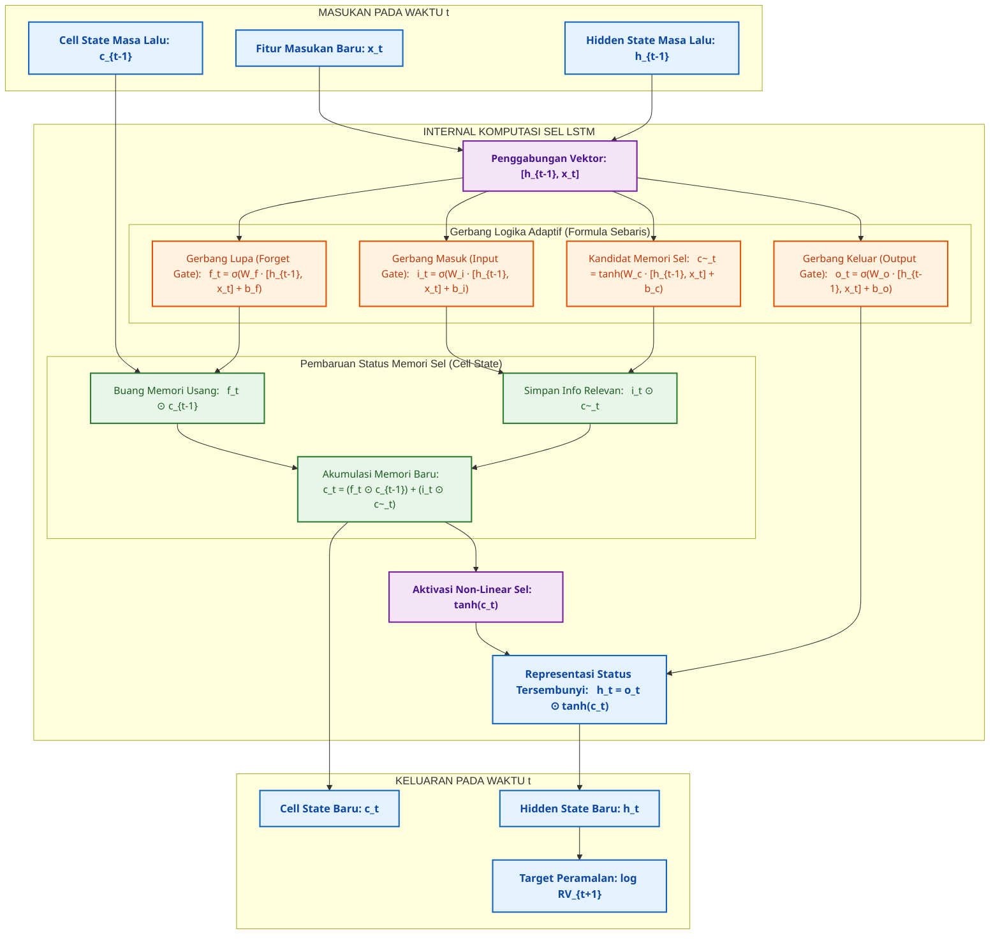

```mermaid
graph TD
    classDef default font-family:'Segoe UI',Helvetica,Arial,sans-serif,font-size:15px,color:#111,stroke-width:2px;
    classDef step1 fill:#FFEBEE,stroke:#C62828,color:#B71C1C,font-size:15px;
    classDef step2 fill:#E3F2FD,stroke:#1565C0,color:#0D47A1,font-size:15px;
    classDef step3 fill:#EDE7F6,stroke:#4527A0,color:#311B92,font-size:15px;
    classDef step4 fill:#FFF8E1,stroke:#F57F17,color:#E65100,font-size:15px;
    classDef step5 fill:#E8F5E9,stroke:#2E7D32,color:#1B5E20,font-size:15px;
    classDef step6 fill:#FCE4EC,stroke:#AD1457,color:#880E4F,font-size:16px,font-weight:bold;

    subgraph T1 ["1. IDENTIFIKASI MASALAH & CELAH RISET"]
        p1["Perdagangan Bitcoin 24/7 mencatat fluktuasi & risiko ekstrem"]:::step1
        p2["Prediksi tingkat harga gagal (sifat random walk, rasio sinyal rendah)"]:::step1
        p3["Model ekonometrika klasik terkendala asumsi kaku linearitas & parameter statis"]:::step1
        p4["Celah Riset: Penalaan hyperparameter rentan kebocoran temporal & metrik simetris bias"]:::step1
    end

    subgraph T2 ["2. DATA HISTORIS & REKAYASA FITUR (BINANCE VISION 2020–2026)"]
        d1["Data Mentah: 2.464 hari bar kline 1 jam BTC/USDT (1 Jan 2020 – 30 Sep 2026)"]:::step2
        d2["Target Terukur: Realized Variance harian (24 bar intra-day) → log RV_{t+1}"]:::step2
        d3["6 Fitur Kausal: log RV_t, log range_t, log volume_t, log absret_t, MA-5, dan MA-22"]:::step2
        d4["Partisi Kronologis: Pengembangan 2020–2023 | Validasi 2024–2025 | Uji Eksternal 2026"]:::step2
    end

    subgraph T3 ["3. PEMODELAN USULAN VS BASELINE PEMBANDING"]
        m1["MODEL USULAN: LSTM + HPO OPTUNA TPE (Arsitektur Vanilla, 50 Trial TPE, 5-Fold Purged CV, MedianPruner)"]:::step3
        b1["MODEL BASELINE PEMBANDING (Naif Persistence, HAR-RV Corsi OLS, GARCH(1,1) Expanding, LSTM Untuned)"]:::step4
    end

    subgraph T4 ["4. EVALUASI AKURASI & PENGUJIAN INFERENSI STATISTIK"]
        e1["Fungsi Kerugian Asimetris Utama: Quasi-Likelihood (QLIKE, Patton 2011) & Pelengkap MAE/RMSE"]:::step5
        e2["Uji Asimtotik Diebold-Mariano (Koreksi HAC Newey-West) & Moving-Block Bootstrap 10.000 Repetisi"]:::step5
    end

    subgraph T5 ["5. LUARAN ILMIAH & KESIMPULAN AKADEMIK"]
        c1["Menjawab Rumusan Masalah 1, 2, 3, 4 & Membuktikan Hipotesis H1, H2, H3 Bebas P-Hacking"]:::step6
    end

    T1 --> T2
    T2 --> T3
    T3 --> T4
    T4 --> T5
```

```mermaid
graph TD
    classDef default font-family:'Segoe UI',Helvetica,Arial,sans-serif,font-size:15px,color:#111,stroke-width:2px;
    classDef step1 fill:#E3F2FD,stroke:#1565C0,color:#0D47A1,font-size:15px;
    classDef step2 fill:#E8F5E9,stroke:#2E7D32,color:#1B5E20,font-size:15px;
    classDef step3 fill:#FFF3E0,stroke:#E65100,color:#BF360C,font-size:15px;
    classDef step4 fill:#EDE7F6,stroke:#4527A0,color:#311B92,font-size:15px;
    classDef step5 fill:#FCE4EC,stroke:#C2185B,color:#880E4F,font-size:15px;
    classDef step6 fill:#E0F2F1,stroke:#00796B,color:#004D40,font-size:15px;
    classDef step7 fill:#FFF8E1,stroke:#F57F17,color:#E65100,font-size:16px,font-weight:bold;

    subgraph S1 ["1. AKUISISI & AUDIT KUALITAS DATA HISTORIS (2020–2026)"]
        a1["Pengunduhan 81 Berkas Bulanan Bar Kline 1 Jam BTC/USDT dari Arsip Resmi Binance Vision"]:::step1
        a2["Audit Integritas Bar Harian UTC (Filter Amandemen: Eliminasi Cacat Maintenance < 20 Bar)"]:::step1
        a3["Penguncian Integritas Data Melalui Verifikasi Kriptografis Hash SHA-256 (2.464 Hari Final)"]:::step1
    end

    subgraph S2 ["2. REKAYASA FITUR KAUSAL & PEMBENTUKAN TARGET"]
        b1["Kalkulasi Realized Variance Harian (24 Bar Intraday) & Transformasi Target: log RV_{t+1}"]:::step2
        b2["Ekstraksi 6 Fitur Masukan Non-Lookahead: log RV_t, log range_t, log volume_t, log absret_t, MA-5, MA-22"]:::step2
        b3["Standarisasi Skala Fitur (StandardScaler) Spesifik Fold Tanpa Kebocoran Informasi Temporal"]:::step2
    end

    subgraph S3 ["3. PARTISI TEMPORAL KRONOLOGIS DATASET"]
        c1["Jendela Pengembangan (2020–2023 | 1.460 Hari): Ruang Uji Optimasi HPO Cross-Validation"]:::step3
        c2["Jendela Validasi Internal (2024–2025 | 731 Hari): Checkpoint Kalibrasi Baseline Tanpa Polusi HPO"]:::step3
        c3["Jendela Uji Eksternal (1 Jan – 30 Sep 2026 | 273 Hari): Evaluasi Out-of-Sample (status paparan di Bab IV)"]:::step3
    end

    subgraph S4 ["4. OPTIMASI HYPERPARAMETER LSTM BERBASIS OPTUNA"]
        d1["Pencarian Bayesian Tree-structured Parzen Estimator (TPE) Sebanyak 50 Trial Terarah"]:::step4
        d2["Validasi Silang Ketat: 5-Fold Purged Rolling-Origin Cross-Validation dengan Gap Lookback"]:::step4
        d3["Pemangkasan Trial Suboptimal Secara Otomatis Menggunakan Algoritma MedianPruner"]:::step4
    end

    subgraph S5 ["5. PELATIHAN MODEL FINAL & MODEL BASELINE PEMBANDING"]
        e1["Pelatihan Model Final Terpilih pada Train Pool (2020–2025) Menggunakan 5-Seed Ensemble"]:::step5
        e2["Implementasi 4 Baseline Pembanding: Naif Persistence, HAR-RV OLS, GARCH(1,1) Expanding, LSTM Untuned"]:::step5
    end

    subgraph S6 ["6. INFERENSI STATISTIK & PENGUJIAN HIPOTESIS OUT-OF-SAMPLE"]
        f1["Perhitungan Metrik Kerugian Asimetris QLIKE (Patton 2011) serta Pelengkap MAE dan RMSE"]:::step6
        f2["Uji Signifikansi Prediksi Diebold-Mariano Satu Sisi Berbantuan Estimator HAC Newey-West"]:::step6
        f3["Estimasi Interval Kepercayaan Empiris Menggunakan Moving-Block Bootstrap (10.000 Repetisi)"]:::step6
    end

    subgraph S7 ["7. KESIMPULAN AKADEMIK & REPRODUSIBILITAS RISET"]
        g1["Pengujian Hipotesis Penelitian H1, H2, H3 Serta Pelaporan Luaran Ilmiah Bebas P-Hacking"]:::step7
    end

    S1 --> S2
    S2 --> S3
    S3 --> S4
    S4 --> S5
    S5 --> S6
    S6 --> S7
```

# PANDUAN IMPORT DIAGRAM DRAW.IO (VERSI 100% SEBARIS & LEBAR LEGA)

> **STATUS: ARSIP / LEGACY — JANGAN DIPAKAI UNTUK GAMBAR FINAL.**
> Sejak 8 November 2026 seluruh gambar skripsi Study 2 dihasilkan ulang sebagai
> figur Matplotlib native (Times New Roman, 300 DPI) melalui
> `05_Source_Code/generators/generate_study2_figures.py`. Berkas Mermaid di bawah
> hanya disimpan sebagai jejak historis dan tidak lagi menjadi sumber gambar pada
> `figures/gambar_2_1_arsitektur_lstm.png`,
> `figures/gambar_2_2_kerangka_pemikiran.png`, dan
> `figures/gambar_3_1_alur_penelitian.png`.

File ini berisi kode Mermaid yang telah dirancang khusus agar:
- **TIDAK ADA TEKS ATAU RUMUS YANG MENUMPUK KE BAWAH**.
- Semua rumus (`f_t = σ(...)`, `c_t = ...`, dll.) **berdiri tegak dalam 1 baris utuh** menggunakan tag `min-width` dan `white-space:nowrap`.
- Kotak-kotak dibuat **lebar, lega, dan horizontal proporsional**.
- Saat di-import ke draw.io, setiap kotak berbentuk persegi panjang rapi dengan teks yang langsung terbaca lega dari kiri ke kanan.

---

## CARA MEMAKAI DI DRAW.IO:
1. Buka [draw.io](https://app.diagrams.net).
2. Buat diagram baru (*Blank Diagram*).
3. Klik tanda **+** pada toolbar atas -> pilih **Advanced** -> pilih **Mermaid**.
4. Hapus teks bawaan, lalu **Paste** salah satu kode di bawah.
5. Klik **Insert**.
6. Simpan / Ekspor:
   * Klik **File** -> **Export as** -> **PNG...**
   * Centang opsi *Transparent Background* (atau putih), DPI **300**.
   * Simpan file PNG tersebut ke folder: `03_Naskah_Skripsi/study2/figures/` sesuai nama file di bawah.

---

## 1. DIAGRAM GAMBAR 2.1: ARSITEKTUR DAN MEKANISME GERBANG SEL LSTM
* **Nama file ekspor PNG yang harus disimpan:**  
  `03_Naskah_Skripsi/study2/figures/gambar_2_1_arsitektur_lstm.png`
* **Penempatan di naskah:** Subbab 2.3.2 (Anatomi Mekanisme Gerbang Sel LSTM)

### Kode Mermaid draw.io:

---

## 2. DIAGRAM GAMBAR 2.2: KERANGKA PEMIKIRAN KONSEPTUAL PENELITIAN
* **Nama file ekspor PNG yang harus disimpan:**  
  `03_Naskah_Skripsi/study2/figures/gambar_2_2_kerangka_pemikiran.png`
* **Penempatan di naskah:** Subbab 2.8 (Kerangka Pemikiran)

### Kode Mermaid draw.io:

---

## 3. DIAGRAM GAMBAR 3.1: ALUR TAHAPAN PENELITIAN DAN PIPELINE EKSPERIMEN
* **Nama file ekspor PNG yang harus disimpan:**  
  `03_Naskah_Skripsi/study2/figures/gambar_3_1_alur_penelitian.png`
* **Penempatan di naskah:** Subbab 3.10.3 (Tahapan Eksperimen dan Alur Komputasi)

### Kode Mermaid draw.io:

