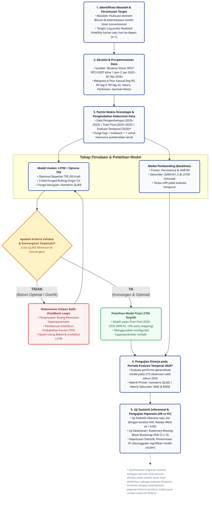

# PANDUAN KODE MERMAID UNTUK IMPORT KE DRAW.IO
**STUDY 2: PERAMALAN REALIZED VOLATILITY BITCOIN (LSTM + OPTUNA)**

Dokumen ini berisi kode Mermaid termutakhir (versi audit revisi 2026) untuk **Gambar 2.1, Gambar 2.2, dan Gambar 3.1** yang siap langsung di-*copy-paste* ke dalam [draw.io](https://app.diagrams.net).

---

## CARA MEMAKAI DI DRAW.IO (SANGAT MUDAH):
1. Buka situs [draw.io](https://app.diagrams.net) di browser kamu.
2. Buat diagram baru (*Create New Diagram* -> *Blank Diagram*).
3. Pada menu atas, klik tanda plus **`+`** (atau menu **Arrange**) -> pilih **Insert** -> pilih **Advanced** -> pilih **Mermaid**.
4. Hapus teks bawaan yang ada di kotak dialog, lalu **Paste** salah satu kode Mermaid di bawah.
5. Klik tombol **Insert**.
6. Diagram akan langsung terbentang rapi, kotak-kotaknya simetris, font terbaca jelas, dan bisa kamu edit sesuka hati (ubah warna, atur ukuran, ubah font, dll.).
7. **Untuk Simpan Gambar PNG Resolusi Tinggi:**
   * Klik menu **File** -> **Export as** -> **PNG...**
   * Pilih Zoom: **200%** atau **300%** (DPI tinggi agar sangat tajam di Word).
   * Centang opsi *Transparent Background* (atau biarkan putih).
   * Klik **Export** -> Simpan ke folder `03_Naskah_Skripsi/study2/figures/`.

---

## 1. GAMBAR 2.1: ARSITEKTUR DAN MEKANISME GERBANG SEL LSTM (LENGKAP SESUAI NASKAH)
* **File Target:** `03_Naskah_Skripsi/study2/figures/gambar_2_1_arsitektur_lstm.png`
* **Penempatan di naskah:** Bab II Sub-bab D.2 (Anatomi Mekanisme Gerbang Sel LSTM)

```mermaid
flowchart TD
    %% Styling Global
    classDef default font-family:'Segoe UI',Arial,sans-serif,font-size:12px;
    classDef blueBox fill:#F8FAFC,stroke:#1E3A8A,stroke-width:2px,color:#0F172A,rx:6px,ry:6px;
    classDef greenBox fill:#F0FDF4,stroke:#15803D,stroke-width:2px,color:#14532D,rx:6px,ry:6px;
    classDef cyanBox fill:#EFF6FF,stroke:#2563EB,stroke-width:2px,color:#1E3A8A,rx:6px,ry:6px;
    
    classDef forgetBox fill:#FEF2F2,stroke:#DC2626,stroke-width:2px,color:#7F1D1D,rx:8px,ry:8px;
    classDef inputBox fill:#FFFBEB,stroke:#D97706,stroke-width:2px,color:#78350F,rx:8px,ry:8px;
    classDef candBox fill:#ECFDF5,stroke:#0D9488,stroke-width:2px,color:#134E4A,rx:8px,ry:8px;
    classDef outBox fill:#FAF5FF,stroke:#7C3AED,stroke-width:2px,color:#4C1D95,rx:8px,ry:8px;
    
    classDef opNode fill:#FFFFFF,stroke:#831843,stroke-width:2px,color:#831843,font-size:15px,font-weight:bold;
    classDef opAdd fill:#FFFFFF,stroke:#1E3A8A,stroke-width:2px,color:#1E3A8A,font-size:16px,font-weight:bold;
    classDef actNode fill:#F0FDF4,stroke:#16A34A,stroke-width:2px,color:#15803D,font-size:14px,font-weight:bold,rx:8px,ry:8px;
    classDef concatBox fill:#EFF6FF,stroke:#2563EB,stroke-width:2px,color:#1E3A8A,rx:6px,ry:6px;
    classDef denseBox fill:#FFFFFF,stroke:#1E3A8A,stroke-width:2px,color:#0F172A,rx:6px,ry:6px;
    classDef legend fill:none,stroke:none,color:#475569,font-size:11px;

    %% Subgraph Batas Internal LSTM
    subgraph Sel_LSTM ["<b>Batas Internal Komputasi Sel LSTM (Langkah Waktu t)</b>"]
        
        %% Jalur Atas Cell State
        subgraph Top_Highway ["<b>Pembaruan Status Sel: &nbsp; c<sub>t</sub> = f<sub>t</sub> ⊙ c<sub>t-1</sub> + i<sub>t</sub> ⊙ c̃<sub>t</sub></b>"]
            mul_f(( "⊙" )):::opNode
            add_c(( "+" )):::opAdd
        end

        %% Operasi Input & Kandidat
        mul_i(( "⊙" )):::opNode

        %% 4 Gerbang Logika Utama
        subgraph Gates [" "]
            fg["<b>Gerbang Lupa (Forget)</b><br/><br/><b><font size='+2'>σ</font></b><br/><br/><i>f<sub>t</sub> = σ(W<sub>f</sub>[h<sub>t-1</sub>, x<sub>t</sub>] + b<sub>f</sub>)</i><br/><br/><small>(Persamaan 2.6)</small>"]:::forgetBox
            ig["<b>Gerbang Masuk (Input)</b><br/><br/><b><font size='+2'>σ</font></b><br/><br/><i>i<sub>t</sub> = σ(W<sub>i</sub>[h<sub>t-1</sub>, x<sub>t</sub>] + b<sub>i</sub>)</i><br/><br/><small>(Persamaan 2.7)</small>"]:::inputBox
            cg["<b>Kandidat Status Sel</b><br/><br/><b><font size='+1'>tanh</font></b><br/><br/><i>c̃<sub>t</sub> = tanh(W<sub>c</sub>[h<sub>t-1</sub>, x<sub>t</sub>] + b<sub>c</sub>)</i><br/><br/><small>(Persamaan 2.8)</small>"]:::candBox
            og["<b>Gerbang Keluar (Output)</b><br/><br/><b><font size='+2'>σ</font></b><br/><br/><i>o<sub>t</sub> = σ(W<sub>o</sub>[h<sub>t-1</sub>, x<sub>t</sub>] + b<sub>o</sub>)</i><br/><br/><small>(Persamaan 2.10)</small>"]:::outBox
        end

        %% Konkatenasi Bawah
        concat["<b>Konkatenasi</b><br/>[h<sub>t-1</sub>, x<sub>t</sub>]<br/><small>Penggabungan Vektor</small>"]:::concatBox

        %% Modulasi Output & Hidden State
        act_tanh["<b>tanh</b>"]:::actNode
        mul_o(( "⊙" )):::opNode

        %% Lapisan Dense Luaran
        dense["<b>Lapisan Luaran Linier (Dense Layer / Proyeksi Regresi Volatilitas)</b><br/><i>ŷ<sub>t+1</sub> = log RV<sub>t+1</sub> = W<sub>y</sub> · h<sub>t</sub> + b<sub>y</sub></i>"]:::denseBox
    end

    %% Masukan Luar (Sisi Kiri)
    ct_prev["<b>Status Sel Masa Lalu</b><br/><i>c<sub>t-1</sub></i>"]:::blueBox
    ht_prev["<b>Status Tersembunyi Lalu</b><br/><i>h<sub>t-1</sub></i>"]:::greenBox
    xt_in["<b>Fitur Masukan Baru</b><br/><i>x<sub>t</sub> ∈ ℝ<sup>6</sup></i><br/><small>(6 fitur kausal)</small>"]:::cyanBox

    %% Keluaran Luar (Sisi Kanan)
    ct_next["<b>Status Sel Baru</b><br/><i>c<sub>t</sub></i>"]:::blueBox
    ht_next["<b>Status Tersembunyi</b><br/><i>h<sub>t</sub></i>"]:::greenBox

    %% Catatan Kaki / Notasi
    note["Notasi Matematis: σ = fungsi aktivasi sigmoid [0, 1]; tanh = tangen hiperbolik [−1, 1]; ⊙ = perkalian elemen (Hadamard product); + = penjumlahan vektor; [h<sub>t-1</sub>, x<sub>t</sub>] = konkatenasi vektor."]:::legend

    %% Aliran Masukan ke Sel
    ct_prev --> mul_f
    ht_prev --> concat
    xt_in --> concat

    %% Aliran Bus Konkatenasi ke 4 Gerbang
    concat --> fg
    concat --> ig
    concat --> cg
    concat --> og

    %% Aliran Gerbang Lupa ke Jalur Atas
    fg -->| "f<sub>t</sub>" | mul_f
    mul_f --> add_c

    %% Aliran Gerbang Masuk & Kandidat
    ig -->| "i<sub>t</sub>" | mul_i
    cg -->| "c̃<sub>t</sub>" | mul_i
    mul_i -->| "i<sub>t</sub> ⊙ c̃<sub>t</sub>" | add_c

    %% Aliran Jalur Cell State ke Luaran & Modulasi
    add_c -->| "c<sub>t</sub>" | ct_next
    add_c -->| "c<sub>t</sub>" | act_tanh

    %% Aliran Output Gate & Hidden State
    act_tanh --> mul_o
    og -->| "o<sub>t</sub>" | mul_o

    %% Aliran Hidden State ke Luar & Dense Layer
    mul_o -->| "h<sub>t</sub>" | ht_next
    mul_o -->| "h<sub>t</sub>" | dense
```

---

## 2. GAMBAR 2.2: KERANGKA PEMIKIRAN PENELITIAN (DENGAN DECISION DIAMOND & FEEDBACK LOOP)
* **File Target:** `03_Naskah_Skripsi/study2/figures/gambar_2_2_kerangka_pemikiran.png`
* **Penempatan Naskah:** Bab II Sub-bab H (Kerangka Pemikiran)




---

## 3. GAMBAR 3.1: ALUR TAHAPAN PENELITIAN KOMPUTASIONAL (8 TAHAP LENGKAP)
* **File Target:** `03_Naskah_Skripsi/study2/figures/gambar_3_1_alur_penelitian.png`
* **Penempatan Naskah:** Bab III Sub-bab J.3 (Tahapan Eksperimen dan Alur Komputasi)

```mermaid
flowchart TD
    classDef default fill:#F4F7FA,stroke:#1F4E79,stroke-width:2px,color:#0F243E,font-family:'Segoe UI',Helvetica,Arial,sans-serif,font-size:13px;
    classDef note fill:none,stroke:none,color:#555555,font-family:'Segoe UI',Helvetica,Arial,sans-serif,font-size:11px,text-align:left;

    S1["<b>1. Akuisisi data</b><br/>Binance Vision BTC/USDT, kline 1 jam<br/>1 Jan 2020–30 Sep 2026"]
    S2["<b>2. Audit dan prapemrosesan</b><br/>Validasi timestamp, OHLCV, duplikasi, celah<br/>Hari 20–23 bar dipertahankan; &lt;20 bar dikeluarkan"]
    S3["<b>3. Target dan fitur kausal</b><br/>Agregasi UTC; proksi RV = jumlah kuadrat return<br/>open-to-close per bar 1 jam; fitur hari t &rarr; target t+1"]
    S4["<b>4. Partisi waktu</b><br/>Development 2020–2023 &rarr; CV/HPO<br/>Train Pool 2020–2025 &rarr; final fit/early stopping<br/>Evaluasi temporal 2026*"]
    S5["<b>5. Optimasi LSTM</b><br/>Optuna TPE, 50 trials; 5-fold purged rolling-origin CV<br/>Kode: gap = lookback + 1; protokol: gap = lookback**<br/>Scaler di-fit pada data pelatihan tiap fold"]
    S6["<b>6. Pelatihan final dan baseline</b><br/>Final LSTM: 90% fit; 10% early stopping; tanpa refit<br/>Persistence, HAR-RV; GARCH(1,1), LSTM untuned sekunder"]
    S7["<b>7. Evaluasi dan inferensi</b><br/>QLIKE primer; MAE/RMSE sekunder<br/>DM primer vs Persistence dan HAR-RV<br/>Bootstrap: batas atas CI 95% &lt; 0 wajib untuk kedua pembanding"]
    S8["<b>8. Pelaporan</b><br/>Laporkan QLIKE, selisih, p-value, CI, dan keterbatasan<br/>2026 bukan holdout eksternal yang sepenuhnya independen"]

    FN["* Sebagian periode 2026 pernah ditinjau; interpretasi dibatasi sebagai evaluasi temporal.<br/>** Deviasi implementasi terhadap protokol terkunci; jangan disajikan sebagai prosedur yang sama."]:::note

    S1 --> S2
    S2 --> S3
    S3 --> S4
    S4 --> S5
    S5 --> S6
    S6 --> S7
    S7 --> S8
    S8 -.-> FN
```


