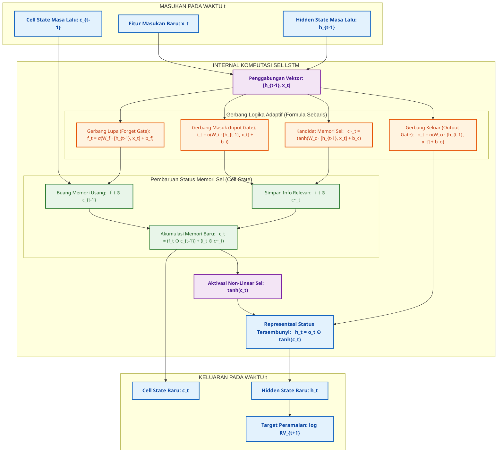
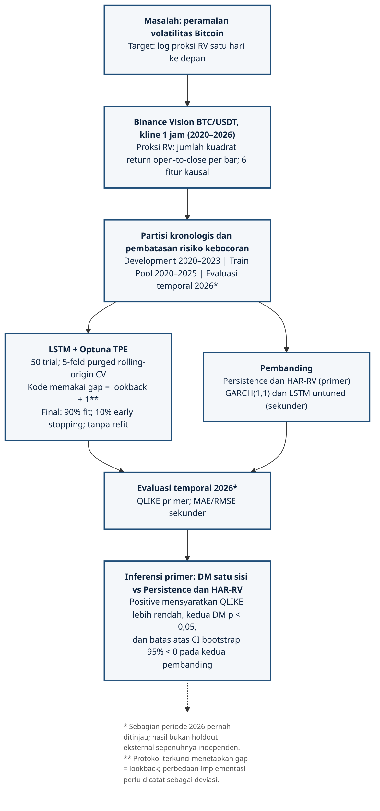

# PANDUAN KODE MERMAID UNTUK IMPORT KE DRAW.IO
**STUDY 2: PERAMALAN REALIZED VOLATILITY BITCOIN (LSTM + OPTUNA)**

Dokumen ini berisi kode Mermaid termutakhir (versi audit revisi 2026) untuk **Gambar 2.1, Gambar 2.2, dan Gambar 3.1** yang siap langsung di-*copy-paste* ke dalam [draw.io](https://app.diagrams.net).

---

## CARA MEMAKAI DI DRAW.IO (SANGAT MUDAH):
1. Buka situs [draw.io](https://app.diagrams.net) di browser kamu.
2. Buat diagram baru (*Create New Diagram* -> *Blank Diagram*).
3. Pada menu atas, klik tanda plus **`+`** (atau menu **Arrange**) -> pilih **Insert** -> pilih **Advanced** -> pilih **Mermaid**.
4. Hapus teks bawaan yang ada di kotak dialog, lalu **Paste** salah satu kode Mermaid di bawah.
5. Klik tombol **Insert**.
6. Diagram akan langsung terbentang rapi, kotak-kotaknya simetris, font terbaca jelas, dan bisa kamu edit sesuka hati (ubah warna, atur ukuran, ubah font, dll.).
7. **Untuk Simpan Gambar PNG Resolusi Tinggi:**
   * Klik menu **File** -> **Export as** -> **PNG...**
   * Pilih Zoom: **200%** atau **300%** (DPI tinggi agar sangat tajam di Word).
   * Centang opsi *Transparent Background* (atau biarkan putih).
   * Klik **Export** -> Simpan ke folder `03_Naskah_Skripsi/study2/figures/`.

---

## 1. GAMBAR 2.1: ARSITEKTUR DAN MEKANISME GERBANG SEL LSTM
* **File Target:** `03_Naskah_Skripsi/study2/figures/gambar_2_1_arsitektur_lstm.png`
* **Penempatan Naskah:** Bab II Sub-bab D.2 (Anatomi Mekanisme Gerbang Sel LSTM)

---

## 2. GAMBAR 2.2: KERANGKA PEMIKIRAN PENELITIAN (VERSI AUDIT TERKINI)
* **File Target:** `03_Naskah_Skripsi/study2/figures/gambar_2_2_kerangka_pemikiran.png`
* **Penempatan Naskah:** Bab II Sub-bab H (Kerangka Pemikiran)

---

## 3. GAMBAR 3.1: ALUR TAHAPAN PENELITIAN KOMPUTASIONAL (8 TAHAP LENGKAP)
* **File Target:** `03_Naskah_Skripsi/study2/figures/gambar_3_1_alur_penelitian.png`
* **Penempatan Naskah:** Bab III Sub-bab J.3 (Tahapan Eksperimen dan Alur Komputasi)

```mermaid
flowchart TD
    classDef default fill:#F4F7FA,stroke:#1F4E79,stroke-width:2px,color:#0F243E,font-family:'Segoe UI',Helvetica,Arial,sans-serif,font-size:13px;
    classDef note fill:none,stroke:none,color:#555555,font-family:'Segoe UI',Helvetica,Arial,sans-serif,font-size:11px,text-align:left;

    S1["<b>1. Akuisisi data</b><br/>Binance Vision BTC/USDT, kline 1 jam<br/>1 Jan 2020–30 Sep 2026"]
    S2["<b>2. Audit dan prapemrosesan</b><br/>Validasi timestamp, OHLCV, duplikasi, celah<br/>Hari 20–23 bar dipertahankan; &lt;20 bar dikeluarkan"]
    S3["<b>3. Target dan fitur kausal</b><br/>Agregasi UTC; proksi RV = jumlah kuadrat return<br/>open-to-close per bar 1 jam; fitur hari t &rarr; target t+1"]
    S4["<b>4. Partisi waktu</b><br/>Development 2020–2023 &rarr; CV/HPO<br/>Train Pool 2020–2025 &rarr; final fit/early stopping<br/>Evaluasi temporal 2026*"]
    S5["<b>5. Optimasi LSTM</b><br/>Optuna TPE, 50 trials; 5-fold purged rolling-origin CV<br/>Kode: gap = lookback + 1; protokol: gap = lookback**<br/>Scaler di-fit pada data pelatihan tiap fold"]
    S6["<b>6. Pelatihan final dan baseline</b><br/>Final LSTM: 90% fit; 10% early stopping; tanpa refit<br/>Persistence, HAR-RV; GARCH(1,1), LSTM untuned sekunder"]
    S7["<b>7. Evaluasi dan inferensi</b><br/>QLIKE primer; MAE/RMSE sekunder<br/>DM primer vs Persistence dan HAR-RV<br/>Bootstrap: batas atas CI 95% &lt; 0 wajib untuk kedua pembanding"]
    S8["<b>8. Pelaporan</b><br/>Laporkan QLIKE, selisih, p-value, CI, dan keterbatasan<br/>2026 bukan holdout eksternal yang sepenuhnya independen"]

    FN["* Sebagian periode 2026 pernah ditinjau; interpretasi dibatasi sebagai evaluasi temporal.<br/>** Deviasi implementasi terhadap protokol terkunci; jangan disajikan sebagai prosedur yang sama."]:::note

    S1 --> S2
    S2 --> S3
    S3 --> S4
    S4 --> S5
    S5 --> S6
    S6 --> S7
    S7 --> S8
    S8 -.-> FN
```

