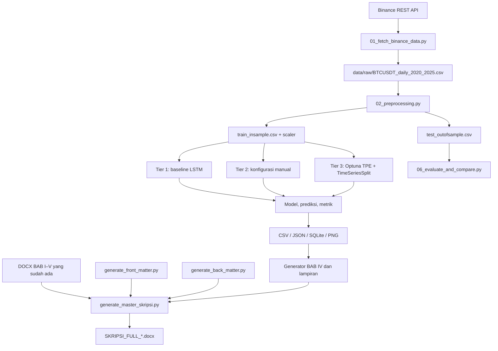

# Laporan X-Ray Repository `jurnal`

**Mode:** `/scan` + static dissection terpilih  
**Bahan:** arsip `jurnal(1).zip`  
**Metode:** inventaris arsip, pembacaan source dan konfigurasi, parsing AST Python, pemeriksaan CSV/JSON, query SQLite read-only, ekstraksi struktur teks DOCX, serta inspeksi teks halaman awal PDF. **Kode proyek tidak dieksekusi**, model tidak dilatih ulang, dan eksperimen tidak dijalankan.

## 1. Project fingerprint

### Tujuan proyek

**FAKTA:** Paket ini adalah proyek penelitian/skripsi dengan topik **optimasi hyperparameter Long Short-Term Memory (LSTM) menggunakan Optuna untuk memprediksi harga Bitcoin**. Repository menggabungkan empat hal: naskah akademik, referensi ilmiah, pipeline data/model, serta pembuat dan pemeriksa dokumen Word.

**Bukan:** aplikasi web siap deploy. Tidak ditemukan entry point aplikasi server seperti `app.py`, konfigurasi deployment, atau struktur aplikasi web. Ada PDF referensi yang menyebut Streamlit pada nama file, tetapi itu bukan bukti bahwa repo ini sendiri adalah aplikasi Streamlit.

### Stack yang dibuktikan dari source

| Area | Teknologi | Peran yang terlihat |
|---|---|---|
| Bahasa utama | Python | eksperimen, pemrosesan data, generator dokumen, verifier |
| Data | pandas, NumPy | CSV, transformasi dan array untuk model |
| Machine learning | TensorFlow/Keras | model LSTM, Dense/Dropout, optimizer Adam, EarlyStopping/ModelCheckpoint |
| Optimasi | Optuna | TPE sampler, MedianPruner, study persisten di SQLite |
| Validasi/metrik | scikit-learn | `MinMaxScaler`, `TimeSeriesSplit`, metrik evaluasi |
| Pengambilan data | `requests`/HTTP ke Binance REST API | mengambil data pasar historis |
| Visualisasi | matplotlib | grafik prediksi, perbandingan metrik, konvergensi |
| Penyimpanan objek | joblib | scaler tersimpan |
| Dokumen | `python-docx`, `docxcompose` | menghasilkan dan menggabungkan DOCX |
| Penyimpanan eksperimen | SQLite + CSV/JSON | trial Optuna, prediksi, konfigurasi, metrik |

**Batas versi:** database Optuna mempunyai metadata `library_version = 5.0.0`. Namun, tidak ada `requirements.txt`, `pyproject.toml`, lockfile, atau file environment yang dapat memastikan semua versi dependency untuk mereproduksi eksperimen. Versi runtime TensorFlow aktual tidak dipastikan hanya dari artefak yang ada. Versi yang tertulis di README adalah klaim dokumen, bukan environment yang terkunci.

### Entry point

1. **Pipeline eksperimen:** `05_Source_Code/model_experiment/run_pipeline.py`, atau jalankan per tahap melalui `01_fetch_binance_data.py` hingga `06_evaluate_and_compare.py`.
2. **Generator skripsi penuh:** `05_Source_Code/generators/generate_master_skripsi.py`. Skrip ini memperbarui front matter dan back matter, kemudian menggabungkan lima file bab yang sudah ada; ia tidak membuat ulang seluruh BAB I–V dari source generator masing-masing.
3. **Generator bab satuan:** `generate_bab1.py` sampai `generate_bab5.py`, disertai generator proposal/front matter/back matter dan skrip verifier.

### Konfigurasi dan kualitas repository

- Tidak ditemukan `requirements.txt`, `pyproject.toml`, `environment.yml`, `setup.py`, Dockerfile, CI workflow, test suite terstruktur, `.gitignore`, atau `LICENSE`.
- Banyak file memakai path absolut Windows `D:\OneDrive\Desktop\jurnal`; ini mengikat skrip ke lokasi mesin tertentu.
- Seluruh 22 file `.py` berhasil diparse dengan Python AST secara statis. Ini **bukan** bukti bahwa dependency tersedia atau runtime/build/eksperimen berhasil.
- Ada artefak biner/generated (`.keras`, `.joblib`, `.db`, `.pyc`, gambar) yang tidak dibedah sebagai source baris per baris.

## 2. Annotated tree

```text
jurnal/
├── README.md                                      # ringkasan dan petunjuk proyek
├── LAPORAN_LENGKAP_EKSEKUTIF_DAN_PANDUAN_SIDANG.md # ringkasan klaim dan materi sidang
├── 01_Panduan_Kampus/                             # panduan/format institusi (DOCX)
├── 02_Pengajuan_Judul/                             # proposal penelitian (DOCX)
├── 03_Naskah_Skripsi/                              # BAB I–V, naskah gabungan, contoh/draft lama
│   └── contoh/                                    # dokumen contoh/versi lama; jangan anggap sumber aktif
├── 04_Referensi_Ilmiah/
│   ├── DAFTAR_32_REFERENSI_SKRIPSI.md              # katalog pustaka
│   ├── Referensi_Utama/                            # PDF utama
│   └── Referensi_Tambahan/                         # PDF latar teori/metode tambahan
└── 05_Source_Code/
    ├── data/
    │   ├── raw/BTCUSDT_daily_2020_2025.csv          # data OHLCV mentah
    │   └── processed/                              # train/test, metadata, scaler
    ├── model_experiment/
    │   ├── 01_fetch_binance_data.py                # pengambilan data
    │   ├── 02_preprocessing.py                     # pemisahan, scaling, sequence
    │   ├── 03_train_baseline_tier1.py               # model baseline
    │   ├── 04_train_manual_tier2.py                  # konfigurasi manual
    │   ├── 05_optimize_optuna_tier3.py               # optimasi TPE + validasi time-series
    │   ├── 06_evaluate_and_compare.py                # metrik/tabel/gambar
    │   ├── data_utils.py                            # utilitas data bersama
    │   └── run_pipeline.py                          # orchestrator pipeline
    ├── models/                                     # model .keras tier 1–3 [biner]
    ├── results/
    │   ├── metrics/                                # JSON metrik tiap tier
    │   ├── figures/                                # tiga gambar evaluasi
    │   ├── predictions_tier*.csv                   # prediksi out-of-sample
    │   ├── optuna_study.db                          # database study Optuna
    │   └── optuna_trials_history.csv                # riwayat trial
    ├── generators/                                 # generator proposal/naskah/lampiran & verifier
    ├── front_matter.docx                            # hasil generate bagian awal
    ├── back_matter.docx                             # hasil generate pustaka/lampiran
    └── extracted_logo/                              # aset gambar yang diekstrak
```

**Komposisi arsip yang terukur:** 122 entri ZIP, 98 file. Ekstensi file: 31 PDF, 22 Python, 14 DOCX, 8 CSV, 6 PNG, 5 JSON, 3 Markdown, 3 PYC, 3 Keras model, 1 JPEG, 1 database SQLite, dan 1 JOBLIB. Jumlah baris source Python sekitar 5.993 LOC (generator 14 file sekitar 4.685 LOC; eksperimen 8 file sekitar 1.308 LOC). Ini hitungan fisik arsip, bukan ukuran kompleksitas atau bukti seluruh konten telah dibaca baris demi baris.

## 3. Peta arsitektur dan alur data



Diagram ini merangkum alur yang terlihat pada struktur file dan kode. Detail pemanggilan tidak selalu otomatis: sebagian generator perlu dijalankan terpisah, dan generator master menggabungkan file bab yang sudah tersimpan.

### Modul eksperimen

| File | Tanggung jawab | Catatan penting |
|---|---|---|
| `01_fetch_binance_data.py` | mengambil data BTCUSDT harian | exception/status HTTP yang gagal dapat menyebabkan loop berhenti, lalu data parsial berpotensi tetap diproses/disimpan; perlu validasi rentang data yang tegas |
| `02_preprocessing.py` | membuat split temporal dan scaler | scaler disesuaikan pada keseluruhan set in-sample sebelum CV Tier 3; menyebabkan kebocoran statistik lintas fold di dalam CV |
| `03_train_baseline_tier1.py` | melatih baseline LSTM | memakai konfigurasi baseline yang disimpan dalam source dan menghasilkan model/metrik/prediksi |
| `04_train_manual_tier2.py` | melatih konfigurasi manual | performa artefak lebih rendah daripada Tier 1 dan Tier 3 pada test yang disimpan, tetapi itu tidak membuktikan penyebabnya |
| `05_optimize_optuna_tier3.py` | mencari hyperparameter melalui Optuna | search space yang terlihat: lookback 7–120, units 32–256, dropout 0,10–0,50, LR 1e-4–1e-2, batch 16/32/64, layers 1–3; `TimeSeriesSplit` 5-fold; trial memberi report setelah tiap fold |
| `06_evaluate_and_compare.py` | menghitung metrik dan menghasilkan tabel/grafik | hasilnya cocok secara numerik dengan CSV prediksi yang tersedia, dalam ketelitian pembulatan JSON |
| `data_utils.py` | fungsi bantu data/sequence/metric | dipakai bersama alur eksperimen |
| `run_pipeline.py` | menjalankan stage melalui subprocess | argumen `--trials` tidak diteruskan ke skrip Optuna; `check=True` membuat cabang pemeriksaan `returncode` sesudahnya tidak tercapai saat error |

### Generator dokumen

| File/kelompok | Fungsi | Hal yang perlu diperhatikan |
|---|---|---|
| `generate_bab1.py`–`generate_bab5.py` | menyusun isi bab per bab | banyak memakai path absolut Windows; isi sumber generator dan DOCX yang sudah ada dapat berbeda |
| `generate_front_matter.py` | membuat halaman awal/daftar isi atau daftar gambar statis | konten daftar/gambar bisa ketinggalan dari bab aktual |
| `generate_back_matter.py` | daftar pustaka dan lampiran, termasuk tabel trial | bagian penandaan trial terbaik di-hardcode dan tak cocok dengan riwayat Optuna saat ini |
| `generate_master_skripsi.py` | menggabungkan DOCX menjadi skripsi penuh | tidak menjalankan generator tiap bab, hanya front matter/back matter lalu merge DOCX per bab yang sudah ada |
| `create_proposal.py` | menghasilkan proposal DOCX | membuka file template dengan path relatif yang tidak cocok jika dijalankan dari root repository |
| `verify_bab*.py`, `verify_full_skripsi.py` | pemeriksaan dokumen | verifier melakukan pemeriksaan heuristik/marker; bukan audit metodologi, sumber pustaka, atau konsistensi angka |
| `download_references.py` | mengunduh PDF referensi | menonaktifkan verifikasi sertifikat TLS dan melakukan pekerjaan saat import/top-level; output folder juga tak cocok dengan struktur referensi repo. Jangan dieksekusi apa adanya |

## 4. Data dan hasil eksperimen yang dapat diverifikasi

### Dataset

- CSV mentah: **2.192 baris × 8 kolom**, dari 1 Januari 2020 sampai 31 Desember 2025.
- Tidak ditemukan nilai kosong, tanggal duplikat, celah tanggal harian, atau pelanggaran geometri OHLC pada pemeriksaan yang dijalankan.
- Split berurutan: **1.753 baris train/in-sample** sampai 18 Oktober 2024; **439 baris test/out-of-sample** mulai 19 Oktober 2024 sampai 31 Desember 2025.
- Input model yang digunakan adalah `close`; kolom OHLCV lainnya tidak menjadi fitur input model menurut source yang diperiksa.
- Scaler fit menggunakan train/in-sample, dengan min close 4.800 dan max 73.072,41. Harga test yang melampaui maksimum train dapat ditransformasikan menjadi nilai skala di atas 1. Itu wajar saat distribusi test bergeser; tidak otomatis berarti data test bocor ke proses fit scaler utama.

### Metrik yang tersimpan

| Tier | Konfigurasi ringkas dalam JSON metrik | RMSE | MAE | MAPE |
|---|---|---:|---:|---:|
| Tier 1 | lookback 30, units 50, dropout 0,2, LR 0,001, batch 32, 1 layer | 2.947,60 | 2.378,56 | 2,36% |
| Tier 2 | lookback 60, units 128, dropout 0,2, LR 0,001, batch 10, 1 layer | 3.904,15 | 3.182,86 | 3,16% |
| Tier 3 | lookback 14, units 80, dropout 0,1, LR 0,001, batch 32, 1 layer | 2.525,38 | 1.929,60 | 2,00% |

Prediksi per tier memiliki 439 baris dan tanggalnya selaras dengan data test. Metrik dihitung ulang dari CSV prediksi cocok dengan nilai JSON pada presisi pembulatan yang sama.

**Interpretasi yang aman:** pada artefak test yang disediakan, konfigurasi Tier 3 mempunyai error terendah dibanding dua konfigurasi Tier 1/Tier 2 itu. Improvement yang dihitung dalam laporan sekitar: terhadap Tier 1, RMSE 14,32%, MAE 18,88%, MAPE 15,25%; terhadap Tier 2, RMSE 35,32%, MAE 39,38%, MAPE 36,71%.

**Yang belum bisa diklaim:** bahwa Optuna secara umum selalu lebih baik daripada metode optimasi lain, atau bahwa parameter tertentu pasti menyebabkan peningkatan secara kausal. Belum terlihat baseline persistence (prediksi harga esok = harga hari ini), pengujian banyak seed, interval ketidakpastian, eksperimen sensitivitas, atau replikasi di beberapa rentang test.

## 5. Temuan prioritas

### P1 — Tinggi: hasil Tier 3 tidak punya provenance yang konsisten

**Bukti:** `05_Source_Code/results/metrics/metrics_tier3.json` menyimpan konfigurasi terbaik lookback 14 / units 80 / dropout 0,1 / LR 0,001 / batch 32 dan metrik test. Namun, `results/optuna_trials_history.csv` serta SQLite `optuna_study.db` berisi 50 trial dan best COMPLETE trial adalah **trial 47**, dengan nilai CV sekitar **0,0007152** dan konfigurasi lookback **105**, units **219**, dropout **0,25**, LR sekitar **0,005637**, batch **16**, layer 1. Tidak ada trial yang cocok dengan konfigurasi utama yang tertulis di JSON Tier 3.

**Bukti tambahan:** `generators/generate_back_matter.py:323–335` menandai trial nomor 44 atau konfigurasi lookback 14 / units 80 / dropout 0,1 sebagai “best”. Pada CSV saat ini, trial 44 tidak cocok dengan konfigurasi itu; tidak ada bukti bahwa penandaan tersebut berasal dari hasil aktual study saat ini.

**Dampak:** hasil model tersimpan secara numerik konsisten dengan prediksi, tetapi jejak yang menghubungkan metrik dan hyperparameter Tier 3 dengan study Optuna yang tersedia tidak konsisten. Penyebab pastinya belum terbukti; kandidatnya adalah artefak dari run/versi berbeda atau perubahan manual.

**Saran:** buat run bersih dengan ID study/database baru dan folder output unik; simpan konfigurasi terbaik langsung dari objek `study.best_trial`, simpan `best_trial_number`, parameter lengkap, hash data/source, seed dan versi library ke JSON; regenerasi model, prediksi, metrik, grafik, tabel lampiran, dan narasi dari satu sumber hasil yang sama.

### P1 — Tinggi: CV memakai scaler yang fit pada seluruh rentang in-sample

**Bukti:** preprocessing membuat scaler pada seluruh train/in-sample; `05_optimize_optuna_tier3.py:81–91, 123–126` membentuk sequence dari data yang sudah ditransformasikan penuh lalu melakukan `TimeSeriesSplit`.

**Dampak:** walau holdout test tetap terpisah dari fit scaler utama, nilai ekstrem dari periode yang menjadi validasi fold yang lebih awal dapat memengaruhi rentang scaler yang digunakan fold tersebut. Ini merupakan **kebocoran statistik di dalam validasi silang**, sehingga skor CV dapat terlalu optimistis atau tidak sepenuhnya merepresentasikan prosedur time-series yang benar.

**Saran:** fit scaler baru pada bagian training tiap fold; transform bagian train dan validation fold dengan scaler itu; bentuk window/sequence tanpa melewati batas waktu fold. Tetap simpan holdout terakhir yang tidak disentuh sampai evaluasi akhir.

### P1 — Tinggi: sumber PDF referensi beberapa tidak sesuai nama

Dari pembacaan teks halaman awal PDF, ditemukan ketidakcocokan mencolok:

- `Referensi_Tambahan/Bouthillier_2020_Survey_Machine_Learning_Evaluation.pdf` terbuka dengan judul simulasi fisika “First fully kinetic three-dimensional simulation of the AWAKE baseline scenario”.
- `Referensi_Tambahan/Feurer_2019_Hyperparameter_Optimization_Book_Chapter.pdf` terbuka dengan judul tentang “Responsive Safety in Reinforcement Learning by PID Lagrangian Methods”.
- `Referensi_Tambahan/Gu_2020_Empirical_Asset_Pricing_via_Machine_Learning.pdf` berisi karya matematika berbahasa Prancis tentang paket Arthur untuk Sp(2n,R).
- `Referensi_Tambahan/Makridakis_2018_M4_Competition_Results_and_Findings.pdf` terbuka dengan studi prevalensi asma.
- `Referensi_Utama/Research on Machine Learning High-Frequency Trading Strategy of Cryptocurrency Based on Transaction Cost-Aware Filtering.pdf` memiliki judul halaman awal berbeda: “From Predictability to Tradability: Machine-Learning Signals and Trading Frictions in Cryptocurrency Markets”. Topiknya terkait, tetapi bukan judul file yang dicantumkan.
- `Referensi_Utama/Intraday trading strategy selection under transaction costs with machine learning.pdf` menampilkan DOI `10.3389/fams.2026.1888767`, sementara generator daftar pustaka menulis DOI `10.3389/fams.2024.1300000`.

**Dampak:** kutipan bisa salah mengidentifikasi karya, sehingga validitas tinjauan pustaka dan daftar pustaka berisiko. Pemeriksaan ini berbasis halaman awal/metadata, belum merupakan verifikasi bibliografis penuh untuk semua PDF.

**Saran:** cocokkan judul, penulis, tahun, DOI, venue, dan URL tiap referensi terhadap halaman penerbit/Crossref; hapus atau ganti PDF salah; buat manifest satu baris per sumber yang dipakai dan cek otomatis kesesuaian antara manifest, file, kutipan, dan daftar pustaka.

### P2 — Sedang: narasi pruning tidak presisi

**Bukti:** `05_optimize_optuna_tier3.py:95–113` menjalankan maksimal 10 epoch pada tiap fold dengan EarlyStopping, tetapi `trial.report(val_loss, step=fold)` dipanggil setelah hasil fold tersedia, bukan setiap epoch.

**Dampak:** klaim README/naskah yang menyebut `MedianPruner` membandingkan trial pada setiap epoch tidak sesuai implementasi. Pruning di sini dilaporkan pada level fold.

**Saran:** samakan narasi dengan implementasi atau ubah kode jika memang ingin pruning berdasarkan epoch. Jelaskan juga fungsi CV dan skema pruning secara eksplisit.

### P2 — Sedang: generator skripsi dapat menggabungkan bab lama

**Bukti:** `generate_master_skripsi.py:25–40, 51–66` menjalankan generator front/back matter dan menggabungkan DOCX BAB I–V yang sudah ada. Ia tidak memanggil `generate_bab1.py`–`generate_bab5.py`.

**Dampak:** hasil akhir dapat berisi bab yang sudah tidak sesuai dengan source generator terbaru. Hanya meregenerasi master tidak menjamin seluruh bab diperbarui.

**Saran:** buat satu orchestrator deterministik yang menjalankan setiap generator bab sesuai urutan sebelum assembly, lalu verifikasi hasilnya. Alternatifnya, ubah teks log agar tidak menyatakan semua komponen diregenerasi.

### P2 — Sedang: daftar/caption gambar naskah tidak sinkron

**Bukti:** output evaluasi menamai gambar sebagai 4.1 prediksi, 4.2 perbandingan metrik, 4.3 konvergensi. `generate_bab4.py` menampilkan file-file itu dengan nomor caption dalam urutan berbeda. Daftar gambar statis pada dokumen master menyebut Gambar 4.3 sebagai distribusi residual, sementara folder hasil saat ini hanya memiliki tiga PNG yang berbeda (tidak ada gambar residual terpisah).

**Dampak:** pembaca dapat diarahkan ke nomor gambar yang salah atau gambar yang tidak ada.

**Saran:** jadikan caption dari generator BAB IV sebagai sumber tunggal dan generate daftar gambar otomatis dari output final; setelah assembly, cek nama, nomor, caption, dan file yang di-embed.

### P2 — Sedang: orkestrator mengabaikan `--trials`

**Bukti:** `run_pipeline.py:33` mendeklarasikan `--trials`; `run_pipeline.py:52–54` menjalankan `05_optimize_optuna_tier3.py` tanpa meneruskan nilai argumen itu.

**Dampak:** `--trials N` dari runner tidak mengatur jumlah trial seperti yang dipahami pengguna. Selain itu, `run_pipeline.py:23–26` menggunakan `subprocess.run(..., check=True)` lalu memeriksa `returncode`; saat child gagal, exception dari `check=True` terjadi sebelum cabang pesan gagal buatan tersebut.

**Saran:** teruskan nilai trials ke child lewat CLI eksplisit, dan tangani `CalledProcessError` atau gunakan `check=False` dengan penanganan return code yang jelas.

### P2 — Sedang: pengunduh referensi tidak aman untuk dipakai mentah

**Bukti:** `generators/download_references.py:7–9` mematikan pemeriksaan sertifikat TLS; `:16–17` menggunakan folder output `referensi/referensi tambahan` yang berbeda dari folder arsip; loop unduhan mulai di top level (`:41` dan seterusnya), bukan di balik fungsi/main guard.

**Dampak:** verifikasi server dilemahkan, file bisa masuk ke lokasi yang tak diharapkan, dan sekadar import modul berpotensi membuat direktori/memulai download. File ini tidak dijalankan selama analisis.

**Saran:** hidupkan lagi TLS verification, pisahkan pengunduhan dalam fungsi `main()`, validasi MIME/header dan signature `%PDF`, verifikasi checksum/metadata, dan simpan ke path repo yang konsisten.

### P2 — Sedang: unduhan data berpotensi menerima cakupan parsial

**Bukti:** alur `01_fetch_binance_data.py` menghentikan proses pengambilan ketika exception atau respons non-sukses terjadi, tetapi masih memiliki jalur penyimpanan data yang sudah terkumpul.

**Dampak:** data yang sebagian terunduh dapat terlihat seperti dataset penuh jika audit kelengkapan tidak tegas.

**Saran:** gagalkan pipeline saat rentang tanggal tidak lengkap; tambah retry/backoff, cek jumlah candle yang diharapkan, cek tanggal awal/akhir, dan tulis manifest pengunduhan.

### P3 — Rendah–Sedang: path dan pemanggilan skrip kurang portabel

- Path absolut Windows digunakan pada loader data, eksperimen, serta generator. Ganti dengan path relatif ke lokasi file/script (`pathlib.Path(__file__)`) atau parameter `--project-root`.
- `generators/create_proposal.py:8` membuka template bernama `file contoh pengajuan judul.docx` relatif terhadap working directory; template yang ditemukan berada di `01_Panduan_Kampus/`. Jika dijalankan dari root, lokasi ini berpotensi gagal.
- Beberapa `verify_*.py` melakukan kerja saat import/top-level, sehingga tidak aman dijadikan utility yang sekadar di-import.
- Model tersimpan bernama `*_best_weights.keras`, tetapi ekstensi `.keras` dengan perilaku `ModelCheckpoint` default biasanya menyimpan seluruh model, bukan hanya bobot. Perjelas maksud dengan memeriksa konfigurasi checkpoint dan cara load yang digunakan.
- Tidak ada dependency lock, automated tests, CI, atau petunjuk lint/test yang dapat direproduksi; ini meningkatkan risiko ketika dijalankan di mesin lain.

## 6. Hal metodologi yang perlu dijaga dalam skripsi

1. **Hasil lebih baik tidak sama dengan mekanisme sebab-akibat teruji.** Artefak menunjukkan Tier 2 kalah pada holdout. Itu belum membuktikan “batch size 10 membuat gradient berosilasi” atau “units 128 menyebabkan overfitting” tanpa kurva train/validation, pengukuran gradien, dan uji terkontrol.
2. **Makna lookback 14 jangan dilebihkan.** Dengan konfigurasi/riwayat Optuna yang sekarang tidak cocok, klaim bahwa 14 hari merupakan “temuan momentum temporal terbaik” belum punya jejak eksperimen yang konsisten. Bahkan setelah diperbaiki, istilah mekanistik butuh ablation/sensitivity test.
3. **Hasil Tier 3 saat ini bukan perbandingan metode optimasi yang seimbang.** Perbandingan utama adalah tiga konfigurasi LSTM, salah satunya yang dipilih Optuna; itu belum merupakan eksperimen Optuna vs Grid Search vs Random Search dengan anggaran komputasi yang sama.
4. **Tambahkan baseline sederhana.** Untuk prediksi harga harian, baseline persistence/random-walk (harga prediksi besok sama dengan harga hari ini) wajib dipertimbangkan agar model menunjukkan nilai tambah yang bermakna.
5. **Perkuat ketahanan hasil.** Tambahkan beberapa random seed, evaluasi walk-forward/rolling-origin, interval ketidakpastian, baseline yang jelas, serta analisis residual dan uji pada lebih dari satu skenario waktu bila ruang lingkup penelitian memungkinkan.
6. **Bedakan CV untuk seleksi model dari holdout akhir.** CV dalam in-sample memilih parameter; holdout test akhir hanya dipakai sekali untuk evaluasi final. Jangan memilih ulang konfigurasi setelah melihat test tanpa mencatat bahwa test sudah menjadi bagian keputusan.
7. **Tier 2 disebut replikasi dengan hati-hati.** Bila paper asal, datanya, periode, kode, fitur, dan protokol tidak identik, istilah yang lebih aman adalah “perbandingan konfigurasi berbasis literatur”, bukan replikasi eksak.

## 7. Rekomendasi urutan perbaikan

1. **Bekukan artefak saat ini.** Jangan overwrite database/model/prediksi sebelum disimpan salinannya.
2. **Benahi provenance Tier 3 terlebih dahulu:** run ID baru, database baru, satu konfigurasi sumber kebenaran, lalu regenerasi model dan seluruh artefak turunan.
3. **Benahi CV scaler leakage** dengan scaler yang fit per fold.
4. **Verifikasi semua 32 entri pustaka** terhadap sumber penerbit dan ganti PDF yang salah; samakan DOI, judul, tahun, penulis, serta daftar pustaka di DOCX.
5. **Jadikan pipeline portable dan deterministic:** hilangkan absolute path, pin dependency, tambahkan `main()` guard, argumen CLI yang benar, validasi data eksplisit.
6. **Jadikan generasi dokumen otomatis end-to-end:** generate setiap bab, front matter, back matter, dan daftar gambar dari output sumber yang sama.
7. **Bangun verifikasi substantif:** unit test untuk split/scaler/sequence/metrics, test untuk jumlah tanggal prediksi, test konsistensi JSON–CSV–DB, dan pemeriksaan referensi/caption otomatis.
8. **Perkuat baseline dan validasi ilmiah** sebelum membuat klaim kontribusi yang lebih luas.

## 8. Coverage ledger dan batas audit

| Artefak/kelompok | Cakupan | Status | Batasan |
|---|---|---|---|
| Daftar ZIP dan struktur folder | semua 98 file dipetakan | Dipetakan | inventaris nama/path, bukan isi penuh setiap dokumen |
| 22 file Python | semua diparse dengan AST; source eksperimen dan jalur kritis dibaca | Kartu terpilih | generator panjang tidak seluruhnya dijelaskan baris demi baris; tak ada runtime execution |
| 8 CSV | struktur, split, tanggal, prediksi dan konsistensi metrik diperiksa | Kartu terpilih | belum audit data eksternal ulang terhadap endpoint Binance |
| 5 JSON | metadata dan metrik yang relevan diperiksa silang | Kartu | provenance hasil Tier 3 bermasalah seperti dijelaskan di atas |
| SQLite `optuna_study.db` | query read-only terhadap study, trial, parameter, metadata | Kartu | database tidak dimodifikasi |
| 14 DOCX | struktur, jumlah paragraf/tabel/gambar dan teks terpilih diekstrak | Dipetakan | tidak dirender untuk pemeriksaan visual penuh; tata letak/halaman belum diaudit seluruhnya |
| 31 PDF | metadata dan teks halaman awal diperiksa, beberapa ketidakcocokan diidentifikasi | Dipetakan | belum membaca seluruh isi setiap paper atau memverifikasi semua DOI ke penerbit |
| 3 Markdown | nama dan dokumen utama dipetakan; README/laporan digunakan sebagai konteks | Dipetakan | klaim dokumen tetap diperlakukan sebagai klaim sampai didukung source/artefak |
| 3 file `.keras` | diinventarisasi | Dilewati (biner) | tidak dimuat atau diuji untuk menghindari eksekusi/deserialisasi artefak asing |
| `.joblib` scaler | nama/path dan perannya dilihat melalui metadata/preprocessing | Dilewati (biner) | tidak di-unpickle secara langsung |
| 3 `.pyc` | diinventarisasi | Dilewati (generated) | bytecode cache tidak dianggap sumber utama |
| 6 PNG + 1 JPEG | inventaris/path | Dilewati (aset visual) | belum dilakukan inspeksi visual penuh satu per satu |

Tidak diberikan persentase “selesai” karena seluruh file tidak ditelaah dengan kedalaman yang sama; denominator hanya dipakai untuk inventaris, bukan untuk mengklaim setiap baris kode atau halaman paper sudah dianalisis.

## 9. Project Memory Block — konteks untuk tanya-jawab berikutnya

- **Tujuan:** skripsi prediksi harga BTC harian memakai LSTM; bandingkan baseline, konfigurasi manual, dan optimasi hyperparameter Optuna.
- **Stack terverifikasi:** Python, pandas/NumPy, TensorFlow/Keras, Optuna, scikit-learn, SQLite, matplotlib, joblib, python-docx/docxcompose, HTTP Binance.
- **Sumber data:** 2.192 baris harian 2020–2025; split train 1.753 dan test 439; fitur model yang tampak digunakan adalah `close`.
- **Artefak hasil:** model tier1–tier3, CSV prediksi 439 baris/tier, JSON metrik, 50 trial Optuna di CSV/SQLite, tiga PNG.
- **Temuan paling penting:** parameter Tier 3 pada JSON/naskah (14/80/0,1) tidak cocok dengan best trial di DB/log (trial 47: 105/219/0,25/...); daftar PDF mengandung salah-identifikasi; scaler CV fit sebelum TimeSeriesSplit; gambar/daftar gambar tidak sinkron; path Windows mengurangi portabilitas; `--trials` tidak diteruskan oleh runner.
- **Interpretasi yang valid sementara:** model Tier 3 pada artefak prediksi mempunyai error terendah dari tiga konfigurasi tersimpan, tetapi hubungan konfigurasi Tier 3 dengan study Optuna yang ada belum dapat dibuktikan secara konsisten.
- **Batas analisis:** statis; tidak ada training, rebuild, tes runtime, download referensi, atau validasi bibliografis eksternal.
- **Urutan langkah lanjut:** provenance eksperimen → scaler per fold → referensi → portabilitas/pipeline → validasi metodologi → sinkronisasi naskah.
